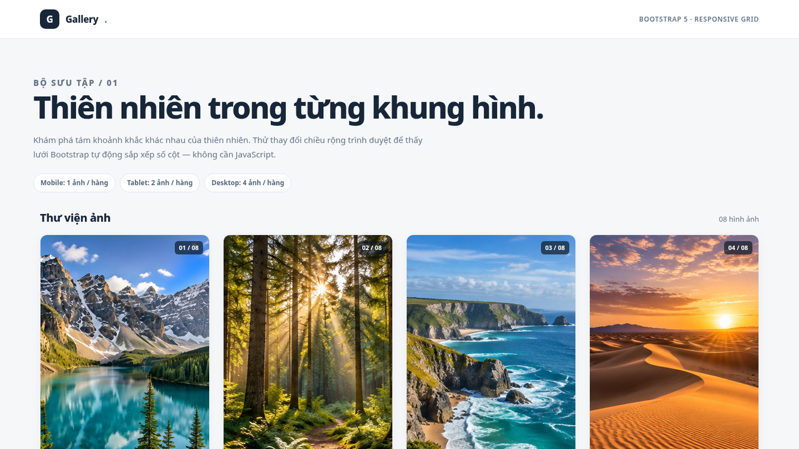
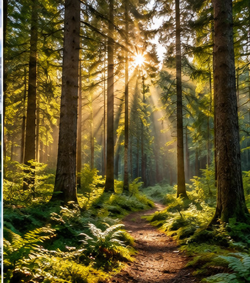
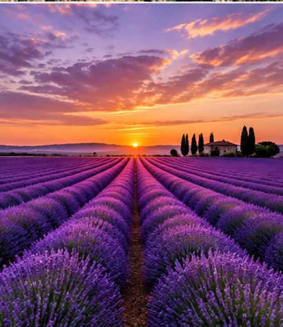
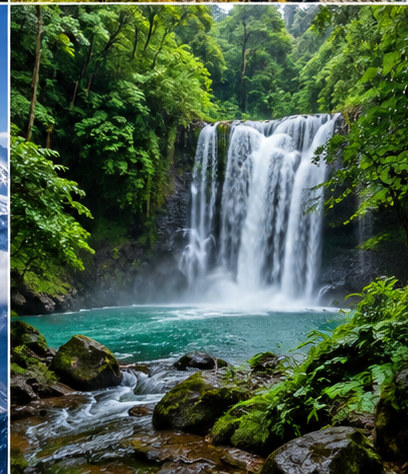
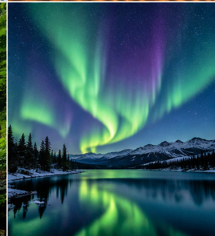

# Bootstrap Responsive Image Gallery



**Ảnh kiểm thử:** [Desktop 4 cột](preview-desktop.png) · [Tablet 2 cột](preview-tablet.png) · [Mobile 1 cột](preview-mobile.png)

Website thư viện ảnh responsive bằng **Bootstrap 5 Grid System**. Bài thực hành CodeGym: [mẫu tham khảo](https://demo.codegym.vn/web/15/gallery/gallery.html).

## Đáp ứng yêu cầu

| Thiết bị | Bootstrap class | Số ảnh trên mỗi hàng |
|---|---|---|
| Mobile (< 576px) | `col-12` | 1 |
| Tablet (576–991px) | `col-sm-6` | 2 |
| Desktop (≥ 992px) | `col-lg-3` | 4 |

Dùng `container`, `row g-4`, và **`col-12 col-sm-6 col-lg-3` trực tiếp trên từng ảnh**. Đây là Bootstrap Grid 12 cột, không tự viết media query để chia số cột. Có 8 ảnh để kiểm thử hai hàng trên desktop. Bộ ảnh minh họa tạo mới cho bài này, lưu trong `images/` (không cần Internet để hiện ảnh).

## Cấu trúc dự án

```text
Bootstrap_Responsive_Gallery/
├── index.html
├── styles.css
├── vendor/
│   └── bootstrap.min.css       # Bootstrap 5 (local, chạy offline)
├── images/
│   ├── ho-nui.jpg
│   ├── rung-som.jpg
│   ├── bo-bien.jpg
│   ├── cat-hoang-hon.jpg
│   ├── canh-dong-oai-huong.jpg
│   ├── nui-tuyet.jpg
│   ├── thac-rung.jpg
│   ├── cuc-quang.jpg
├── preview-cover.png
├── preview-desktop.png
├── preview-tablet.png
├── preview-mobile.png
└── README.md
```

## Chạy thử

Mở `index.html` bằng trình duyệt, hoặc dùng **Live Server** trong VS Code. Thu nhỏ trình duyệt lần lượt xuống 1200px, 768px và 390px để thấy số cột 4 → 2 → 1. Click ảnh để mở file JPG gốc.

## Giải thích ngắn về Bootstrap Grid

Bootstrap chia mỗi hàng thành 12 cột. `col-12` chiếm toàn bộ hàng (1 ảnh), `col-sm-6` chiếm 6/12 cột từ 576px trở lên (2 ảnh), `col-lg-3` chiếm 3/12 cột từ 992px trở lên (4 ảnh). `row g-4` tạo khoảng cách đồng nhất giữa các cột. CSS riêng chỉ dành cho typography, màu sắc, khung và hover.

## Toàn bộ mã index.html (để đọc được từ một link GitHub)

```html
<!DOCTYPE html>
<html lang="vi">
<head>
    <meta charset="UTF-8">
    <meta name="viewport" content="width=device-width, initial-scale=1.0">
    <meta name="description" content="Thực hành Bootstrap Responsive Gallery: 1 ảnh trên mobile, 2 ảnh trên tablet, 4 ảnh trên desktop.">
    <title>Khung hình thiên nhiên | Bootstrap Responsive Gallery</title>
    <!-- Bootstrap 5 local: chay offline duoc, khong phu thuoc CDN -->
    <link rel="stylesheet" href="vendor/bootstrap.min.css">
    <!-- CSS rieng chi trang tri, khong thay the luoi Bootstrap -->
    <link rel="stylesheet" href="styles.css">
</head>
<body>
    <header class="site-header">
        <div class="container header-inner">
            <a class="brand" href="index.html"><span class="brand-mark" aria-hidden="true">G</span> Gallery<span style="color:#648096">.</span></a>
            <span class="header-note">Bootstrap 5 · Responsive Grid</span>
        </div>
    </header>

    <main>
        <section class="hero container" aria-labelledby="page-title">
            <p class="eyebrow">BỘ SƯU TẬP / 01</p>
            <h1 id="page-title">Thiên nhiên trong từng khung hình.</h1>
            <p>Khám phá tám khoảnh khắc khác nhau của thiên nhiên. Thử thay đổi chiều rộng trình duyệt để thấy lưới Bootstrap tự động sắp xếp số cột — không cần JavaScript.</p>
            <div class="hero-meta" aria-label="Quy tắc responsive">
                <span class="info-pill">Mobile: 1 ảnh / hàng</span>
                <span class="info-pill">Tablet: 2 ảnh / hàng</span>
                <span class="info-pill">Desktop: 4 ảnh / hàng</span>
            </div>
        </section>

        <section class="container pb-2" aria-labelledby="gallery-title">
            <div class="gallery-heading">
                <h2 id="gallery-title">Thư viện ảnh</h2>
                <span>08 hình ảnh</span>
            </div>
            <!-- Bootstrap Grid 12 cot: container > row > col-12 col-sm-6 col-lg-3 -->
            <div class="row g-4" id="gallery-grid">
                <!-- Anh 1: col-12 (mobile) / col-sm-6 (tablet) / col-lg-3 (desktop) -->
                <div class="col-12 col-sm-6 col-lg-3">
                    <figure class="gallery-card mb-0">
                        <a class="gallery-link" href="images/ho-nui.jpg" target="_blank" rel="noopener" aria-label="Xem ảnh lớn: Hồ giữa đại ngàn">
                            
                            <span class="image-number">01 / 08</span>
                        </a>
                        <figcaption class="gallery-caption">
                            <h3>Hồ giữa đại ngàn</h3>
                            <p>Núi & hồ</p>
                        </figcaption>
                    </figure>
                </div>
                <!-- Anh 2: col-12 (mobile) / col-sm-6 (tablet) / col-lg-3 (desktop) -->
                <div class="col-12 col-sm-6 col-lg-3">
                    <figure class="gallery-card mb-0">
                        <a class="gallery-link" href="images/rung-som.jpg" target="_blank" rel="noopener" aria-label="Xem ảnh lớn: Nắng qua tán lá">
                            
                            <span class="image-number">02 / 08</span>
                        </a>
                        <figcaption class="gallery-caption">
                            <h3>Nắng qua tán lá</h3>
                            <p>Rừng xanh</p>
                        </figcaption>
                    </figure>
                </div>
                <!-- Anh 3: col-12 (mobile) / col-sm-6 (tablet) / col-lg-3 (desktop) -->
                <div class="col-12 col-sm-6 col-lg-3">
                    <figure class="gallery-card mb-0">
                        <a class="gallery-link" href="images/bo-bien.jpg" target="_blank" rel="noopener" aria-label="Xem ảnh lớn: Dọc bờ biển xanh">
                            
                            <span class="image-number">03 / 08</span>
                        </a>
                        <figcaption class="gallery-caption">
                            <h3>Dọc bờ biển xanh</h3>
                            <p>Biển cả</p>
                        </figcaption>
                    </figure>
                </div>
                <!-- Anh 4: col-12 (mobile) / col-sm-6 (tablet) / col-lg-3 (desktop) -->
                <div class="col-12 col-sm-6 col-lg-3">
                    <figure class="gallery-card mb-0">
                        <a class="gallery-link" href="images/cat-hoang-hon.jpg" target="_blank" rel="noopener" aria-label="Xem ảnh lớn: Đồi cát hoàng hôn">
                            
                            <span class="image-number">04 / 08</span>
                        </a>
                        <figcaption class="gallery-caption">
                            <h3>Đồi cát hoàng hôn</h3>
                            <p>Sa mạc</p>
                        </figcaption>
                    </figure>
                </div>
                <!-- Anh 5: col-12 (mobile) / col-sm-6 (tablet) / col-lg-3 (desktop) -->
                <div class="col-12 col-sm-6 col-lg-3">
                    <figure class="gallery-card mb-0">
                        <a class="gallery-link" href="images/canh-dong-oai-huong.jpg" target="_blank" rel="noopener" aria-label="Xem ảnh lớn: Cánh đồng oải hương">
                            
                            <span class="image-number">05 / 08</span>
                        </a>
                        <figcaption class="gallery-caption">
                            <h3>Cánh đồng oải hương</h3>
                            <p>Đồng hoa</p>
                        </figcaption>
                    </figure>
                </div>
                <!-- Anh 6: col-12 (mobile) / col-sm-6 (tablet) / col-lg-3 (desktop) -->
                <div class="col-12 col-sm-6 col-lg-3">
                    <figure class="gallery-card mb-0">
                        <a class="gallery-link" href="images/nui-tuyet.jpg" target="_blank" rel="noopener" aria-label="Xem ảnh lớn: Đỉnh núi phủ tuyết">
                            
                            <span class="image-number">06 / 08</span>
                        </a>
                        <figcaption class="gallery-caption">
                            <h3>Đỉnh núi phủ tuyết</h3>
                            <p>Núi tuyết</p>
                        </figcaption>
                    </figure>
                </div>
                <!-- Anh 7: col-12 (mobile) / col-sm-6 (tablet) / col-lg-3 (desktop) -->
                <div class="col-12 col-sm-6 col-lg-3">
                    <figure class="gallery-card mb-0">
                        <a class="gallery-link" href="images/thac-rung.jpg" target="_blank" rel="noopener" aria-label="Xem ảnh lớn: Thác nước trong rừng">
                            
                            <span class="image-number">07 / 08</span>
                        </a>
                        <figcaption class="gallery-caption">
                            <h3>Thác nước trong rừng</h3>
                            <p>Thác nước</p>
                        </figcaption>
                    </figure>
                </div>
                <!-- Anh 8: col-12 (mobile) / col-sm-6 (tablet) / col-lg-3 (desktop) -->
                <div class="col-12 col-sm-6 col-lg-3">
                    <figure class="gallery-card mb-0">
                        <a class="gallery-link" href="images/cuc-quang.jpg" target="_blank" rel="noopener" aria-label="Xem ảnh lớn: Ánh sáng cực quang">
                            
                            <span class="image-number">08 / 08</span>
                        </a>
                        <figcaption class="gallery-caption">
                            <h3>Ánh sáng cực quang</h3>
                            <p>Bầu trời đêm</p>
                        </figcaption>
                    </figure>
                </div>            </div>
            <p class="hint">Nhấn vào từng ảnh để mở phiên bản lớn. Tất cả ảnh được lưu trực tiếp trong dự án và có thể xem khi offline.</p>
        </section>
    </main>

    <footer class="site-footer">
        <div class="container d-flex justify-content-between gap-2 flex-wrap">
            <span>© 2026 — Bootstrap Responsive Image Gallery</span>
            <span>Bài thực hành CSS / Bootstrap Grid — CodeGym</span>
        </div>
    </footer>
</body>
</html>
```

## Toàn bộ mã styles.css

```css
/* =============================================
   Bootstrap Responsive Gallery — CodeGym
   Bootstrap lo chia cot: col-12 col-sm-6 col-lg-3.
   CSS tu viet chi dinh dang giao dien, KHONG chia cot.
   ============================================= */
:root {
    --ink: #172638;
    --muted: #657589;
    --accent: #225a81;
    --line: #e5eaf0;
    --paper: #ffffff;
    --canvas: #f5f7f9;
}

html { scroll-behavior: smooth; }
body { margin: 0; font-family: system-ui, -apple-system, "Segoe UI", Arial, sans-serif; color: var(--ink); background: var(--canvas); }
a { color: inherit; }

.site-header { border-bottom: 1px solid var(--line); background: #fff; }
.header-inner { display: flex; align-items: center; justify-content: space-between; flex-wrap: wrap; gap: 10px; padding-top: 17px; padding-bottom: 17px; }
.brand { display: inline-flex; align-items: center; gap: 11px; font-weight: 800; font-size: 17px; letter-spacing: -.02em; text-decoration: none; }
.brand-mark { width: 35px; height: 35px; border-radius: 10px; display: grid; place-items: center; background: var(--ink); color: #fff; font-size: 17px; font-weight: 800; }
.header-note { font-size: 12px; color: var(--muted); font-weight: 600; letter-spacing: .06em; text-transform: uppercase; }

.hero { padding: clamp(34px, 5vw, 66px) 0 34px; }
.eyebrow { font-size: 12px; font-weight: 800; text-transform: uppercase; letter-spacing: .14em; color: var(--accent); margin: 0 0 13px; }
.hero h1 { font-size: clamp(31px, 4vw, 55px); font-weight: 800; line-height: 1.12; letter-spacing: -.045em; margin: 0 0 15px; }
.hero p { max-width: 720px; line-height: 1.75; font-size: 15px; color: var(--muted); margin: 0; }
.hero-meta { display: flex; gap: 8px; flex-wrap: wrap; margin-top: 22px; }
.info-pill { padding: 7px 12px; border: 1px solid #dfe7ef; border-radius: 999px; background: var(--paper); font-size: 12px; font-weight: 700; color: #536a80; }

.gallery-heading { display: flex; justify-content: space-between; align-items: baseline; gap: 8px; margin-bottom: 17px; }
.gallery-heading h2 { font-size: 20px; margin: 0; font-weight: 800; letter-spacing: -.025em; }
.gallery-heading span { font-size: 13px; color: var(--muted); }
.gallery-card { height: 100%; overflow: hidden; border-radius: 13px; border: 1px solid var(--line); background: var(--paper); box-shadow: 0 6px 20px rgba(16, 37, 56, .045); transition: transform .18s ease, box-shadow .18s ease; }
.gallery-card:hover, .gallery-card:focus-within { transform: translateY(-3px); box-shadow: 0 13px 32px rgba(16,37,56,.12); }
.gallery-link { display: block; overflow: hidden; position: relative; text-decoration: none; }
.gallery-link img { display: block; width: 100%; aspect-ratio: 4/3; object-fit: cover; transition: transform .28s ease; }
.gallery-link:hover img, .gallery-link:focus-visible img { transform: scale(1.045); }
.gallery-link:focus-visible { outline: 3px solid #2b83c7; outline-offset: -4px; }
.image-number { position: absolute; right: 11px; top: 11px; padding: 4px 8px; background: rgba(8,20,30,.66); color: #fff; border-radius: 6px; font-weight: 700; font-size: 11px; }
.gallery-caption { padding: 16px 17px 18px; }
.gallery-caption h3 { margin: 0 0 6px; font-size: 15px; font-weight: 800; line-height: 1.4; }
.gallery-caption p { margin: 0; font-size: 12px; color: var(--muted); }
.hint { padding: 24px 0 42px; font-size: 13px; color: var(--muted); }
.site-footer { border-top: 1px solid var(--line); background: #fff; font-size: 12px; color: var(--muted); padding: 20px 0; }

@media (prefers-reduced-motion: reduce) {
    html { scroll-behavior: auto; }
    .gallery-card, .gallery-link img { transition: none; }
}
```

## Tài nguyên

- Bootstrap CSS bản local từ Bootstrap 5.3.6, dùng hệ lưới chính thức.
- Ảnh minh họa được tạo riêng cho bài thực hành; không tải từ nguồn bên ngoài.
- Trang không dùng JavaScript hoặc thu thập dữ liệu.
