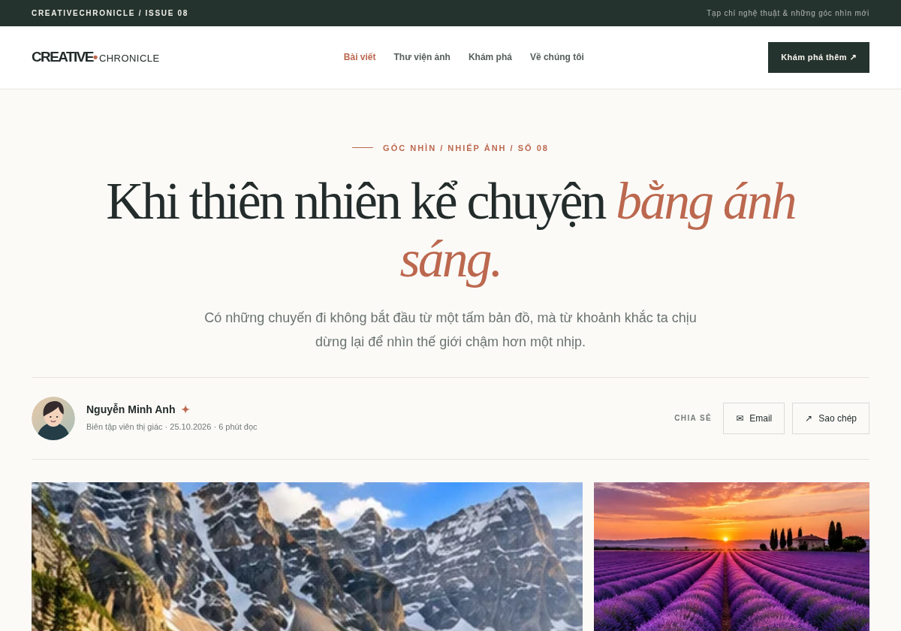

# CreativeChronicle — CSS Layout Refactoring



**Xem trước:** [Desktop](preview-desktop.png) · [Tablet](preview-tablet.png) · [Mobile](preview-mobile.png)

Trang chi tiết tạp chí nghệ thuật, luyện tập chọn đúng công cụ dàn trang: **Author Meta → Flexbox**, **Mosaic Gallery → CSS Grid**, **Recommended Articles → Bootstrap 5**.

**Demo offline:** mở `creative_chronicle/index.html` (hoặc `magazine.html`) bằng trình duyệt. Bootstrap CSS và toàn bộ hình ảnh được lưu sẵn trong dự án; không cần đăng ký API, chạy server hay cài package.

## Cấu trúc bài nộp

```text
CreativeChronicle_Submission/
├── creative_chronicle/
│   ├── magazine.html          # File chính theo yêu cầu
│   ├── index.html             # Trang mở nhanh, nội dung tương đương
│   ├── style.css              # CSS Flex + Grid + responsive
│   ├── assets/                # Ảnh phong cảnh minh hoạ và avatar
│   └── vendor/bootstrap.min.css (Bootstrap 5, offline)
├── layout_refactoring.md     # Báo cáo ~150 từ
├── ai_prompt_log.md          # Nhật ký 7 câu hỏi nghiên cứu
├── preview-cover.png
├── preview-desktop.png
├── preview-tablet.png
├── preview-mobile.png
└── README.md
```

## Kiến trúc giải pháp & Audit legacy

| Khu vực | Legacy / vấn đề | Giải pháp |
|---|---|---|
| Author | float, clearfix; lệch dọc, không theo độ dài tên | `.author-section {display:flex; align-items:center; justify-content:space-between; flex-wrap:wrap}` |
| Mosaic | absolute, fixed height 400px; đè ảnh vào text | `.mosaic-gallery {display:grid; grid-template-columns:2fr 1fr}`; ảnh đầu `grid-row:span 2`; mobile 1 cột |
| Recommended | float + width 23%; thẻ rớt dòng | Bootstrap `row g-4` + từng card `col-12 col-md-6 col-lg-3` |

### Bản đồ Responsive

| Viewport | Author | Mosaic | Recommended |
|---|---|---|---|
| Desktop ≥ 992px | Avatar/chi tiết trái; nút phải | 2 cột (2fr / 1fr), ảnh lớn 2 hàng | 4 card/hàng |
| Tablet 768–991px | Flex wrap khi cần | 2 cột | 2 card/hàng |
| Mobile < 768px | Nút có thể xuống hàng | 1 cột (media query ≤ 575.98px; 576–767px vẫn 2 cột) | 1 card/hàng |

## Vấn đáp thường gặp

**Tại sao Flexbox thay vì Bootstrap Grid cho Author?** Thanh tác giả là một trục 1D gồm avatar, tên, thời gian và nút. Flexbox tự phân phối không gian và có `flex-wrap` cho nội dung dài mà không cần ép tỷ lệ 12 cột.

**Vì sao float gây collapse?** Phần tử float được lấy khỏi luồng thông thường, do đó khung chỉ có các phần tử float có thể không tính được chiều cao theo chúng và thường phải clearfix. `display:flex` giữ các phần tử thành con flex trong khung.

**Thêm ảnh vào Grid thì sao?** CSS Grid tự tạo implicit rows nếu số item vượt số ô tường minh; kiểm tra tỷ lệ và `grid-auto-rows` khi gallery mở rộng.

**Ảnh có bị méo?** Không: `img {object-fit:cover}` phủ khung và cắt bớt một phần hình nếu tỷ lệ khác nhau.

**Sử dụng tài nguyên:** 7 ảnh phong cảnh dùng hình minh hoạ được tạo cho các bài học trong workspace; đóng gói local, không sử dụng hình từ bên thứ ba; avatar vector tự tạo.

## Bằng chứng kỹ thuật (trích mã)

```css
.author-section { display: flex; align-items: center; justify-content: space-between; flex-wrap: wrap; gap: 20px; }
.mosaic-gallery { display: grid; grid-template-columns: minmax(0,2fr) minmax(0,1fr); grid-template-rows: repeat(2,minmax(0,1fr)); gap: 15px; aspect-ratio:2.17/1; }
.photo-main { grid-row: span 2; }
@media (max-width: 575.98px) { .mosaic-gallery { grid-template-columns: minmax(0,1fr); grid-template-rows: none; aspect-ratio: auto; } }
```

```html
<div class="row g-4">
  <div class="col-12 col-md-6 col-lg-3"> ... Bootstrap card ... </div>
</div>
```

## Báo cáo Refactoring

# CreativeChronicle — Báo cáo Refactoring Layout

Kỹ thuật cũ đặt ảnh đại diện và nút chia sẻ bằng `float`, khiến việc căn giữa theo chiều dọc khó kiểm soát. Phần tử `float` tách khỏi luồng thông thường nên đôi khi phần tử cha không tự ôm đủ chiều cao, buộc dùng `clearfix`. Tôi chuyển thanh tác giả sang **Flexbox** với `align-items: center`, `justify-content: space-between` và `flex-wrap: wrap` để tên dài hoặc màn hình hẹp không đè lên nút.

Thư viện cũ dùng `position: absolute` và chiều cao 400px, làm ảnh thoát khỏi luồng bố cục, vùng cha có thể không phản ánh nội dung, gây chồng lấn khi thu nhỏ màn hình. Tôi thay bằng **CSS Grid** hai cột tỷ lệ `2fr 1fr`, ảnh chính `grid-row: span 2`, và một cột trên mobile; ảnh dùng `object-fit: cover` để không méo.

Bài đề xuất dùng **Bootstrap `row`, `col-12 col-md-6 col-lg-3`** nên tự đổi 1–2–4 cột theo thiết bị.

## AI Prompt Log

# CreativeChronicle — AI Prompt Log

**Phạm vi:** Các câu hỏi về kỹ thuật dùng trong bài tập. Câu trả lời là giải thích thiết kế; kiểm tra hiển thị được ghi riêng trong README. Không xem đây là benchmark hiệu năng.

### 1. Vì sao `float` khó dùng để căn giữa thanh tác giả?

**Prompt:** “`float: left/right` hoạt động thế nào với chiều cao phần tử cha và căn giữa avatar, tên tác giả, ngày đăng?”

**AI giải thích:** `float` chủ yếu dành cho nội dung chạy vòng quanh hình; phần tử float không còn tham gia chiều cao của container như phần tử trong luồng thông thường. Vì thế thường cần clearfix. Nó không có cơ chế `align-items: center` như Flexbox.

### 2. Tại sao `position: absolute` dễ gây chồng lấn ảnh và đoạn văn?

**Prompt:** “Khi ảnh được đặt bằng `position: absolute` trong container cao 400px, điều gì xảy ra khi giảm viewport?”

**AI giải thích:** Phần tử absolute bị tách khỏi luồng tài liệu, không đẩy chiều cao của container; nếu ảnh và nội dung co giãn, container có chiều cao cứng không đủ và ảnh có thể đè vào đoạn văn kế tiếp. Grid giải quyết quan hệ 2D trong luồng bố cục.

### 3. Grid với một ảnh lớn và hai ảnh nhỏ nên viết thế nào?

**Prompt:** “Cú pháp CSS Grid dùng `grid-template-columns: 2fr 1fr`, `grid-row: span 2` cho mosaic ba ảnh là gì?”

**AI giải thích:** Dùng `.mosaic-gallery { display:grid; grid-template-columns: 2fr 1fr; grid-template-rows: repeat(2,minmax(0,1fr)); }`. Cho ảnh đầu `.photo-main { grid-row:span 2; }`. Grid tự căn hàng/cột và giữ nội dung trong luồng.

### 4. Thêm ảnh thứ tư, thứ năm vào Mosaic thì sao?

**Prompt:** “CSS Grid có tự tạo thêm hàng mới nếu thêm nhiều phần tử con không?”

**AI giải thích:** Có. Grid tạo **implicit rows** tùy `grid-auto-flow` và `grid-auto-rows`. Tuy nhiên, cần kiểm tra lại tỷ lệ, thứ tự và responsive để bố cục đẹp với ảnh bổ sung.

### 5. Bootstrap 5 đổi 4–2–1 card tại breakpoint nào?

**Prompt:** “`col-12 col-md-6 col-lg-3` nghĩa là gì ở 375px, 768px, 1200px? Khác `col-sm-6` thế nào?”

**AI giải thích:** Dưới 768px: mỗi card chiếm 12/12, một cột. Từ 768px đến dưới 992px: 6/12, hai cột. Từ 992px: 3/12, bốn cột. `col-sm-6` chuyển sang hai cột sớm hơn, từ 576px.

### 6. Bootstrap utilities nào giúp giảm CSS thủ công?

**Prompt:** “Có thể dùng `d-flex`, `align-items-center`, `justify-content-between`, `g-4`, `mt-3`, `pb-2` thế nào?”

**AI giải thích:** Đây là các class tiện ích cho display, căn chỉnh, khoảng cách hàng/cột và margin/padding. Trong khu Recommended dùng `row g-4`, `h-100`, `card`, `card-body`; Flexbox riêng hợp lý cho thanh tác giả khi cần điều chỉnh `flex-wrap` và `min-width`.

### 7. Khi nào dùng Flexbox trong widget nằm trong Grid?

**Prompt:** “Flexbox và CSS Grid có thể kết hợp với nhau trong một thiết kế không?”

**AI giải thích:** Có. Grid quy hoạch vị trí các khối hai chiều; bên trong từng widget, Flexbox căn biểu tượng và dòng chữ theo một chiều. Việc kết hợp hai công cụ thường đơn giản hơn lồng nhiều lớp layout giả lập.

## Mã nguồn đầy đủ để hệ thống chấm một link

### `creative_chronicle/magazine.html`

```html
<!DOCTYPE html>
<html lang="vi">
<head>
  <meta charset="UTF-8">
  <meta name="viewport" content="width=device-width, initial-scale=1.0">
  <meta name="description" content="CreativeChronicle — tạp chí nghệ thuật và nhiếp ảnh. Bài thực hành Frontend dùng Flexbox, CSS Grid và Bootstrap.">
  <title>CreativeChronicle — Khi thiên nhiên kể chuyện bằng ánh sáng</title>
  <!-- Bootstrap 5 Grid/System Utilities: packaged locally for offline review -->
  <link rel="stylesheet" href="vendor/bootstrap.min.css">
  <link rel="stylesheet" href="style.css">
</head>
<body>
  <div class="editorial-strip">
    <div class="container-xl editorial-strip-inner">
      <span>CREATIVECHRONICLE / ISSUE 08</span>
      <span>Tạp chí nghệ thuật &amp; những góc nhìn mới</span>
    </div>
  </div>
  <header class="site-header">
    <nav class="site-nav container-xl" aria-label="Điều hướng chính">
      <a class="wordmark" href="#top" aria-label="CreativeChronicle — Trang đầu">CREATIVE<span>•</span><small>CHRONICLE</small></a>
      <div class="nav-links">
        <a class="active" href="#story">Bài viết</a>
        <a href="#gallery">Thư viện ảnh</a>
        <a href="#recommended">Khám phá</a>
        <a href="#about">Về chúng tôi</a>
      </div>
      <a class="nav-action" href="#recommended">Khám phá thêm <span aria-hidden="true">↗</span></a>
    </nav>
  </header>

  <main id="top">
    <article class="feature-article container-xl" id="story">
      <header class="article-header">
        <div class="article-kicker"><span class="kicker-line" aria-hidden="true"></span> GÓC NHÌN / NHIẾP ẢNH / SỐ 08</div>
        <h1>Khi thiên nhiên kể chuyện <em>bằng ánh sáng.</em></h1>
        <p class="article-deck">Có những chuyến đi không bắt đầu từ một tấm bản đồ, mà từ khoảnh khắc ta chịu dừng lại để nhìn thế giới chậm hơn một nhịp.</p>
      </header>

      <!-- 1D: flex aligns avatar, name, date and share actions vertically. No float/clearfix. -->
      <div class="author-section" aria-label="Thông tin tác giả">
        <div class="author-identity">
          
          <div class="author-details">
            <div class="author-name">Nguyễn Minh Anh <span class="verified" aria-label="Biên tập viên">✦</span></div>
            <div class="author-date">Biên tập viên thị giác <span aria-hidden="true">·</span> 25.10.2026 <span aria-hidden="true">·</span> 6 phút đọc</div>
          </div>
        </div>
        <div class="share-actions" aria-label="Chia sẻ bài viết">
          <span class="share-label">CHIA SẺ</span>
          <a class="share-btn" href="mailto:?subject=CreativeChronicle%20-%20Khi%20thi%C3%AAn%20nhi%C3%AAn%20k%E1%BB%83%20chuy%E1%BB%87n" aria-label="Chia sẻ qua email" title="Chia sẻ qua email">✉ <span>Email</span></a>
          <button class="share-btn" id="copy-link" type="button" aria-label="Sao chép đường dẫn bài viết" title="Sao chép liên kết">↗ <span id="copy-label">Sao chép</span></button>
        </div>
      </div>

      <!-- 2D: CSS Grid automatically sizes content; main image spans two rows. -->
      <section class="visual-story" id="gallery" aria-label="Thư viện ảnh khảm">
        <div class="mosaic-gallery">
          <figure class="mosaic-photo photo-main">
            
            <figcaption class="visually-hidden">Núi và mặt hồ yên ả</figcaption>
          </figure>
          <figure class="mosaic-photo photo-side-one">
            
            <figcaption class="visually-hidden">Màu tím trước hoàng hôn</figcaption>
          </figure>
          <figure class="mosaic-photo photo-side-two">
            
            <figcaption class="visually-hidden">Ánh nắng xuyên rừng</figcaption>
          </figure>
        </div>
        <p class="gallery-credit"><span>01—03 / FIELD NOTES</span><span>Hình minh họa tự tạo · CSS Grid Mosaic</span></p>
      </section>

      <div class="article-content">
        <p class="intro">Ánh sáng luôn là người kể chuyện thầm lặng nhất. Nó đi qua một mặt hồ xanh, lướt trên những cánh đồng hoa tím rồi len vào khoảng trống giữa hai thân cây. Mỗi nơi nó chạm tới đều lưu giữ một sắc độ cảm xúc mà không câu chữ nào có thể ghi chép trọn vẹn.</p>
        <p>Trong nhiếp ảnh, khung hình không chỉ là nơi lưu một cảnh đẹp. Đó còn là cách ta chọn nhìn thế giới: điều gì được đặt ở tiền cảnh, điều gì được để mờ, và vì sao một khoảng lặng có thể đáng nhớ hơn cả sự rực rỡ.</p>
        <blockquote>“Một bức ảnh đẹp không đơn thuần cho ta thấy nơi chốn. Nó khiến ta muốn được đứng ở đó, dù chỉ trong một khoảnh khắc.”</blockquote>
        <p>Từ dãy núi soi bóng xuống mặt hồ đến vệt nắng cuối ngày băng qua cánh rừng, thiên nhiên luôn thay đổi theo thời gian. Có lẽ điều đặc biệt nhất của hành trình khám phá là học cách quan sát những thay đổi rất nhỏ ấy — rồi mang câu chuyện về nhà.</p>
      </div>
      <div class="article-endmark" aria-hidden="true">✦</div>
    </article>

    <section id="recommended" class="recommendations" aria-labelledby="recommended-title">
      <div class="container-xl">
        <div class="section-heading">
          <div><p class="section-eyebrow">KHÁM PHÁ TIẾP</p><h2 id="recommended-title">Câu chuyện dành cho bạn</h2></div>
          <a class="more-link" href="#top">Về đầu trang ↑</a>
        </div>
        <!-- Bootstrap 12-column Grid only for Recommended: 1 / 2 / 4 cards. -->
        <div class="row g-4">
          <div class="col-12 col-md-6 col-lg-3">
            <article class="card article-card h-100 border-0">
              
              <div class="card-body"><p class="card-category">DU LỊCH / 04 PHÚT</p><h3 class="card-title">Nơi đại dương chạm vào những vách đá</h3><p class="card-text">Đi tìm thanh âm bình yên giữa các con sóng và gió biển.</p><a href="#story" class="stretched-link" aria-label="Đọc bài Nơi đại dương chạm vào những vách đá">Khám phá <span aria-hidden="true">↗</span></a></div>
            </article>
          </div>
          <div class="col-12 col-md-6 col-lg-3">
            <article class="card article-card h-100 border-0">
              
              <div class="card-body"><p class="card-category">THIÊN NHIÊN / 05 PHÚT</p><h3 class="card-title">Âm thanh trong veo giữa khu rừng</h3><p class="card-text">Câu chuyện về những dòng nước chưa bao giờ ngừng chảy.</p><a href="#story" class="stretched-link" aria-label="Đọc bài Âm thanh trong veo giữa khu rừng">Khám phá <span aria-hidden="true">↗</span></a></div>
            </article>
          </div>
          <div class="col-12 col-md-6 col-lg-3">
            <article class="card article-card h-100 border-0">
              
              <div class="card-body"><p class="card-category">NHIẾP ẢNH / 06 PHÚT</p><h3 class="card-title">Đêm nào bầu trời cũng có phép màu</h3><p class="card-text">Những dải sáng ở miền cực Bắc khiến ta ngước nhìn.</p><a href="#story" class="stretched-link" aria-label="Đọc bài Đêm nào bầu trời cũng có phép màu">Khám phá <span aria-hidden="true">↗</span></a></div>
            </article>
          </div>
          <div class="col-12 col-md-6 col-lg-3">
            <article class="card article-card h-100 border-0">
              
              <div class="card-body"><p class="card-category">KHÁM PHÁ / 03 PHÚT</p><h3 class="card-title">Một ngày đi qua miền cát vàng</h3><p class="card-text">Khi bóng tối và ánh sáng cùng vẽ nên một đường chân trời.</p><a href="#story" class="stretched-link" aria-label="Đọc bài Một ngày đi qua miền cát vàng">Khám phá <span aria-hidden="true">↗</span></a></div>
            </article>
          </div>
        </div>
      </div>
    </section>
  </main>
  <footer class="site-footer" id="about">
    <div class="container-xl footer-inner">
      <div><strong>CREATIVE<span>•</span>CHRONICLE</strong><p>Nhìn thế giới bằng những góc nhìn khác.</p></div>
      <div class="footer-note">© 2026 CreativeChronicle · Website demo học tập<br>Layout: Flexbox + CSS Grid + Bootstrap 5</div>
    </div>
  </footer>
  <script>
    // Tiny progressive enhancement, layout remains HTML/CSS without JavaScript.
    const copyButton = document.getElementById('copy-link');
    copyButton.addEventListener('click', async () => {
      const label = document.getElementById('copy-label');
      try {
        if (!navigator.clipboard || !window.isSecureContext) throw new Error('Unavailable');
        await navigator.clipboard.writeText(window.location.href);
        label.textContent = 'Đã sao chép!';
      } catch (_) {
        label.textContent = 'Dùng Ctrl+C URL';
      }
      copyButton.setAttribute('aria-label', label.textContent);
    });
  </script>
</body>
</html>

```

### `creative_chronicle/style.css`

```css
/* CreativeChronicle: 1D Flexbox, 2D Grid Mosaic, Bootstrap 12-col recommendations.
    */
:root {--ink:#232c2b;--muted:#737b79;--accent:#bc684f;--cream:#fbfaf7;--line:#e8e5df;--paper:#ffffff}
*,*::before,*::after{box-sizing:border-box}
html{scroll-behavior:smooth}
body{background:var(--cream);color:var(--ink);font-family:Arial,"Helvetica Neue",sans-serif;margin:0;-webkit-font-smoothing:antialiased}
img{max-width:100%}
a{color:inherit}
a:hover{color:var(--accent)}
.editorial-strip{background:#25332f;color:#f1f0ea;font-size:10px;font-weight:700;letter-spacing:1.7px}
.editorial-strip-inner{display:flex;align-items:center;justify-content:space-between;flex-wrap:wrap;gap:8px;padding:10px 12px}
.editorial-strip-inner span:last-child{opacity:.68;font-weight:400;letter-spacing:.8px}
.site-header{background:var(--paper);border-bottom:1px solid var(--line)}
.site-nav{display:flex;align-items:center;justify-content:space-between;flex-wrap:wrap;gap:18px;padding:21px 12px}
.wordmark{display:inline-flex;align-items:baseline;font-size:19px;letter-spacing:-1.6px;font-weight:900;text-decoration:none;white-space:nowrap;color:var(--ink)}
.wordmark span,.site-footer strong span{color:var(--accent)}
.wordmark small{font-size:13px;letter-spacing:.45px;font-weight:500;margin-left:3px}
.nav-links{display:flex;align-items:center;flex-wrap:wrap;justify-content:center;gap:clamp(12px,2vw,32px)}
.nav-links a{text-decoration:none;font-size:12px;font-weight:700;color:#57605e;transition:color .2s}
.nav-links a:hover,.nav-links .active{color:var(--accent)}
.nav-action{font-size:11px;font-weight:700;letter-spacing:.4px;text-decoration:none;color:#f7f4ed;background:#25332f;padding:12px 17px;white-space:nowrap;transition:background-color .2s}
.nav-action:hover{color:white;background:var(--accent)}
.feature-article{padding:70px 12px 78px}
.article-header{max-width:970px;margin:0 auto 30px;text-align:center}
.article-kicker{font-size:11px;letter-spacing:2px;color:var(--accent);font-weight:800;display:flex;align-items:center;justify-content:center;gap:13px;margin-bottom:25px}
.kicker-line{height:1px;width:28px;background:var(--accent)}
.article-header h1{font-family:Georgia,'Times New Roman',serif;font-size:clamp(38px,5.8vw,78px);font-weight:500;line-height:1.1;letter-spacing:-2.8px;margin:0 auto 24px;max-width:950px}
.article-header h1 em{font-weight:400;color:var(--accent)}
.article-deck{max-width:700px;color:#6a7370;font-size:clamp(15px,1.7vw,18px);line-height:1.8;margin:auto}
.author-section{display:flex;align-items:center;justify-content:space-between;flex-wrap:wrap;gap:20px;padding:25px 0;margin-bottom:30px;border-top:1px solid var(--line);border-bottom:1px solid var(--line)}
.author-identity{display:flex;align-items:center;gap:15px;min-width:0;flex:1 1 280px}
.author-avatar{width:58px;height:58px;flex:0 0 58px;border-radius:50%;object-fit:cover}
.author-details{min-width:0;overflow-wrap:anywhere}
.author-name{font-size:14px;font-weight:800;line-height:1.4}
.verified{color:var(--accent);margin-left:4px}
.author-date{font-size:11px;color:var(--muted);margin-top:5px;line-height:1.6}
.share-actions{display:flex;align-items:center;flex-wrap:wrap;gap:10px}
.share-label{font-size:10px;font-weight:800;letter-spacing:1.4px;color:var(--muted);margin-right:5px}
.share-btn{display:inline-flex;align-items:center;gap:8px;justify-content:center;border:1px solid #d9dbd6;color:var(--ink);background:transparent;padding:11px 16px;font-size:12px;text-decoration:none;white-space:nowrap;transition:background-color .2s,color .2s;cursor:pointer}
.share-btn:hover,.share-btn:focus-visible{color:#fff;background:var(--ink)}
.visual-story{margin-top:0}
.mosaic-gallery{display:grid;grid-template-columns:minmax(0,2fr) minmax(0,1fr);grid-template-rows:repeat(2,minmax(0,1fr));gap:15px;aspect-ratio:2.17/1}
.mosaic-photo{margin:0;min-width:0;min-height:0;overflow:hidden;background:#d2d9d3}
.mosaic-photo img{display:block;width:100%;height:100%;object-fit:cover;transition:transform .4s ease}
.mosaic-photo:hover img{transform:scale(1.025)}
.photo-main{grid-row:span 2}
.photo-main img{object-position:center 42%}
.photo-side-one img{object-position:center 64%}
.gallery-credit{display:flex;justify-content:space-between;align-items:center;flex-wrap:wrap;gap:8px;margin:13px 0 0;color:#89908b;font-size:10px;letter-spacing:1px;text-transform:uppercase}
.article-content{max-width:800px;margin:65px auto 0;font-family:Georgia,'Times New Roman',serif;font-size:clamp(17px,1.6vw,20px);line-height:1.95;color:#3b4441}
.article-content p{margin-bottom:25px}
.article-content .intro::first-letter{font-size:1.4em;color:var(--accent);font-weight:700}
.article-content blockquote{border-left:3px solid var(--accent);padding:8px 0 8px 28px;font-family:Georgia,serif;color:#354740;font-size:clamp(21px,2.6vw,30px);line-height:1.5;font-style:italic;margin:42px 0}
.article-endmark{text-align:center;font-size:22px;color:var(--accent);margin-top:42px}
.recommendations{background:#f3f1eb;padding:88px 0 98px;border-top:1px solid var(--line)}
.section-heading{display:flex;align-items:end;justify-content:space-between;gap:20px;flex-wrap:wrap;margin-bottom:28px}
.section-eyebrow,.card-category{color:var(--accent);font-size:10px;letter-spacing:2px;font-weight:800;margin:0 0 10px}
.section-heading h2{font-family:Georgia,serif;font-size:clamp(27px,3.2vw,42px);margin:0;font-weight:500;letter-spacing:-1px}
.more-link{font-size:12px;font-weight:700;text-decoration:none;border-bottom:1px solid currentColor;padding-bottom:5px}
.article-card{background:white;border-radius:0!important;overflow:hidden;box-shadow:0 8px 24px rgba(37,51,47,.035);transition:transform .25s,box-shadow .25s}
.article-card:hover{transform:translateY(-4px);box-shadow:0 14px 30px rgba(37,51,47,.1)}
.article-card .card-img-top{width:100%;height:210px;object-fit:cover;border-radius:0}
.article-card .card-body{padding:24px;display:flex;flex-direction:column}
.article-card .card-title{font-family:Georgia,serif;letter-spacing:-.5px;font-size:22px;line-height:1.35;min-height:84px;margin:0 0 12px;color:var(--ink)}
.article-card .card-text{font-size:13px;line-height:1.7;color:#79817e;flex-grow:1;margin-bottom:22px}
.article-card .card-body>a{font-size:12px;font-weight:800;text-decoration:none;color:var(--accent)}
.site-footer{background:#25332f;color:#fff;padding:45px 0}
.footer-inner{display:flex;align-items:center;justify-content:space-between;flex-wrap:wrap;gap:24px}
.site-footer strong{font-size:18px;letter-spacing:-.9px}
.site-footer p{font-size:12px;margin:8px 0 0;color:#b8c5bf}
.footer-note{text-align:right;font-size:12px;line-height:1.8;color:#b8c5bf}
@media(max-width:991.98px){
  .site-nav{justify-content:center}.nav-action{display:none}
  .article-header h1{letter-spacing:-1.5px}
  .feature-article{padding-top:56px}
  .article-card .card-title{min-height:0}
}
@media(max-width:575.98px){
  .editorial-strip-inner{justify-content:center}.editorial-strip-inner span:last-child{display:none}
  .site-nav{padding:15px 10px;gap:15px}.nav-links{gap:10px 20px}.nav-links a{font-size:11px}
  .feature-article{padding:46px 12px 54px}
  .article-header h1{font-size:clamp(34px,10vw,49px);letter-spacing:-1px}
  .article-kicker{font-size:9px;letter-spacing:1px}
  .author-section{align-items:flex-start}.share-actions{width:100%}
  .mosaic-gallery{grid-template-columns:minmax(0,1fr);grid-template-rows:none;aspect-ratio:auto;gap:12px}
  .mosaic-photo,.photo-main{grid-row:auto;aspect-ratio:16/10}
  .mosaic-photo img{height:100%}
  .gallery-credit{letter-spacing:.3px;font-size:9px}
  .article-content{margin-top:38px;font-size:17px;line-height:1.85}
  .article-content blockquote{padding-left:16px}
  .recommendations{padding:60px 0}.article-card .card-img-top{height:230px}
  .footer-note{text-align:left}
}
@media(prefers-reduced-motion:reduce){*,*::before,*::after{scroll-behavior:auto!important;transition:none!important}}

```
