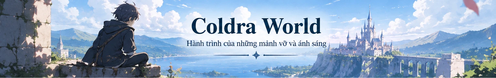

# Thực hành CSS — Trang đọc truyện (CodeGym)

**Bài làm:** Website đọc truyện fantasy mẫu *Coldra World* gồm 5 chương có ảnh bìa, mục lục `<h5>`, liên kết đến từng chương, stylesheet ngoài `styles.css`, hover và định dạng nội dung. Nội dung 5 chương là **đoạn văn hư cấu viết để thực hành**, không phải bản thảo chính thức.

## Cách xem

Mở `index.html` bằng trình duyệt Chrome/Edge/Firefox. Không cần cài thư viện, không cần server. **Giữ nguyên** đường dẫn `styles.css` và `assets/bia-truyen.webp` khi tải về từ ZIP.

## Đối chiếu 9 bước đề bài

| Bước | Minh chứng |
|---|---|
| 1 | Khối `<aside id="muc-luc">` liệt kê 5 chương |
| 2 | Mỗi phần nội dung trong `<section class="chapter" id="chuong-N">` |
| 3 | Mục lục dùng `<a href="#chuong-N">` liên kết đúng `id`, có thể click |
| 4 | Ảnh truyện hiển thị ngay đầu trang với `` |
| 5 | Từng mục lục được bao trong thẻ `<h5 class="toc-entry">` |
| 6 | HTML nhúng CSS ngoài bằng `<link rel="stylesheet" href="styles.css">` |
| 7 | CSS `.page-intro h1` dùng `font-family`, `font-size`, `color`, `text-align: center` |
| 8 | `.toc` có `border`, `background-color`, `padding`; `.toc-entry a:hover` và `text-decoration` |
| 9 | `.prose p` có `line-height`, `text-align: justify`, `text-indent` |

## Cấu trúc thư mục

```text
DocTruyen_CSS/
├── index.html
├── styles.css
├── assets/
│   └── bia-truyen.webp
└── README.md
```

## Mã nguồn HTML (`index.html`)

```html
<!DOCTYPE html>
<html lang="vi">
<head>
  <meta charset="UTF-8">
  <meta name="viewport" content="width=device-width, initial-scale=1.0">
  <meta name="description" content="Trang đọc truyện fantasy minh họa bài thực hành CSS: mục lục, liên kết chương, ảnh bìa, hiệu ứng hover và định dạng văn bản.">
  <title>Coldra World | Trang đọc truyện — Thực hành CSS</title>
  <!--
    BAI THUC HANH CSS - CODEGYM
    Buoc 1/5: Muc luc moi chuong dung h5, lien ket href="#chuong-...".
    Buoc 2/3: Noi dung o section id="chuong-..."; click muc luc nhay dung section.
    Buoc 4: Anh bia assets/bia-truyen.webp o dau trang.
    Buoc 6: CSS EXTERNAL trong styles.css duoc nhung bang link.
    Buoc 7: font-family, font-size, color, text-align center cho tieu de.
    Buoc 8: border, background-color, padding cho muc luc; text-decoration, :hover cho a.
    Buoc 9: line-height, text-align: justify, text-indent cho doan van.
    De cham du ca HTML va CSS trong MOT LINK, xem README.md kem ma nguon HTML + CSS.
  -->
  <link rel="stylesheet" href="styles.css">
</head>
<body id="dau-trang">
  <header class="cover" aria-label="Ảnh bìa truyện Coldra World">
    
  </header>

  <div class="page-intro">
    <div class="eyebrow">✦ THƯ VIỆN TRUYỆN ✦</div>
    <h1>Hành trình bắt đầu từ một bước chân</h1>
    <p>Một câu chuyện nhỏ bên biển xanh, những lá thư bí ẩn và lòng can đảm để lên đường.</p>
    <div class="intro-tags"><span>Fantasy</span><span>5 chương</span><span>Tiếng Việt</span></div>
  </div>

  <div class="page-layout">
    <aside class="toc" id="muc-luc" aria-label="Mục lục truyện">
      <div class="toc-heading"><span aria-hidden="true">☷</span> Mục lục truyện</div>
      <div class="toc-items">
        <h5 class="toc-entry"><a href="#chuong-1"><span class="toc-number">01</span><span>Chương 1: Khởi đầu tại Seawind</span><span class="toc-arrow" aria-hidden="true">↗</span></a></h5>
        <h5 class="toc-entry"><a href="#chuong-2"><span class="toc-number">02</span><span>Chương 2: Bức thư không người gửi</span><span class="toc-arrow" aria-hidden="true">↗</span></a></h5>
        <h5 class="toc-entry"><a href="#chuong-3"><span class="toc-number">03</span><span>Chương 3: Ánh đèn cuối vịnh</span><span class="toc-arrow" aria-hidden="true">↗</span></a></h5>
        <h5 class="toc-entry"><a href="#chuong-4"><span class="toc-number">04</span><span>Chương 4: Lời hứa dưới trời sao</span><span class="toc-arrow" aria-hidden="true">↗</span></a></h5>
        <h5 class="toc-entry"><a href="#chuong-5"><span class="toc-number">05</span><span>Chương 5: Bước chân đầu tiên</span><span class="toc-arrow" aria-hidden="true">↗</span></a></h5>
      </div>
      <div class="toc-note">“Mỗi cuộc phiêu lưu đều bắt đầu khi ta dám bước thêm một bước.”</div>
    </aside>

    <main class="reading-content" id="noi-dung">
      <div class="reader-note">Chọn một chương trong mục lục để chuyển đến nội dung tương ứng. <span>↓</span></div>
      <section class="chapter" id="chuong-1" aria-labelledby="title-chuong-1">
        <div class="chapter-topline"><span>CHƯƠNG 01</span><span>✦</span><span>COLDRA WORLD · TRUYỆN MẪU</span></div>
        <h2 id="title-chuong-1">Khởi đầu tại Seawind</h2>
        <p class="chapter-subtitle">Một buổi sáng có mùi muối biển</p>
        <div class="prose">
          <p>Ở Seawind, buổi sáng luôn đến cùng tiếng chuông từ ngọn tháp phía cảng. Khi tiếng chuông thứ ba ngân lên, những người bán cá đã bày xong sạp, còn gió biển thì bắt đầu kéo những lá cờ nhỏ căng ra dưới nắng. Trong thành phố này, dường như ai cũng biết mình phải đi về đâu — trừ cậu thiếu niên đang đứng trên bức tường đá cũ.</p>
          <p>Cậu đã ngắm đường chân trời ấy rất nhiều lần. Những con tàu đi qua rồi trở lại, mang về lụa, sách, chuyện kể và đôi khi cả những lá thư chưa kịp gửi. Thế giới ngoài kia rộng đến mức bản đồ treo ở quán trọ cũng chỉ vẽ được một phần. Ý nghĩ ấy khiến cậu vừa háo hức, vừa thấy tim mình đập nhanh hơn.</p>
          <p>Hôm đó, thay vì xuống cảng như thường lệ, cậu đi về phía con đường nhỏ dẫn đến thư viện. Ở chân cầu thang, có một phong thư nằm ngay ngắn bên cạnh chậu hoa xanh. Trên bì thư không có tên người nhận, chỉ có một dòng chữ viết bằng mực bạc: “Gửi người vẫn còn biết lắng nghe tiếng gió.”</p>
          <p>Cậu nhặt thư lên. Từ khoảnh khắc ấy, buổi sáng bình thường ở Seawind bắt đầu trở nên khác lạ.</p>
        </div>
        <div class="chapter-footer"><a class="back-to-top" href="#dau-trang">↑ Về đầu trang</a> <a class="next-chapter" href="#chuong-2">Đọc chương tiếp →</a></div>
      </section>
      <section class="chapter" id="chuong-2" aria-labelledby="title-chuong-2">
        <div class="chapter-topline"><span>CHƯƠNG 02</span><span>✦</span><span>COLDRA WORLD · TRUYỆN MẪU</span></div>
        <h2 id="title-chuong-2">Bức thư không người gửi</h2>
        <p class="chapter-subtitle">Những điều chỉ thấy khi nhìn kỹ</p>
        <div class="prose">
          <p>Chiếc phong bì không được niêm bằng sáp, nhưng mở thế nào cũng không ra. Cậu xoay nó dưới ánh sáng, thấy những đường nét mảnh như mạng nhện chạy dọc mép giấy. Chúng chỉ hiện lên mỗi khi một cơn gió lùa qua ô cửa thư viện.</p>
          <p>Người thủ thư già nhìn qua gọng kính, im lặng hồi lâu rồi nói rằng có những thứ không mở bằng sức mạnh. “Thử đọc điều mà lá thư đang chờ nghe,” ông bảo. Cậu định cười vì câu nói khó hiểu, nhưng rồi chợt nhận ra từ sáng đến giờ mình chỉ chăm chăm tìm cách mở nó mà chưa hề nghĩ vì sao nó xuất hiện.</p>
          <p>Cậu ngồi xuống cạnh cửa sổ. Ở bên kia mái ngói, Seawind vẫn ồn ào và rực nắng. Cậu khẽ nói điều mình luôn giấu kín: “Tôi muốn bước ra ngoài thành phố này, nhưng tôi sợ đến một ngày mình chẳng còn nhận ra đường về.”</p>
          <p>Một tiếng tách nhỏ vang lên. Phong thư tự mở, để lộ tấm bản đồ không có tên địa danh và một chấm sáng đang nhấp nháy ngoài vịnh. Người thủ thư chỉ mỉm cười: “Xem ra nó đã tìm đúng người.”</p>
        </div>
        <div class="chapter-footer"><a class="back-to-top" href="#dau-trang">↑ Về đầu trang</a> <a class="next-chapter" href="#chuong-3">Đọc chương tiếp →</a></div>
      </section>
      <section class="chapter" id="chuong-3" aria-labelledby="title-chuong-3">
        <div class="chapter-topline"><span>CHƯƠNG 03</span><span>✦</span><span>COLDRA WORLD · TRUYỆN MẪU</span></div>
        <h2 id="title-chuong-3">Ánh đèn cuối vịnh</h2>
        <p class="chapter-subtitle">Khi bóng tối làm rõ con đường</p>
        <div class="prose">
          <p>Chiều xuống nhanh hơn cậu nghĩ. Đường tới ngọn hải đăng bị che bởi hàng cây thấp, đôi chỗ những rễ cây trồi lên như những bậc thang lộn xộn. Cậu từng nghe nhiều chuyện kể về ngọn tháp bỏ hoang, nhưng chưa lần nào bước xa đến thế.</p>
          <p>Ở chân tháp, một chiếc đèn nhỏ vẫn cháy dù không có người trông nom. Ánh sáng ấy không soi xa; nó chỉ đủ để làm hiện rõ từng viên đá trước mũi giày. Cậu chợt hiểu rằng có lẽ hành trình không cần bắt đầu bằng một lời hứa lớn lao. Đôi khi người ta chỉ cần thấy được bước kế tiếp.</p>
          <p>Cậu đặt tấm bản đồ lên bậc cửa. Chấm sáng đổi vị trí, trôi dọc theo bờ biển rồi dừng ở một con đường vẽ bằng mực xanh. Tiếng sóng vỗ đều đặn dưới chân vách đá. Phía sau lưng, những ngọn đèn đầu tiên của Seawind đã sáng lên như một dải sao thấp.</p>
          <p>Cậu không tìm thấy kho báu hay bí mật vĩ đại nào trong ngọn hải đăng. Nhưng khi quay về, cậu mang theo điều mà lúc đi mình chưa có: một hướng đi.</p>
        </div>
        <div class="chapter-footer"><a class="back-to-top" href="#dau-trang">↑ Về đầu trang</a> <a class="next-chapter" href="#chuong-4">Đọc chương tiếp →</a></div>
      </section>
      <section class="chapter" id="chuong-4" aria-labelledby="title-chuong-4">
        <div class="chapter-topline"><span>CHƯƠNG 04</span><span>✦</span><span>COLDRA WORLD · TRUYỆN MẪU</span></div>
        <h2 id="title-chuong-4">Lời hứa dưới trời sao</h2>
        <p class="chapter-subtitle">Một lời hứa vừa đủ</p>
        <div class="prose">
          <p>Tối hôm đó, mái nhà ở Seawind mát lạnh sau cơn gió lớn. Cậu ngồi trên bậc thềm, nhìn những vì sao xuất hiện lần lượt trên nền trời tím. Tấm bản đồ đặt cạnh tay vẫn lấp lánh, như thể nó biết cậu đang đắn đo.</p>
          <p>Không ai có thể bảo đảm phía sau những ngọn đồi là điều tốt đẹp. Sẽ có những ngày mưa, những ngã rẽ sai, những lúc nhớ nhà đến mức chỉ muốn quay đầu. Cậu hiểu điều đó; cũng chính vì thế, quyết định lên đường mới có ý nghĩa.</p>
          <p>“Tôi sẽ đi,” cậu nói nhỏ. “Nhưng tôi sẽ không quên nơi mình bắt đầu.” Gió đưa câu nói qua khu vườn, làm những chiếc lá va vào nhau lách tách như tiếng vỗ tay rất khẽ.</p>
          <p>Bầu trời không trả lời. Nó chỉ trải rộng, bình yên và vô tận. Cậu nhận ra đôi khi một lời hứa không cần nhân chứng; chỉ cần mình còn nhớ để thực hiện.</p>
        </div>
        <div class="chapter-footer"><a class="back-to-top" href="#dau-trang">↑ Về đầu trang</a> <a class="next-chapter" href="#chuong-5">Đọc chương tiếp →</a></div>
      </section>
      <section class="chapter" id="chuong-5" aria-labelledby="title-chuong-5">
        <div class="chapter-topline"><span>CHƯƠNG 05</span><span>✦</span><span>COLDRA WORLD · TRUYỆN MẪU</span></div>
        <h2 id="title-chuong-5">Bước chân đầu tiên</h2>
        <p class="chapter-subtitle">Một hành trình mới mở ra</p>
        <div class="prose">
          <p>Khi cổng thành mở vào sáng hôm sau, những người đi chợ bước qua như mọi ngày. Giữa dòng người ấy có một chiếc ba lô nhỏ, một bình nước, cuốn sổ còn trống và tấm bản đồ được gấp cẩn thận.</p>
          <p>Cậu dừng lại ở cây cầu nhìn xuống vịnh. Từ đây, Seawind trông gần gũi hơn bao giờ hết: ngọn tháp đồng hồ, mái thư viện, những cánh buồm trắng. Cậu muốn ghi nhớ tất cả trước khi đi, nhưng rồi tự bật cười. Nếu muốn nhớ, cậu hoàn toàn có thể trở về.</p>
          <p>Chuyến đi bắt đầu mà không có đoàn người tiễn đưa hay tiếng kèn rộn rã. Chỉ có tiếng giày chạm vào con đường sỏi và một cơn gió nhẹ thổi theo sau.</p>
          <p>Ở trang đầu tiên của cuốn sổ, cậu viết: “Chương một — hôm nay mình đã dám bước đi.” Rồi cậu khép sổ lại, bước về phía ánh nắng.</p>
        </div>
        <div class="chapter-footer"><a class="back-to-top" href="#dau-trang">↑ Về đầu trang</a> <a class="next-chapter" href="#muc-luc">Xem mục lục ↑</a></div>
      </section>
      <footer class="reader-footer">
        <span>✦ HẾT TRUYỆN ✦</span>
        <p>Nội dung hư cấu viết riêng để minh họa bài thực hành HTML/CSS; không phải chương truyện chính thức.</p>
        <a href="#dau-trang">Quay về đầu trang ↑</a>
      </footer>
    </main>
  </div>
</body>
</html>
```

## Mã nguồn CSS (`styles.css`)

```css
/* BAI THUC HANH CSS: TRANG DOC TRUYEN - STYLES EXTERNAL */
:root {
  --ink: #192d43;
  --muted: #647789;
  --blue: #1e507c;
  --navy: #203d5e;
  --accent: #3979ab;
  --paper: #fffefb;
  --soft: #f1f5f8;
  --border: #dfe7ed;
}

* { box-sizing: border-box; }
html { scroll-behavior: smooth; }
body {
  margin: 0;
  font-family: Arial, Helvetica, sans-serif; /* font-family */
  color: var(--ink); /* color */
  background: linear-gradient(180deg, #eaf2f8 0, #f7f9fb 310px, #f5f7f8 100%);
}
a { color: var(--blue); }
a:focus-visible { outline: 3px solid #f4a940; outline-offset: 3px; border-radius: 4px; }

/* Bước 4: ảnh bìa đặt ngay đầu trang */
.cover { max-width: 1536px; margin: 0 auto; background: #b3d5ed; box-shadow: 0 8px 24px #15395b16; }
.cover img { display: block; width: 100%; height: auto; }

/* Bước 7: định dạng và căn giữa tiêu đề truyện */
.page-intro { max-width: 1050px; margin: 0 auto; padding: 38px 20px 27px; text-align: center; }
.page-intro .eyebrow { color: var(--accent); font-size: 12px; font-weight: 700; letter-spacing: .21em; }
.page-intro h1 { margin: 12px 0; font-family: Georgia, 'Times New Roman', serif; font-size: clamp(27px, 3.7vw, 43px); line-height: 1.25; color: #173a5a; text-align: center; }
.page-intro > p { margin: 0; color: var(--muted); font-size: 15px; line-height: 1.7; }
.intro-tags { display: flex; justify-content: center; gap: 8px; margin-top: 16px; }
.intro-tags span { font-size: 12px; color: #396b91; background: #e7f0f7; padding: 5px 11px; border-radius: 20px; border: 1px solid #d2e4f1; }

/* Bước 1 + 5 + 8: mục lục trong khung viền, nền màu, padding, hover */
.page-layout { max-width: 1280px; margin: 0 auto; padding: 5px 24px 65px; display: grid; grid-template-columns: 310px minmax(0, 1fr); gap: 24px; align-items: start; }
.toc { position: sticky; top: 20px; border: 1px solid var(--border); border-radius: 14px; background-color: var(--paper); overflow: hidden; box-shadow: 0 7px 22px #1c3c5810; }
.toc-heading { padding: 18px 20px; color: #fff; background-color: var(--navy); font-family: Georgia, serif; font-size: 22px; font-weight: bold; }
.toc-heading span { margin-right: 8px; }
.toc-items { padding: 9px 8px; }
.toc-entry { margin: 0; font-family: Georgia, 'Times New Roman', serif; font-size: 15px; font-weight: 400; }
.toc-entry + .toc-entry { border-top: 1px solid #eef1f4; }
.toc-entry a { display: flex; align-items: center; gap: 9px; border-radius: 8px; color: #273e55; padding: 14px 9px; line-height: 1.5; text-decoration: none; transition: background-color .2s ease, color .2s ease, transform .2s ease; }
.toc-entry a:hover { background-color: #eaf3fc; color: #09549e; text-decoration: underline; transform: translateX(2px); }
.toc-number { color: var(--accent); font-family: Arial, sans-serif; font-size: 11px; font-weight: bold; letter-spacing: .07em; }
.toc-arrow { margin-left: auto; color: #81a0b9; font-family: Arial, sans-serif; }
.toc-note { border-top: 1px solid var(--border); color: #70849a; font-family: Georgia, serif; font-style: italic; font-size: 14px; text-align: center; padding: 24px 22px 26px; line-height: 1.9; }

/* Bước 2 + 3: mỗi phần truyện có id tương ứng href từ mục lục */
.reading-content { min-width: 0; }
.reader-note { margin: 0 0 18px; color: #688199; text-align: center; font-size: 13px; }
.reader-note span { color: var(--accent); }
.chapter { scroll-margin-top: 20px; padding: clamp(23px, 4vw, 44px); margin-bottom: 24px; background-color: var(--paper); border: 1px solid var(--border); border-radius: 14px; box-shadow: 0 7px 25px #1c3c580c; transition: border-color .2s ease, box-shadow .2s ease; }
.chapter:target { border-color: #80b6dd; box-shadow: 0 0 0 3px #2a8ed521, 0 8px 25px #1c3c580c; }
.chapter-topline { display: flex; gap: 15px; align-items: center; font-size: 10px; color: var(--accent); letter-spacing: .15em; font-weight: 700; }
.chapter-topline span:nth-child(2) { color: #aabfce; }
.chapter h2 { margin: 15px 0 8px; font-family: Georgia, 'Times New Roman', serif; font-size: clamp(28px, 3vw, 39px); line-height: 1.2; color: #142f4b; }
.chapter-subtitle { margin: 0 0 25px; color: var(--muted); font-family: Georgia, serif; font-size: 17px; font-style: italic; padding-bottom: 17px; border-bottom: 1px solid #e5edf3; }

/* Bước 9: căn đều, giãn dòng, thụt đầu dòng văn bản */
.prose { font-family: Georgia, 'Times New Roman', serif; font-size: 18px; color: #283746; }
.prose p { margin: 0 0 20px; line-height: 1.95; text-align: justify; text-indent: 36px; hyphens: none; }
.prose p:first-child::first-letter { font-size: 1.4em; color: #276498; font-weight: bold; }
.chapter-footer { margin-top: 28px; padding-top: 19px; border-top: 1px solid #e9eef2; display: flex; justify-content: space-between; gap: 15px; flex-wrap: wrap; }
.chapter-footer a { font-size: 13px; text-decoration: none; font-weight: bold; }
.chapter-footer a:hover { text-decoration: underline; color: #0b6cae; }
.reader-footer { text-align: center; color: var(--muted); padding: 12px 20px 30px; font-size: 13px; line-height: 1.7; }
.reader-footer > span { font-weight: bold; color: #2d5d88; letter-spacing: .25em; }
.reader-footer a { text-decoration: none; font-weight: bold; }
.reader-footer a:hover { text-decoration: underline; }

@media (max-width: 830px) {
  .page-layout { grid-template-columns: 1fr; gap: 18px; padding: 4px 16px 45px; }
  .toc { position: static; }
  .toc-heading { font-size: 19px; }
  .toc-items { display: grid; grid-template-columns: repeat(2, minmax(0,1fr)); gap: 4px; }
  .toc-entry + .toc-entry { border-top: 0; }
  .toc-entry a { min-height: 60px; background: #f4f8fb; }
  .toc-note { padding: 12px; }
  .page-intro { padding-top: 27px; }
}
@media (max-width: 520px) {
  .toc-items { grid-template-columns: 1fr; }
  .page-intro h1 { font-size: 26px; }
  .chapter { padding: 24px 19px; }
  .chapter h2 { font-size: 28px; }
  .prose { font-size: 16px; }
  .prose p { line-height: 1.85; text-indent: 28px; }
  .chapter-topline { letter-spacing: .06em; gap: 8px; }
}
@media (prefers-reduced-motion: reduce) {
  html { scroll-behavior: auto; }
  .toc-entry a, .chapter { transition: none; }
}
```

Ảnh bìa là tài nguyên ảnh `.webp` thực tế trong thư mục `assets` và được trang HTML tham chiếu tương đối. Trang hỗ trợ màn hình nhỏ bằng CSS media query.
