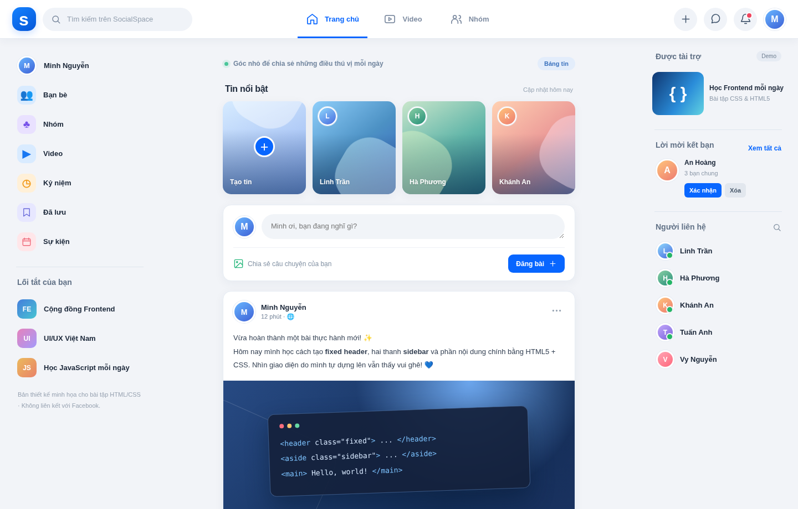

# Facebook-style Fixed Header & Sidebar — SocialSpace

> **Bài thực hành HTML5/CSS** thiết kế bố cục mạng xã hội đơn giản tương tự Facebook. Đây là giao diện mô phỏng cho mục đích học tập, không phải website chính thức và không liên kết với Facebook/Meta.

## Ảnh xem trước



[📱 Xem giao diện điện thoại](preview-mobile.png)

## Mục tiêu và kết quả

- **Fixed Header**: `header.topbar { position: fixed; top: 0; left: 0; right: 0; z-index: 100; }` luôn hiện trên màn hình khi người dùng cuộn bảng tin.
- **Sidebar trái và sidebar phải**: hai thẻ `<aside>` độc lập, áp dụng `position: fixed`, giới hạn `top` bằng chiều cao header và `overflow-y: auto` để cuộn độc lập nếu danh sách dài.
- **Nội dung chính**: `<main id="feed">` ở giữa, dùng `padding-top` để nội dung không bị header che; gồm tin (stories), form tạo bài, bài đăng và tương tác.
- **Responsive**: dưới 1120px ẩn sidebar phải, dưới 760px ẩn hai sidebar; nội dung chính chiếm chiều rộng còn lại trên điện thoại.
- **CSS và HTML5 tách file**: `index.html` liên kết `<link rel="stylesheet" href="styles.css">`.

## Cấu trúc thư mục

```text
Facebook_FixedHeader_Sidebar/
├── index.html      # HTML5: header, nav, aside, main, article, section
├── styles.css      # Fixed positioning, layout, card, responsive
├── script.js       # Thêm bài, thích, bình luận, tìm kiếm (demo offline)
├── preview-desktop.png  # Ảnh giao diện máy tính
├── preview-mobile.png   # Ảnh giao diện điện thoại
└── README.md       # Tài liệu và cách sử dụng
```

## Chạy dự án

Mở trực tiếp `index.html` bằng Chrome/Edge/Firefox, hoặc dùng VS Code Live Server. Không cần cài thư viện, kết nối mạng, đăng nhập hay server.

## Bố cục quan trọng (để ôn CSS)

```css
/* 1. Header đứng yên ở trên */
.topbar {
  position: fixed;
  inset: 0 0 auto;
  height: var(--header-height);
  z-index: 100;
}

/* 2. Hai sidebar cố định, có thể cuộn độc lập */
.sidebar {
  position: fixed;
  top: calc(var(--header-height) + 18px);
  bottom: 14px;
  width: var(--sidebar-width);
  overflow-y: auto;
}
.sidebar-left { left: var(--edge); }
.sidebar-right { right: var(--edge); }

/* 3. Main chừa khoảng trống cho header */
.feed {
  max-width: 636px;
  margin: 0 auto;
  padding-top: calc(var(--header-height) + 26px);
}

/* 4. Bố cục tự co giãn theo kích thước màn hình */
@media (max-width: 1120px) { .sidebar-right { display: none; } }
@media (max-width: 760px) {
  .sidebar-left, .sidebar-right { display: none; }
}
```

**Tại sao phải dùng `padding-top`?** Vì `position: fixed` đưa header ra khỏi luồng tài liệu, nội dung thường sẽ bị header đè lên nếu không chừa khoảng trống.

**Phân biệt `position: fixed` và `position: sticky`:** Fixed bám theo cửa sổ trình duyệt bất kể cuộn tới đâu. Sticky bám trong phạm vi vùng chứa sau khi đến ngưỡng cuộn. Bài này dùng fixed đúng yêu cầu.

## Các thành phần minh họa

| Vùng | Thành phần | Cách thực hiện |
|---|---|---|
| Header | Logo, ô tìm kiếm, menu, thông báo | `header`, `nav`, `position: fixed` |
| Sidebar trái | Trang cá nhân, Bạn bè, Nhóm, Đã lưu | `<aside class="sidebar sidebar-left">` |
| Bảng tin | Stories, đăng bài, bài viết | `<main>`, `<section>`, `<article>` |
| Sidebar phải | Tài trợ, lời mời kết bạn, liên hệ | `<aside class="sidebar sidebar-right">` |
| Tương tác | Thích, bình luận, tìm kiếm và đăng bài thử | JavaScript nội bộ, không lưu server |

## Giới hạn bài thực hành

Tất cả nội dung, tài khoản, ảnh minh họa dạng CSS và số lượt tương tác đều là dữ liệu giả lập. Đăng bài hoặc bình luận chỉ thay đổi trên trang đang mở, tải lại sẽ trở về trạng thái ban đầu. Không có cơ sở dữ liệu hoặc đăng nhập thật.

## Nộp bài

Nộp link trực tiếp đến `README.md` hoặc `index.html` trong repository GitHub. Nếu giảng viên cần kiểm tra CSS, mã nguồn đầy đủ nằm trong `styles.css`; các trích đoạn ở trên giúp bộ chấm tự động nhận ra những điểm chính mà không phải mở nhiều file.
