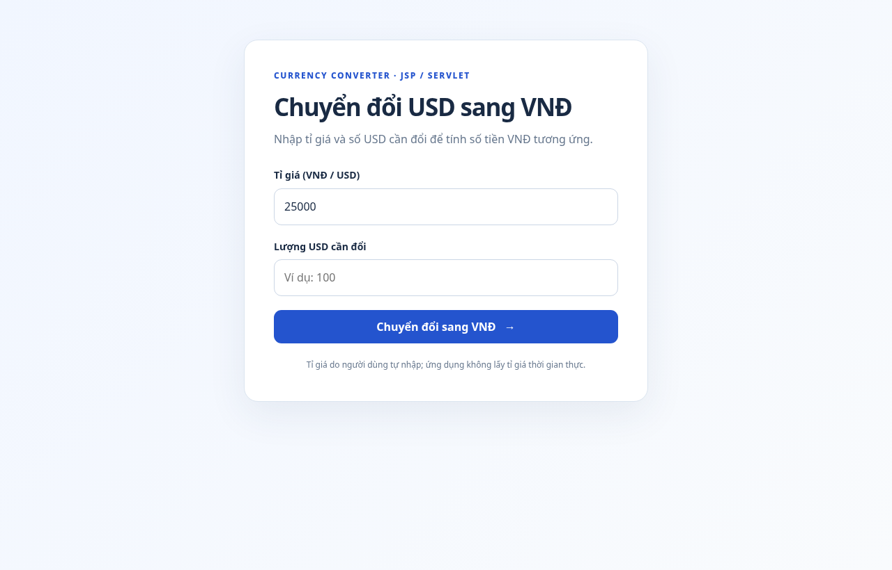

# JSP Servlet Currency Converter — CodeGym

[Đọc hướng dẫn và mã nguồn đầy đủ](jsp-servlet-currency-converter/README.md)

[Form nhập liệu](jsp-servlet-currency-converter/src/main/webapp/index.jsp) · [ConverterServlet](jsp-servlet-currency-converter/src/main/java/com/codegym/ConverterServlet.java) · [pom.xml](jsp-servlet-currency-converter/pom.xml)

**Build:** tại `jsp-servlet-currency-converter/`, chạy `mvn clean package` và deploy `target/jsp-servlet-currency-converter.war` trên Tomcat 10.1+.

**Ví dụ:** tỉ giá 25.000, USD 100 → **2.500.000 VNĐ**.

Ảnh xem trước (chỉ mô phỏng HTML/CSS, không phải JSP chạy thật):

