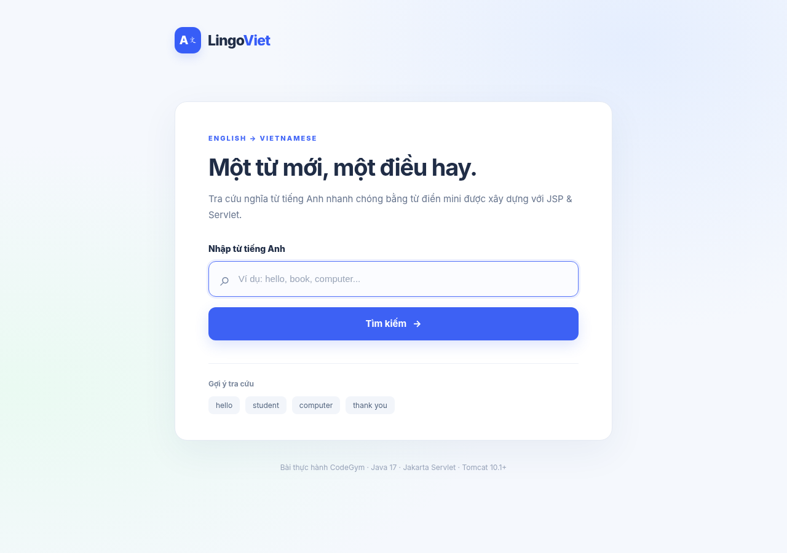

# Từ điển Anh – Việt (JSP + Servlet) — CodeGym

Bài thực hành **tạo Servlet**: trang `index.jsp` nhận từ tiếng Anh (`name="word"`) và gửi **POST** đến `/translate`. `DictionaryServlet` tra cứu trong `Map<String,String>` và trả về nghĩa tiếng Việt, hoặc thông báo **“Không tìm thấy từ: ...”**.

- **Stack:** Java 17, Maven WAR, JSP, Jakarta Servlet 6.0, Tomcat 10.1+.
- **Dữ liệu:** 25 từ/cụm từ Anh–Việt lưu trực tiếp trong Java `Map`; không cần MySQL, không gọi API ngoài.
- **Tương thích đề:** `com.codegym.DictionaryServlet` dùng `@WebServlet(name="DictionaryServlet", urlPatterns="/translate")`, form `POST /translate`, `web.xml` khai báo `index.jsp` làm trang chủ.
- **Cải tiến:** không phân biệt hoa/thường, bỏ khoảng trắng hai đầu, kiểm tra đầu vào, UTF-8, escape HTML đối với từ do người dùng nhập.

## Yêu cầu và đường dẫn mã nguồn

| Yêu cầu của CodeGym | Vị trí thực hiện |
| --- | --- |
| Form `index.jsp`, input `word`, nút Tìm kiếm | `jsp-servlet-dictionary/src/main/webapp/index.jsp` |
| POST đến `/translate` | `form action="${pageContext.request.contextPath}/translate" method="post"` |
| Servlet xử lý POST | `jsp-servlet-dictionary/src/main/java/com/codegym/DictionaryServlet.java` |
| Map từ Anh–Việt | `jsp-servlet-dictionary/src/main/java/com/codegym/DictionaryService.java` |
| Kết quả tìm thấy/không tìm thấy | Servlet xuất HTML UTF-8 |
| Cấu hình Maven và Tomcat 10.1+ | `jsp-servlet-dictionary/pom.xml`, `src/main/webapp/WEB-INF/web.xml` |

## Giao diện xem trước



[Xem phiên bản điện thoại](preview-mobile.png). Đây là ảnh mô phỏng HTML/CSS theo mã nguồn, **không phải ảnh Tomcat chạy thật**.

## Cấu trúc

```text
JSP_Servlet_Dictionary/
├── README.md                        (file này)
├── preview-desktop.png
├── preview-mobile.png
├── preview-small.png
└── jsp-servlet-dictionary/
    ├── README.md
    ├── pom.xml
    ├── run-tests-windows.bat
    ├── run-tests-unix.sh
    ├── .gitignore
    └── src/
        ├── main/
        │   ├── java/com/codegym/
        │   │   ├── DictionaryServlet.java
        │   │   ├── DictionaryService.java
        │   │   └── HtmlUtil.java
        │   └── webapp/
        │       ├── index.jsp
        │       ├── css/style.css
        │       └── WEB-INF/web.xml
        └── test/java/com/codegym/DictionaryServiceTest.java
```

## Cách chạy bằng Maven và Tomcat

1. Cài **JDK 17+**, **Apache Maven 3.8+**, **Tomcat 10.1+**.
2. Mở terminal tại `JSP_Servlet_Dictionary/jsp-servlet-dictionary` (nơi có `pom.xml`).
3. Chạy `mvn clean package` để tạo `target/jsp-servlet-dictionary.war`.
4. Copy file `.war` vào `webapps` của Tomcat hoặc deploy WAR qua IDE.
5. Bật Tomcat, mở **http://localhost:8080/jsp-servlet-dictionary/**.
6. Nhập `hello` → “Xin chào”; `BOOK` → “Quyển sách”; `unknownword` → thông báo không tìm thấy.

> `/translate` là endpoint thuộc context path của ứng dụng. Khi deploy tên WAR mặc định, URL đầy đủ là `http://localhost:8080/jsp-servlet-dictionary/translate` và nhận **POST**. Nếu mở trực tiếp bằng GET, Servlet sẽ chuyển về trang nhập.

## Tự kiểm tra không cần Maven

- Windows: chạy `run-tests-windows.bat` từ thư mục dự án.
- macOS/Linux: chạy `sh run-tests-unix.sh`.
- Bộ kiểm tra thuần Java gồm **19/19 ca đạt**: từ phổ biến, chữ hoa/thường, khoảng trắng, từ không tồn tại, `null`, ký tự HTML nguy hiểm.
- Đã **biên dịch Servlet bằng Java 17 với bộ API mô phỏng** và vượt qua **15/15 kiểm tra luồng Servlet** (POST, GET, content type, lỗi dữ liệu, XSS, context path).
- Đã xem giao diện trong Chromium ở 1280, 390, 320px; không tràn ngang và form POST trỏ đúng URL.

**Giới hạn kiểm chứng:** Môi trường soạn bài không có `mvn`/Tomcat, nên **chưa chạy `mvn clean package` hoặc deploy Tomcat thực tế**. Các test Servlet là mô phỏng, không thay thế kiểm thử tích hợp.

## Một số từ vựng mẫu

| Từ tiếng Anh | Nghĩa tiếng Việt |
| --- | --- |
| hello | Xin chào |
| how | Thế nào |
| book | Quyển sách |
| computer | Máy tính |
| student | Sinh viên |
| teacher | Giáo viên |
| thank you | Cảm ơn |

## Toàn bộ mã nguồn cốt lõi (để người chấm xem ngay trên GitHub)

Các đoạn sau là nội dung **thực tế trong dự án**. Các file cũng có thể xem riêng bằng đường dẫn bên trên.

### `pom.xml`

```xml
<project xmlns="http://maven.apache.org/POM/4.0.0"
         xmlns:xsi="http://www.w3.org/2001/XMLSchema-instance"
         xsi:schemaLocation="http://maven.apache.org/POM/4.0.0 https://maven.apache.org/xsd/maven-4.0.0.xsd">
    <modelVersion>4.0.0</modelVersion>
    <groupId>com.codegym</groupId>
    <artifactId>jsp-servlet-dictionary</artifactId>
    <version>1.0-SNAPSHOT</version>
    <packaging>war</packaging>
    <name>English Vietnamese Dictionary - JSP Servlet</name>
    <properties>
        <maven.compiler.release>17</maven.compiler.release>
        <project.build.sourceEncoding>UTF-8</project.build.sourceEncoding>
    </properties>
    <dependencies>
        <dependency>
            <groupId>jakarta.servlet</groupId>
            <artifactId>jakarta.servlet-api</artifactId>
            <version>6.0.0</version>
            <scope>provided</scope>
        </dependency>
        <dependency>
            <groupId>jakarta.servlet.jsp</groupId>
            <artifactId>jakarta.servlet.jsp-api</artifactId>
            <version>3.1.1</version>
            <scope>provided</scope>
        </dependency>
    </dependencies>
    <build>
        <finalName>jsp-servlet-dictionary</finalName>
        <plugins>
            <plugin>
                <groupId>org.apache.maven.plugins</groupId>
                <artifactId>maven-compiler-plugin</artifactId>
                <version>3.13.0</version>
            </plugin>
            <plugin>
                <groupId>org.apache.maven.plugins</groupId>
                <artifactId>maven-war-plugin</artifactId>
                <version>3.4.0</version>
            </plugin>
        </plugins>
    </build>
</project>
```

### `src/main/java/com/codegym/DictionaryService.java`

```java
package com.codegym;

import java.util.Collections;
import java.util.LinkedHashMap;
import java.util.Locale;
import java.util.Map;

/**
 * An in-memory English -> Vietnamese dictionary for the servlet exercise.
 * This service has no dependencies on the Servlet API and is easy to test.
 */
public final class DictionaryService {
    private static final Map<String, String> WORDS = createWords();

    private DictionaryService() {
        // Utility class; callers use translate().
    }

    private static Map<String, String> createWords() {
        Map<String, String> dictionary = new LinkedHashMap<>();
        dictionary.put("hello", "Xin chào");
        dictionary.put("how", "Thế nào");
        dictionary.put("book", "Quyển sách");
        dictionary.put("computer", "Máy tính");
        dictionary.put("student", "Sinh viên");
        dictionary.put("teacher", "Giáo viên");
        dictionary.put("school", "Trường học");
        dictionary.put("university", "Trường đại học");
        dictionary.put("apple", "Quả táo");
        dictionary.put("water", "Nước");
        dictionary.put("house", "Ngôi nhà");
        dictionary.put("friend", "Bạn bè");
        dictionary.put("family", "Gia đình");
        dictionary.put("love", "Tình yêu");
        dictionary.put("goodbye", "Tạm biệt");
        dictionary.put("morning", "Buổi sáng");
        dictionary.put("evening", "Buổi tối");
        dictionary.put("cat", "Con mèo");
        dictionary.put("dog", "Con chó");
        dictionary.put("programming", "Lập trình");
        dictionary.put("language", "Ngôn ngữ");
        dictionary.put("study", "Học tập");
        dictionary.put("work", "Công việc");
        dictionary.put("name", "Tên");
        dictionary.put("thank you", "Cảm ơn");
        return Collections.unmodifiableMap(dictionary);
    }

    /**
     * Looks up a word regardless of leading/trailing whitespace or letter case.
     * @return Vietnamese meaning or null if the word is absent.
     */
    public static String translate(String word) {
        if (word == null) {
            return null;
        }
        return WORDS.get(word.strip().toLowerCase(Locale.ROOT));
    }

    public static int size() {
        return WORDS.size();
    }
}
```

### `src/main/java/com/codegym/HtmlUtil.java`

```java
package com.codegym;

/** Escapes untrusted text before inserting it into HTML content or attributes. */
public final class HtmlUtil {
    private HtmlUtil() {
    }

    public static String escape(String value) {
        if (value == null) {
            return "";
        }
        return value.replace("&", "&amp;")
                .replace("<", "&lt;")
                .replace(">", "&gt;")
                .replace("\"", "&quot;")
                .replace("'", "&#39;");
    }
}
```

### `src/main/java/com/codegym/DictionaryServlet.java`

```java
package com.codegym;

import jakarta.servlet.ServletException;
import jakarta.servlet.annotation.WebServlet;
import jakarta.servlet.http.HttpServlet;
import jakarta.servlet.http.HttpServletRequest;
import jakarta.servlet.http.HttpServletResponse;

import java.io.IOException;
import java.io.PrintWriter;

/** Receives POST /translate and renders the Vietnamese dictionary result. */
@WebServlet(name = "DictionaryServlet", urlPatterns = "/translate")
public class DictionaryServlet extends HttpServlet {
    private static final int MAX_WORD_LENGTH = 80;

    @Override
    protected void doGet(HttpServletRequest request, HttpServletResponse response)
            throws IOException {
        response.sendRedirect(request.getContextPath() + "/");
    }

    @Override
    protected void doPost(HttpServletRequest request, HttpServletResponse response)
            throws ServletException, IOException {
        // Must happen before reading POST parameters, so Vietnamese text works.
        request.setCharacterEncoding("UTF-8");
        response.setContentType("text/html;charset=UTF-8");
        response.setHeader("X-Content-Type-Options", "nosniff");

        String word = request.getParameter("word");
        String trimmedWord = word == null ? "" : word.strip();
        boolean invalid = trimmedWord.isEmpty() || trimmedWord.length() > MAX_WORD_LENGTH;
        if (invalid) {
            response.setStatus(HttpServletResponse.SC_BAD_REQUEST);
        }

        String meaning = invalid ? null : DictionaryService.translate(trimmedWord);
        String safeWord = HtmlUtil.escape(trimmedWord);
        String contextPath = HtmlUtil.escape(request.getContextPath());

        try (PrintWriter out = response.getWriter()) {
            out.println("<!DOCTYPE html>");
            out.println("<html lang=\"vi\"><head><meta charset=\"UTF-8\">");
            out.println("<meta name=\"viewport\" content=\"width=device-width, initial-scale=1\">");
            out.println("<title>Kết quả tra cứu - Từ điển Anh Việt</title>");
            out.println("<link rel=\"stylesheet\" href=\"" + contextPath + "/css/style.css\">");
            out.println("</head><body><main class=\"page-shell\">");
            out.println("<header class=\"brand-row\"><span class=\"logo-mark\">A<span>文</span></span>");
            out.println("<span class=\"brand-title\">Lingo<span>Viet</span></span></header>");
            out.println("<article class=\"card result-card\">");
            if (invalid) {
                out.println("<p class=\"eyebrow error-label\">DỮ LIỆU KHÔNG HỢP LỆ</p>");
                out.println("<h1>Vui lòng nhập từ khóa hợp lệ</h1>");
                out.println("<p class=\"description\">Từ cần tra cứu phải có từ 1 đến 80 ký tự.</p>");
            } else if (meaning == null) {
                out.println("<p class=\"eyebrow error-label\">CHƯA CÓ TRONG TỪ ĐIỂN</p>");
                out.println("<h1>Không tìm thấy từ: <span class=\"query\">" + safeWord + "</span></h1>");
                out.println("<p class=\"description\">Thử lại với hello, book hoặc computer nhé.</p>");
            } else {
                out.println("<p class=\"eyebrow success-label\">ĐÃ TÌM THẤY</p>");
                out.println("<h1 class=\"query\">" + safeWord + "</h1>");
                out.println("<div class=\"result-divider\"></div>");
                out.println("<p class=\"meaning-label\">Nghĩa tiếng Việt</p>");
                out.println("<p class=\"meaning\">" + HtmlUtil.escape(meaning) + "</p>");
            }
            out.println("<a class=\"primary-button return-button\" href=\"" + contextPath
                    + "/\">Tra từ khác <span aria-hidden=\"true\">→</span></a>");
            out.println("</article></main></body></html>");
        }
    }
}
```

### `src/main/webapp/index.jsp`

```jsp
<%@ page contentType="text/html; charset=UTF-8" pageEncoding="UTF-8" %>
<!DOCTYPE html>
<html lang="vi">
<head>
    <meta charset="UTF-8">
    <meta name="viewport" content="width=device-width, initial-scale=1">
    <title>LingoViet | Từ điển Anh - Việt</title>
    <link rel="stylesheet" href="${pageContext.request.contextPath}/css/style.css">
</head>
<body>
    <main class="page-shell">
        <header class="brand-row">
            <span class="logo-mark">A<span>文</span></span>
            <span class="brand-title">Lingo<span>Viet</span></span>
        </header>
        <section class="card search-card" aria-labelledby="page-title">
            <div class="eyebrow">ENGLISH → VIETNAMESE</div>
            <h1 id="page-title">Một từ mới, một điều hay.</h1>
            <p class="description">Tra cứu nghĩa từ tiếng Anh nhanh chóng bằng từ điển mini được xây dựng với JSP &amp; Servlet.</p>
            <form action="${pageContext.request.contextPath}/translate" method="post" accept-charset="UTF-8">
                <label for="word">Nhập từ tiếng Anh</label>
                <div class="search-field">
                    <span class="search-icon" aria-hidden="true">⌕</span>
                    <input id="word" name="word" type="text" maxlength="80" placeholder="Ví dụ: hello, book, computer..." autofocus autocomplete="off" required>
                </div>
                <button type="submit" class="primary-button">Tìm kiếm <span aria-hidden="true">→</span></button>
            </form>
            <div class="examples">
                <p>Gợi ý tra cứu</p>
                <div class="chips"><span>hello</span><span>student</span><span>computer</span><span>thank you</span></div>
            </div>
        </section>
        <footer class="footer-note">Bài thực hành CodeGym · Java 17 · Jakarta Servlet · Tomcat 10.1+</footer>
    </main>
</body>
</html>
```

### `src/main/webapp/WEB-INF/web.xml`

```xml
<?xml version="1.0" encoding="UTF-8"?>
<web-app xmlns="https://jakarta.ee/xml/ns/jakartaee"
         xmlns:xsi="http://www.w3.org/2001/XMLSchema-instance"
         xsi:schemaLocation="https://jakarta.ee/xml/ns/jakartaee https://jakarta.ee/xml/ns/jakartaee/web-app_6_0.xsd"
         version="6.0">
    <display-name>English Vietnamese Dictionary</display-name>
    <welcome-file-list>
        <welcome-file>index.jsp</welcome-file>
    </welcome-file-list>
</web-app>
```

**Giao diện CSS:** [style.css](jsp-servlet-dictionary/src/main/webapp/css/style.css).

## Nộp CodeGym

Đưa nguyên thư mục `JSP_Servlet_Dictionary/` lên GitHub và nộp URL đến thư mục hoặc file README này. Ví dụ, nếu repository là `Shion-NewbieCoder/JSP-homework` và nhánh `main`, URL sau chỉ hoạt động **sau khi bạn push**:

`https://github.com/Shion-NewbieCoder/JSP-homework/tree/main/JSP_Servlet_Dictionary`

Không cần MySQL hoặc cơ sở dữ liệu cho bài tập này.
