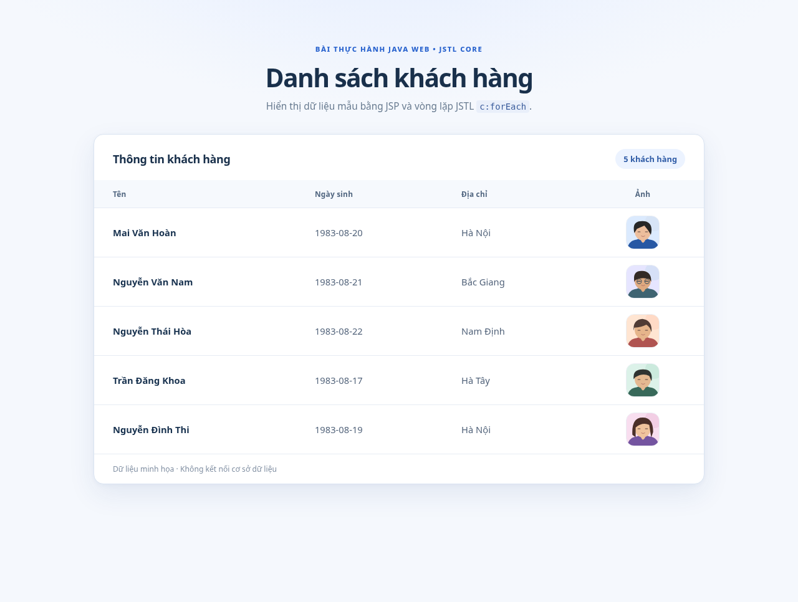

# JSP & JSTL — Danh sách khách hàng

> Bài thực hành CodeGym: tạo trang `index.jsp` hiển thị danh sách khách hàng với 4 cột **Tên, Ngày sinh, Địa chỉ, Ảnh** bằng JSTL.



**Demo 5 khách hàng** từ đề: Mai Văn Hoàn, Nguyễn Văn Nam, Nguyễn Thái Hòa, Trần Đăng Khoa, Nguyễn Đình Thi. Hình chân dung là **SVG minh họa tự tạo** (không phải ảnh thật của người có tên), dùng offline.

## Điểm kỹ thuật chính

- Dùng **`c:forEach`** để lặp `List<Customer>` và **`c:out`** để in dữ liệu an toàn.
- `CustomerData.java` cung cấp danh sách mẫu, `index.jsp` đưa danh sách vào request scope rồi render bằng JSTL.
- Dùng `c:url` để tạo đường dẫn ảnh tương thích khi app chạy với context path khác nhau.
- Giao diện desktop là bảng; dưới 640px tự biến thành thẻ thông tin, không tràn ngang.
- Không sử dụng database hoặc JavaScript.

## Cấu trúc dự án

```text
jsp-jstl-customers/
├── pom.xml
├── .gitignore
└── src/main/
    ├── java/com/codegym/model/
    │   ├── Customer.java
    │   └── CustomerData.java
    └── webapp/
        ├── index.jsp
        ├── css/styles.css
        ├── images/customer-1.svg ... customer-5.svg
        └── WEB-INF/web.xml
```

## Cách chạy

Cần JDK 17+, Maven 3.9+ và Apache Tomcat 10.1+.

```powershell
cd jsp-jstl-customers
mvn clean package
```

Sau khi **BUILD SUCCESS**, chép `target/jsp-jstl-customers.war` vào `webapps` của Tomcat, khởi động server và truy cập:

`http://localhost:8080/jsp-jstl-customers/`

Tomcat phải chạy thì JSP mới được dịch và JSTL mới được thực thi. Không mở file JSP bằng Live Server hoặc `file://`.

## Lưu ý phiên bản JSTL

Đề CodeGym đưa cú pháp Java EE cũ `http://java.sun.com/jsp/jstl/core`. Với **Tomcat 10.1 / Jakarta Tags 3.0**, sử dụng:

```jsp
<%@ taglib prefix="c" uri="jakarta.tags.core" %>
```

`pom.xml` thêm **cả API `jakarta.servlet.jsp.jstl-api:3.0.2` và implementation `org.glassfish.web:jakarta.servlet.jsp.jstl:3.0.1`**. Hai dependency này được đóng trong `WEB-INF/lib` của WAR; không tự chép thư viện JSTL 1.x (javax) vào Tomcat 10.1.

## Các trường hợp kiểm tra

| Trường hợp | Kết quả kỳ vọng |
|---|---|
| Vào trang `/jsp-jstl-customers/` | Hiện bảng 5 khách hàng, đủ 4 cột |
| Kiểm tra `index.jsp` | Có `c:forEach`, `c:out`, `c:url`, `c:if` |
| Xem trên điện thoại ~375px | Hiện 5 thẻ, không tràn ngang |
| Tắt Internet | Avatar SVG và CSS vẫn hiển thị |

**Giới hạn kiểm thử:** Mã Java đã kiểm tra với JDK 17. Nếu không có Maven/Tomcat ở môi trường tạo tài liệu thì chưa thể khẳng định build WAR và JSP runtime chạy thực tế; chạy `mvn clean package` trên máy cá nhân để nghiệm thu.

## Mã nguồn tham khảo trực tiếp

Toàn bộ logic của bài (bằng JSP/JSTL) được trích lại để có thể đọc qua một README trên GitHub.

### index.jsp

```jsp
<%@ page contentType="text/html; charset=UTF-8" pageEncoding="UTF-8" %>
<%@ page import="com.codegym.model.CustomerData" %>
<%@ taglib prefix="c" uri="jakarta.tags.core" %>
<%
    // Buoc 5: lay danh sach khach hang mau, dua vao request scope cho JSTL.
    request.setAttribute("customers", CustomerData.getCustomers());
%>
<!DOCTYPE html>
<html lang="vi">
<head>
    <meta charset="UTF-8">
    <meta name="viewport" content="width=device-width, initial-scale=1.0">
    <meta name="description" content="Bài thực hành JSP và JSTL: hiển thị danh sách khách hàng.">
    <title>Danh sách khách hàng | JSP &amp; JSTL</title>
    <link rel="stylesheet" href="${pageContext.request.contextPath}/css/styles.css">
</head>
<body>
<main class="page-shell">
    <header class="page-header">
        <span class="eyebrow">BÀI THỰC HÀNH JAVA WEB • JSTL CORE</span>
        <h1>Danh sách khách hàng</h1>
        <p>Hiển thị dữ liệu mẫu bằng JSP và vòng lặp JSTL <code>c:forEach</code>.</p>
    </header>

    <section class="table-card" aria-labelledby="list-title">
        <div class="card-heading">
            <h2 id="list-title">Thông tin khách hàng</h2>
            <span class="total-count">5 khách hàng</span>
        </div>
        <div class="table-scroll">
            <table class="customer-table">
                <thead>
                <tr>
                    <th scope="col">Tên</th>
                    <th scope="col">Ngày sinh</th>
                    <th scope="col">Địa chỉ</th>
                    <th scope="col">Ảnh</th>
                </tr>
                </thead>
                <tbody>
                <%-- Buoc 6: JSTL lap qua List<Customer>, EL doc cac getter cua JavaBean. --%>
                <c:forEach var="customer" items="${customers}">
                    <c:url value="/images/${customer.photo}" var="photoUrl" />
                    <tr>
                        <td data-label="Tên" class="customer-name"><c:out value="${customer.name}" /></td>
                        <td data-label="Ngày sinh"><c:out value="${customer.birthday}" /></td>
                        <td data-label="Địa chỉ"><c:out value="${customer.address}" /></td>
                        <td data-label="Ảnh" class="photo-cell">
                            
                        </td>
                    </tr>
                </c:forEach>
                <c:if test="${empty customers}">
                    <tr><td colspan="4" class="empty-state">Chưa có khách hàng nào.</td></tr>
                </c:if>
                </tbody>
            </table>
        </div>
        <div class="card-footer">Dữ liệu minh họa · Không kết nối cơ sở dữ liệu</div>
    </section>
</main>
</body>
</html>
```

### Customer.java

```java
package com.codegym.model;

/** Thong tin khach hang mau; pham vi demo, khong luu du lieu nhay cam. */
public class Customer {
    private final String name;
    private final String birthday;
    private final String address;
    private final String photo;

    public Customer(String name, String birthday, String address, String photo) {
        this.name = name;
        this.birthday = birthday;
        this.address = address;
        this.photo = photo;
    }

    public String getName() {
        return name;
    }

    public String getBirthday() {
        return birthday;
    }

    public String getAddress() {
        return address;
    }

    public String getPhoto() {
        return photo;
    }
}
```

### CustomerData.java

```java
package com.codegym.model;

import java.util.List;

/** Danh sach co dinh de thuc hanh JSTL; khong can database. */
public final class CustomerData {
    private CustomerData() {
        // Utility class.
    }

    private static final List<Customer> CUSTOMERS = List.of(
        new Customer("Mai Văn Hoàn", "1983-08-20", "Hà Nội", "customer-1.svg"),
        new Customer("Nguyễn Văn Nam", "1983-08-21", "Bắc Giang", "customer-2.svg"),
        new Customer("Nguyễn Thái Hòa", "1983-08-22", "Nam Định", "customer-3.svg"),
        new Customer("Trần Đăng Khoa", "1983-08-17", "Hà Tây", "customer-4.svg"),
        new Customer("Nguyễn Đình Thi", "1983-08-19", "Hà Nội", "customer-5.svg")
    );

    public static List<Customer> getCustomers() {
        return CUSTOMERS;
    }
}
```

### pom.xml

```xml
<?xml version="1.0" encoding="UTF-8"?>
<project xmlns="http://maven.apache.org/POM/4.0.0"
         xmlns:xsi="http://www.w3.org/2001/XMLSchema-instance"
         xsi:schemaLocation="http://maven.apache.org/POM/4.0.0 https://maven.apache.org/xsd/maven-4.0.0.xsd">
    <modelVersion>4.0.0</modelVersion>
    <groupId>com.codegym</groupId>
    <artifactId>jsp-jstl-customers</artifactId>
    <version>1.0-SNAPSHOT</version>
    <packaging>war</packaging>
    <name>JSP JSTL Customer List</name>

    <properties>
        <maven.compiler.release>17</maven.compiler.release>
        <project.build.sourceEncoding>UTF-8</project.build.sourceEncoding>
    </properties>

    <dependencies>
        <!-- Tomcat 10.1 cung cap Servlet/JSP API luc chay. -->
        <dependency>
            <groupId>jakarta.servlet</groupId>
            <artifactId>jakarta.servlet-api</artifactId>
            <version>6.0.0</version>
            <scope>provided</scope>
        </dependency>
        <dependency>
            <groupId>jakarta.servlet.jsp</groupId>
            <artifactId>jakarta.servlet.jsp-api</artifactId>
            <version>3.1.1</version>
            <scope>provided</scope>
        </dependency>

        <!-- JSTL 3.0 cho Tomcat 10.1: can CA API va implementation. -->
        <dependency>
            <groupId>jakarta.servlet.jsp.jstl</groupId>
            <artifactId>jakarta.servlet.jsp.jstl-api</artifactId>
            <version>3.0.2</version>
        </dependency>
        <dependency>
            <groupId>org.glassfish.web</groupId>
            <artifactId>jakarta.servlet.jsp.jstl</artifactId>
            <version>3.0.1</version>
        </dependency>
    </dependencies>

    <build>
        <finalName>jsp-jstl-customers</finalName>
        <plugins>
            <plugin>
                <groupId>org.apache.maven.plugins</groupId>
                <artifactId>maven-compiler-plugin</artifactId>
                <version>3.13.0</version>
            </plugin>
            <plugin>
                <groupId>org.apache.maven.plugins</groupId>
                <artifactId>maven-war-plugin</artifactId>
                <version>3.4.0</version>
            </plugin>
        </plugins>
    </build>
</project>
```

### css/styles.css

```css
/* JSP JSTL Customer List — pure CSS, no client-side JS */
:root {
    color-scheme: light;
    --text: #19304b;
    --muted: #687b90;
    --line: #e7ecf4;
    --blue: #2963ce;
    --background: #f5f8fd;
}
* { box-sizing: border-box; }
html { -webkit-text-size-adjust: 100%; }
body {
    margin: 0;
    min-height: 100vh;
    font-family: system-ui, -apple-system, "Segoe UI", sans-serif;
    background: radial-gradient(ellipse 900px 400px at 50% -130px, #e4edff 0%, transparent 75%), var(--background);
    color: var(--text);
}
.page-shell { width: min(100% - 40px, 980px); margin: 66px auto; }
.page-header { text-align: center; margin-bottom: 34px; }
.eyebrow { font-size: .71rem; font-weight: 800; letter-spacing: .13em; color: var(--blue); }
h1 { font-size: clamp(1.8rem, 4vw, 2.55rem); letter-spacing: -.04em; line-height: 1.18; margin: 12px 0; }
.page-header p { font-size: .96rem; color: var(--muted); margin: 0; }
.page-header code { font-size: .9em; color: #3a5c9c; background: #e9effa; padding: 2px 5px; border-radius: 4px; }
.table-card {
    background: white;
    border: 1px solid #dae4f2;
    border-radius: 16px;
    box-shadow: 0 16px 44px rgba(33, 70, 128, .09), 0 2px 7px rgba(33,70,128,.04);
    overflow: hidden;
}
.card-heading { display: flex; align-items: center; justify-content: space-between; gap: 12px; padding: 23px 30px 18px; }
.card-heading h2 { font-size: 1.12rem; margin: 0; letter-spacing: -.02em; }
.total-count { color: #315da7; border-radius: 25px; background: #ecf3ff; padding: 7px 13px; font-size: .8rem; font-weight: 700; white-space: nowrap; }
.table-scroll { width: 100%; }
.customer-table { width: 100%; border-collapse: collapse; text-align: left; }
.customer-table thead { background: #f6f9fd; }
.customer-table th { color: #526781; font-size: .74rem; letter-spacing: .02em; font-weight: 750; padding: 14px 30px; }
.customer-table th:last-child, .customer-table td:last-child { text-align: center; }
.customer-table td { padding: 12px 30px; border-top: 1px solid var(--line); font-size: .92rem; color: #53647b; }
.customer-table tr:hover td { background: #f9fbff; }
.customer-table .customer-name { font-weight: 750; color: #18324f; }
.customer-avatar { width: 54px; height: 54px; display: inline-block; border-radius: 13px; border: 1px solid rgba(42,81,142,.10); object-fit: cover; vertical-align: middle; }
.card-footer { border-top: 1px solid var(--line); padding: 15px 30px; color: #8290a3; font-size: .76rem; }
.empty-state { text-align: center !important; padding: 32px !important; }
@media (max-width: 640px) {
    .page-shell { width: min(100% - 26px, 480px); margin: 30px auto; }
    .page-header { margin-bottom: 24px; }
    .page-header p { line-height: 1.6; }
    .card-heading { padding: 19px 16px 17px; }
    .card-heading h2 { font-size: 1rem; }
    .total-count { font-size: .72rem; padding: 6px 9px; }
    .customer-table thead { display: none; }
    .customer-table tbody { display: grid; gap: 0; }
    .customer-table tr {
        display: grid;
        grid-template-columns: 64px minmax(0,1fr);
        grid-template-areas: "photo name" "photo birthday" "photo address";
        column-gap: 15px;
        padding: 17px 18px;
        border-top: 1px solid var(--line);
        align-items: center;
    }
    .customer-table td {
        display: block;
        border: 0;
        padding: 2px 0;
        font-size: .87rem;
        min-width: 0;
        text-align: left !important;
    }
    .customer-table td:nth-child(1) { grid-area: name; font-size: .96rem; }
    .customer-table td:nth-child(2) { grid-area: birthday; }
    .customer-table td:nth-child(3) { grid-area: address; }
    .customer-table td:nth-child(4) { grid-area: photo; align-self: center; }
    .customer-table td:nth-child(2)::before { content: "Ngày sinh: "; color: #8695a5; }
    .customer-table td:nth-child(3)::before { content: "Địa chỉ: "; color: #8695a5; }
    .customer-avatar { width: 62px; height: 62px; border-radius: 12px; }
    .card-footer { padding: 14px 18px; }
}
```
