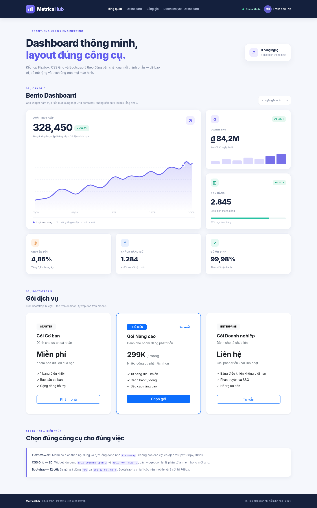

# MetricsHub — Sửa layout Front-end theo đúng công cụ

Bài tập **CodeGym: Flexbox, CSS Grid và Bootstrap**. Bản demo là một dashboard tĩnh có số liệu giả lập, không gọi API và không cần backend.

## Xem bài làm



[Ảnh giao diện điện thoại](preview-mobile.png)

Mở `metricshub_ui/index.html` trong trình duyệt (hoạt động offline vì đã kèm Bootstrap 5.3.6 trong `metricshub_ui/vendor/`). Có thể mở bằng VS Code + Live Server.

## Thành phần và kỹ thuật

| Thành phần | Công nghệ | Cách kiểm chứng |
|---|---|---|
| Navbar | **Flexbox** | `.navbar-flex` dùng `display: flex`, `justify-content`, `align-items`, `flex-wrap`, `gap`; mục `Datenanalyse-Dashboard` tự xuống dòng |
| Bento Dashboard | **CSS Grid** | `.grid-dashboard` dùng `grid-template-columns: repeat(3, minmax(0, 1fr))`; `.widget-featured` dùng `grid-column: span 2; grid-row: span 2` |
| Pricing | **Bootstrap 5 / lưới 12 cột** | `.row.g-4` cùng 3 `.col-12.col-md-4`; dùng `card`, `card-body`, `h-100`, `btn` và các utilities |
| Responsive | Media queries cho navbar và Bento | 375px: Grid 1 cột; 768px: Grid 2 cột; 1440px: Grid 3 cột. Pricing dùng breakpoint `md` của Bootstrap |

## Đối chiếu lỗi Legacy

**Navbar:** Không sử dụng `grid-template-columns: 200px 600px 200px`; chuyển sang Flexbox một chiều, co giãn theo nội dung. **Dashboard:** Xóa wrapper `.column` thừa; các widget là direct children của Grid, hỗ trợ span hai hàng/hai cột. **Pricing:** Không dùng float/33.33% hay tự viết media query riêng; dùng hoàn toàn Bootstrap 12 cột.

## Trả lời câu hỏi vấn đáp

**Grid và Flexbox có thể kết hợp không?** Có: Grid để định vị widget, Flexbox để căn icon, tên, số liệu ở bên trong một widget (`.widget-header`). **Tại sao Bootstrap Grid dùng Flexbox?** Bootstrap 5 có `.row { display: flex; flex-wrap: wrap }` và các cột tính trên 12 phần; tái sử dụng breakpoint giúp làm nhanh, đồng nhất. **Bố cục zig-zag ưu tiên gì?** Grid, vì phải kiểm soát đồng thời hai chiều hàng và cột. **Vì sao dùng gap?** `gap` tạo khoảng cách đều mà không thêm margin ngoài container, hỗ trợ cả Grid và Flexbox.

## Cấu trúc nộp bài

```text
MetricsHub_Layout_Submission/
├── metricshub_ui/
│   ├── index.html
│   ├── style.css
│   └── vendor/
│       └── bootstrap.min.css
├── layout_strategy.md          # < 150 từ, phân tích lựa chọn layout
├── ai_prompt_log.md            # 6 câu hỏi/giải thích kỹ thuật
├── preview-desktop.png         # giao diện 1440px
├── preview-mobile.png          # giao diện 375px
└── README.md                   # tổng hợp, có toàn bộ mã nguồn bên dưới
```

## Kiểm tra responsive (Chromium)

| Độ rộng | Navbar | Bento | Pricing | Tràn ngang |
|---|---|---|---|---|
| 1440px | Flex | 3 cột | 3 cột | Không |
| 1024px | Flex, tự xuống dòng nếu cần | 3 cột | 3 cột | Không |
| 768px | Flex, wrap | 2 cột | 3 cột | Không |
| 375px | Flex, wrap | 1 cột | 1 cột | Không |
| 320px | Flex, wrap | 1 cột | 1 cột | Không |

Các bài thử nạp đúng Bootstrap 5.3.6 và CSS nội bộ vào Chromium để xác nhận computed styles. Các số đo và hình ảnh là UI demo, không phải dashboard sản xuất.


---

## Báo cáo lựa chọn công cụ

# MetricsHub — Chiến lược layout

**Audit:** Navbar Grid có cột cố định gây tràn chữ. Dashboard dùng Flexbox lồng nhau (“div soup”), khó cho widget chiếm hai chiều. Pricing dùng `float` và media query thủ công, gây khó bảo trì.

**Giải pháp:** Flexbox xử lý bố cục một chiều của Navbar: `justify-content`, `align-items`, `flex-wrap` và `gap` giúp menu tự co giãn. CSS Grid xử lý Bento hai chiều: các widget là con trực tiếp, ô lớn dùng `grid-column: span 2` và `grid-row: span 2`. Bootstrap sử dụng lưới 12 cột với `row` và `col-12 col-md-4`, cho ba gói giá nằm ngang trên desktop và xếp dọc trên mobile.

**Đánh đổi:** Grid hợp bố cục phức tạp; Flexbox hợp căn chỉnh thành phần. Bootstrap triển khai nhanh nhưng thêm phụ thuộc thư viện. Kiểm thử 375px, 768px và desktop.

---

## Nhật ký hỏi đáp AI

# MetricsHub — Nhật ký trao đổi kỹ thuật với AI

Các prompt dưới đây ghi lại những câu hỏi thiết kế và phần giải thích kỹ thuật dùng trong quá trình hoàn thiện bài thực hành. **Đây là log học tập/trao đổi kiến thức, không phải kết quả đo hiệu năng trình duyệt do AI tự bịa.**

## Prompt 1 — Flexbox so với CSS Grid

**Câu hỏi:** “Một widget cần chiếm chính xác hai hàng và hai cột, đan xen với các widget nhỏ khác. Nên dùng Grid hay Flexbox, và vì sao?”

**AI trả lời:** Grid giải quyết trục hàng và cột cùng lúc; `grid-column: span 2` và `grid-row: span 2` tạo hình Bento trực tiếp. Flexbox tối ưu một trục trong mỗi flex container, muốn tái hiện bố cục phức tạp dễ phải lồng nhiều wrapper khó bảo trì.

**Ứng dụng:** Sáu `.widget` là các phần tử anh em nằm trực tiếp dưới `.grid-dashboard`. Không tạo các `.column` lồng nhau như Legacy.

## Prompt 2 — Flexbox Navbar và tên dài

**Câu hỏi:** “Dùng `flex-wrap` và `gap` thế nào để thanh điều hướng có nhãn dài tiếng Đức không đè lên logo?”

**AI trả lời:** `display: flex; align-items: center; justify-content: space-between` cho navbar; `flex-wrap: wrap` cho cả container và vùng liên kết; dùng `min-width: 0`, `overflow-wrap: anywhere` cho nhãn dài; không dùng các cột pixel cố định.

**Ứng dụng:** Navbar có mục `Datenanalyse-Dashboard` để kiểm thử nhãn dài. Ở màn hình hẹp, khu liên kết tự xuống hàng và không ép logo biến dạng.

## Prompt 3 — Bootstrap 12 cột

**Câu hỏi:** “`col-sm-4` khác `col-md-4` thế nào? Khi nào dùng Bootstrap cho ba thẻ giá thay vì tự viết Grid?”

**AI trả lời:** Cả hai chiếm 4/12 cột, nhưng `sm` có hiệu lực từ 576px và `md` từ 768px. `col-12 col-md-4` khiến mỗi card toàn hàng ở mobile và ba card nằm ngang từ màn hình tablet. Dùng Bootstrap khi bố cục tiêu chuẩn, cần triển khai nhanh và đồng nhất.

**Ứng dụng:** `.row.g-4` chứa đúng ba `.col-12.col-md-4`. Không tự định nghĩa `width: 33.33%` hoặc `float` cho pricing.

## Prompt 4 — `gap` trong Flexbox và Grid

**Câu hỏi:** “`gap` có dùng được cho cả CSS Grid và Flexbox không? Nó tốt hơn đặt margin tùy tiện ở đâu?”

**AI trả lời:** Có. `gap` tạo khoảng trống đều giữa các item của một container mà không thêm margin ở viền ngoài. Có thể dùng `row-gap` và `column-gap` khi cần khác nhau. Với Flexbox nhiều dòng, `gap` tách cả các dòng và mục; với Grid, `gap` tách các track.

**Ứng dụng:** Navbar sử dụng `gap: 12px 28px`; Dashboard sử dụng `gap: 18px`. Không đặt `margin: 5px` lên từng widget.

## Prompt 5 — Vấn đáp lựa chọn kiến trúc

**Câu hỏi:** “Có thể kết hợp Grid với Flexbox không? Bootstrap Grid có dùng Flexbox ngầm không? Khi nào chọn Grid cho hình zig-zag?”

**AI trả lời:** Có thể kết hợp: Grid bố trí widget ở cấp trang, còn Flexbox căn icon với chữ bên trong mỗi widget. Bootstrap 5 sử dụng Flexbox trong `.row` và `.col-*` để tạo lưới 12 cột. Bố cục zig-zag nhiều hàng/cột có quan hệ hình học nên ưu tiên CSS Grid; Flexbox phù hợp menu hoặc nhóm nút trên một chiều.

**Ứng dụng:** Bento dùng Grid cấp cha, `.widget-header` và `.metric-top` dùng Flexbox cấp con.

## Prompt 6 — Kiểm tra tính trung thực của UI demo

**Câu hỏi:** “Dashboard tĩnh được dùng để thực hành layout nên trình bày các số liệu thế nào?”

**AI trả lời:** Nên ghi rõ dữ liệu là minh họa, không dùng số liệu như thể lấy từ API thật. Với bài tập này không cần thêm backend, chart library hay JavaScript; mục tiêu chính là layout.

**Ứng dụng:** Trang hiển thị dấu `Demo Mode` và ghi chú dữ liệu mẫu.

---

## Toàn bộ mã `metricshub_ui/index.html`

```html
<!DOCTYPE html>
<html lang="vi">
<head>
    <meta charset="UTF-8">
    <meta name="viewport" content="width=device-width, initial-scale=1.0">
    <meta name="description" content="MetricsHub — bài thực hành lựa chọn Flexbox, CSS Grid và Bootstrap 5 cho từng vùng giao diện.">
    <title>MetricsHub | Responsive Dashboard</title>
    <!-- Bootstrap 5.3.6 (MIT) luu trong vendor/ de chay offline va co luoi 12 cot cho Pricing. -->
    <link href="vendor/bootstrap.min.css" rel="stylesheet">
    <link rel="stylesheet" href="style.css">
</head>
<body>
    <a class="skip-link" href="#main-content">Chuyển tới nội dung chính</a>

    <!-- 1D: Navbar dùng Flexbox, không chia 200px/600px/200px cứng. -->
    <header class="site-header">
        <nav class="navbar-flex page-width" aria-label="Điều hướng chính">
            <a class="brand" href="#overview" aria-label="MetricsHub - trang đầu">
                <span class="brand-mark" aria-hidden="true">
                    <svg width="26" height="26" viewBox="0 0 26 26" fill="none"><rect x="2" y="12" width="5" height="11" rx="1.5" fill="currentColor"/><rect x="10" y="7" width="5" height="16" rx="1.5" fill="currentColor"/><rect x="18" y="2" width="5" height="21" rx="1.5" fill="currentColor"/></svg>
                </span>
                <span>Metrics<span class="brand-accent">Hub</span></span>
            </a>

            <div class="nav-links" aria-label="Các mục">
                <a class="nav-link-custom active" href="#overview">Tổng quan</a>
                <a class="nav-link-custom" href="#dashboard">Dashboard</a>
                <a class="nav-link-custom" href="#pricing">Bảng giá</a>
                <a class="nav-link-custom long-label" href="#audit">Datenanalyse-Dashboard</a>
            </div>

            <div class="nav-actions">
                <span class="demo-pill"><span class="online-dot"></span> Demo Mode</span>
                <a class="profile-chip" href="#audit" aria-label="Đến mục giải thích lựa chọn công nghệ"><span class="avatar">MH</span><span class="profile-text">Front-end Lab</span></a>
            </div>
        </nav>
    </header>

    <main id="main-content" class="page-width">
        <section class="intro" id="overview" aria-labelledby="intro-title">
            <div>
                <p class="eyebrow"><span class="eyebrow-line"></span> FRONT-END UI / UX ENGINEERING</p>
                <h1 id="intro-title">Dashboard thông minh,<br><span>layout đúng công cụ.</span></h1>
                <p class="intro-desc">Kết hợp Flexbox, CSS Grid và Bootstrap 5 theo đúng bản chất của mỗi thành phần — dễ bảo trì, dễ mở rộng và thích ứng trên mọi màn hình.</p>
            </div>
            <div class="intro-badge" aria-label="Thông tin bản demo">
                <span class="intro-badge-icon" aria-hidden="true">↗</span>
                <span><strong>3 công nghệ</strong><small>1 giao diện thống nhất</small></span>
            </div>
        </section>

        <section class="dashboard-section" id="dashboard" aria-labelledby="dashboard-title">
            <div class="section-heading">
                <div>
                    <p class="section-kicker">02 / CSS GRID</p>
                    <h2 id="dashboard-title">Bento Dashboard</h2>
                    <p class="section-subtitle">Các widget nằm trực tiếp dưới cùng một Grid container, không cần cột Flexbox lồng nhau.</p>
                </div>
                <span class="time-filter" aria-label="Khoảng thời gian minh họa">30 ngày gần nhất <span aria-hidden="true">⌄</span></span>
            </div>

            <!-- 2D: Tất cả widget là siblings trong .grid-dashboard. -->
            <div class="grid-dashboard">
                <article class="widget widget-featured" aria-labelledby="visitors-title">
                    <div class="widget-header">
                        <div>
                            <p class="widget-label">LƯỢT TRUY CẬP</p>
                            <h3 id="visitors-title" class="metric-large">328,450 <span class="growth-tag">↗ +18,6%</span></h3>
                            <p class="widget-muted">Tổng lượng truy cập tháng này <span class="contrast-note">· Dữ liệu minh họa</span></p>
                        </div>
                        <span class="widget-symbol" aria-hidden="true">↗</span>
                    </div>
                    <div class="chart-area">
                        <svg class="line-chart" viewBox="0 0 760 245" role="img" aria-label="Biểu đồ đường lượng truy cập minh họa có xu hướng tăng">
                            <defs>
                                <linearGradient id="chartFill" x1="0" y1="0" x2="0" y2="1"><stop offset="0%" stop-color="#6965ef" stop-opacity="0.23"/><stop offset="100%" stop-color="#6965ef" stop-opacity="0.005"/></linearGradient>
                            </defs>
                            <path d="M0 38 H760 M0 95 H760 M0 153 H760 M0 210 H760" stroke="#e9ecf5" stroke-width="1" stroke-dasharray="5 6"/>
                            <path d="M0 195 C42 184 61 196 94 161 S148 145 184 163 S241 108 279 124 S324 145 361 100 S408 113 441 87 S501 103 540 67 S583 103 628 54 S690 74 715 28 S741 38 760 17 L760 244 L0 244 Z" fill="url(#chartFill)"/>
                            <path d="M0 195 C42 184 61 196 94 161 S148 145 184 163 S241 108 279 124 S324 145 361 100 S408 113 441 87 S501 103 540 67 S583 103 628 54 S690 74 715 28 S741 38 760 17" fill="none" stroke="#6965ef" stroke-width="4" stroke-linecap="round"/>
                            <circle cx="715" cy="28" r="7" fill="#6965ef" stroke="white" stroke-width="4"/>
                        </svg>
                        <div class="chart-legend"><span>01/09</span><span>08/09</span><span>15/09</span><span>22/09</span><span>30/09</span></div>
                    </div>
                    <div class="featured-bottom"><span class="legend-dot"></span> Lượt xem trang <span class="featured-secondary">Xu hướng tăng ổn định so với kỳ trước</span></div>
                </article>

                <article class="widget widget-revenue" aria-label="Doanh thu minh họa">
                    <div class="metric-top"><span class="round-icon violet" aria-hidden="true">₫</span><span class="small-trend">+12,4% ↗</span></div>
                    <p class="widget-label">DOANH THU</p>
                    <p class="metric">₫ 84,2M</p>
                    <p class="widget-muted">So với 30 ngày trước</p>
                    <div class="mini-bars" aria-hidden="true"><i style="height:28%"></i><i style="height:49%"></i><i style="height:36%"></i><i style="height:64%"></i><i style="height:51%"></i><i style="height:82%"></i><i style="height:100%"></i></div>
                </article>

                <article class="widget widget-orders" aria-label="Đơn hàng minh họa">
                    <div class="metric-top"><span class="round-icon green" aria-hidden="true">◫</span><span class="small-trend">+8,2% ↗</span></div>
                    <p class="widget-label">ĐƠN HÀNG</p>
                    <p class="metric">2.845</p>
                    <p class="widget-muted">Giao dịch thành công</p>
                    <div class="progress-track" role="img" aria-label="Tỷ lệ mục tiêu đơn hàng đã hoàn thành là 78%"><span style="width:78%"></span></div>
                    <p class="progress-caption">78% mục tiêu tháng</p>
                </article>

                <article class="widget widget-small" aria-label="Tỷ lệ chuyển đổi minh họa">
                    <span class="round-icon peach" aria-hidden="true">◎</span>
                    <p class="widget-label">CHUYỂN ĐỔI</p>
                    <p class="metric-small">4,86%</p>
                    <span class="widget-muted">Tăng 0,9% trong kỳ</span>
                </article>

                <article class="widget widget-small" aria-label="Khách hàng mới minh họa">
                    <span class="round-icon blue" aria-hidden="true">♙</span>
                    <p class="widget-label">KHÁCH HÀNG MỚI</p>
                    <p class="metric-small">1.284</p>
                    <span class="widget-muted">+16% so với kỳ trước</span>
                </article>

                <article class="widget widget-small" aria-label="Uptime minh họa">
                    <span class="round-icon green" aria-hidden="true">✓</span>
                    <p class="widget-label">ĐỘ ỔN ĐỊNH</p>
                    <p class="metric-small">99,98%</p>
                    <span class="widget-muted">Theo dõi vận hành</span>
                </article>
            </div>
        </section>

        <section class="pricing-section" id="pricing" aria-labelledby="pricing-title">
            <div class="section-heading">
                <div>
                    <p class="section-kicker">03 / BOOTSTRAP 5</p>
                    <h2 id="pricing-title">Gói dịch vụ</h2>
                    <p class="section-subtitle">Lưới Bootstrap 12 cột: 3 thẻ trên desktop, tự xếp dọc trên mobile.</p>
                </div>
            </div>
            <!-- Bootstrap Grid: row + col-12 col-md-4. Không có CSS riêng để chia cột pricing. -->
            <div class="container-fluid px-0">
                <div class="row g-4">
                    <div class="col-12 col-md-4">
                        <div class="card h-100 shadow-sm border-0 rounded-4">
                            <div class="card-body p-4 p-xl-5 d-flex flex-column">
                                <div class="d-flex justify-content-between align-items-center mb-3"><span class="badge text-bg-light px-3 py-2">STARTER</span></div>
                                <h3 class="h5 fw-bold">Gói Cơ bản</h3>
                                <p class="text-secondary small">Dành cho dự án cá nhân</p>
                                <p class="h2 fw-bold mt-2">Miễn phí</p>
                                <p class="text-secondary small mb-4">Khám phá dữ liệu của bạn</p>
                                <ul class="list-unstyled small lh-lg mb-4"><li>✓ 1 bảng điều khiển</li><li>✓ Báo cáo cơ bản</li><li>✓ Cộng đồng hỗ trợ</li></ul>
                                <a href="#audit" class="btn btn-outline-primary w-100 mt-auto">Khám phá</a>
                            </div>
                        </div>
                    </div>
                    <div class="col-12 col-md-4">
                        <div class="card h-100 shadow-sm border-primary border-2 rounded-4">
                            <div class="card-body p-4 p-xl-5 d-flex flex-column">
                                <div class="d-flex justify-content-between align-items-center mb-3"><span class="badge text-bg-primary px-3 py-2">PHỔ BIẾN</span><span class="text-primary small fw-semibold">Đề xuất</span></div>
                                <h3 class="h5 fw-bold">Gói Nâng cao</h3>
                                <p class="text-secondary small">Dành cho nhóm đang phát triển</p>
                                <p class="h2 fw-bold mt-2">299K <span class="fs-6 fw-normal text-secondary">/ tháng</span></p>
                                <p class="text-secondary small mb-4">Nhiều công cụ phân tích hơn</p>
                                <ul class="list-unstyled small lh-lg mb-4"><li>✓ 10 bảng điều khiển</li><li>✓ Cảnh báo tự động</li><li>✓ Báo cáo nâng cao</li></ul>
                                <a href="#audit" class="btn btn-primary w-100 mt-auto">Chọn gói</a>
                            </div>
                        </div>
                    </div>
                    <div class="col-12 col-md-4">
                        <div class="card h-100 shadow-sm border-0 rounded-4">
                            <div class="card-body p-4 p-xl-5 d-flex flex-column">
                                <div class="d-flex justify-content-between align-items-center mb-3"><span class="badge text-bg-light px-3 py-2">ENTERPRISE</span></div>
                                <h3 class="h5 fw-bold">Gói Doanh nghiệp</h3>
                                <p class="text-secondary small">Dành cho tổ chức lớn</p>
                                <p class="h2 fw-bold mt-2">Liên hệ</p>
                                <p class="text-secondary small mb-4">Giải pháp triển khai linh hoạt</p>
                                <ul class="list-unstyled small lh-lg mb-4"><li>✓ Bảng điều khiển không giới hạn</li><li>✓ Phân quyền và SSO</li><li>✓ Hỗ trợ ưu tiên</li></ul>
                                <a href="#audit" class="btn btn-outline-primary w-100 mt-auto">Tư vấn</a>
                            </div>
                        </div>
                    </div>
                </div>
            </div>
        </section>

        <section class="audit-section" id="audit" aria-labelledby="audit-title">
            <div class="section-heading"><div><p class="section-kicker">01 / 02 / 03 — KIẾN TRÚC</p><h2 id="audit-title">Chọn đúng công cụ cho đúng việc</h2></div></div>
            <div class="audit-notes">
                <p><strong>Flexbox — 1D:</strong> Menu co giãn theo nội dung và tự xuống dòng nhờ <code>flex-wrap</code>. Không còn các cột cố định 200px/600px/200px.</p>
                <p><strong>CSS Grid — 2D:</strong> Widget lớn dùng <code>grid-column: span 2</code> và <code>grid-row: span 2</code>; các widget còn lại là phần tử anh em trong một grid.</p>
                <p><strong>Bootstrap — 12 cột:</strong> Ba gói giá dùng <code>row</code> và <code>col-12 col-md-4</code>. Bootstrap tự chia 1 cột trên mobile và 3 cột từ 768px.</p>
            </div>
        </section>
    </main>

    <footer class="site-footer"><div class="page-width footer-inner"><span><strong>MetricsHub</strong> · Thực hành Flexbox × Grid × Bootstrap</span><span>Dữ liệu giao diện chỉ để minh họa · 2026</span></div></footer>
</body>
</html>

```

---

## Toàn bộ mã `metricshub_ui/style.css`

```css
/* MetricsHub — CSS Tuning Exercise
 * 1D Navbar = Flexbox; 2D Bento = CSS Grid.
 * Pricing uses Bootstrap's 12-column .row/.col-md-4, NO custom column layout.
 * The source intentionally avoids a JavaScript dependency.
 */
:root {
    --ink: #1b2640;
    --muted: #75819c;
    --primary: #635fee;
    --surface: #fff;
    --background: #f5f7fc;
    --border: #e8eaf2;
}
* { box-sizing: border-box; }
html { scroll-behavior: smooth; scroll-padding-top: 100px; }
body { margin: 0; background: var(--background); color: var(--ink); font-family: Inter, "Segoe UI", Arial, sans-serif; }
a { text-decoration: none; }
a:focus-visible { outline: 3px solid #91a4ff; outline-offset: 3px; }
.page-width { max-width: 1260px; padding-inline: 28px; margin-inline: auto; }
.skip-link { position: absolute; left: 15px; top: -70px; background: #fff; padding: 12px; z-index: 100; }
.skip-link:focus { top: 10px; }

/* FLEXBOX: natural width, wrapping, gap instead of hard-coded three Grid columns. */
.site-header { background: #14203d; color: #fff; position: sticky; top: 0; z-index: 50; box-shadow: 0 5px 20px #0c173015; }
.navbar-flex { min-height: 82px; display: flex; justify-content: space-between; align-items: center; flex-wrap: wrap; gap: 12px 28px; padding-block: 12px; }
.brand { color: #fff; display: inline-flex; gap: 10px; align-items: center; white-space: nowrap; font-size: 22px; letter-spacing: -.7px; font-weight: 800; flex-shrink: 0; }
.brand:hover { color: #fff; }
.brand-mark { display: grid; place-items: center; color: #fff; width: 40px; height: 40px; border-radius: 11px; background: linear-gradient(135deg, #8c83ff, #514adc); }
.brand-accent { color: #a9a6ff; }
.nav-links { display: flex; align-items: center; justify-content: center; flex-wrap: wrap; gap: 5px 22px; min-width: 0; flex: 1 1 420px; }
.nav-link-custom { color: #aab5cf; font-size: 13px; font-weight: 600; padding: 9px 0; overflow-wrap: anywhere; transition: color .16s ease; }
.nav-link-custom:hover, .nav-link-custom.active { color: #fff; }
.nav-link-custom.active { box-shadow: inset 0 -2px #8b86ff; }
.nav-actions { display: flex; align-items: center; justify-content: flex-end; gap: 15px; flex-wrap: wrap; flex: 0 1 auto; }
.demo-pill { font-size: 11px; font-weight: 700; letter-spacing: .03em; color: #a4f0d3; white-space: nowrap; }
.online-dot { display: inline-block; background: #4be1a6; width: 7px; height: 7px; border-radius: 50%; margin-right: 5px; }
.profile-chip { display: inline-flex; align-items: center; gap: 8px; color: #fff; font-size: 12px; white-space: nowrap; }
.profile-chip:hover { color: #fff; }
.avatar { background: #615dcb; width: 35px; height: 35px; border-radius: 50%; display: grid; place-items: center; font-size: 11px; font-weight: 700; }

.intro { display: flex; align-items: center; justify-content: space-between; gap: 24px; padding: 51px 0 51px; }
.eyebrow { display: flex; gap: 9px; align-items: center; color: #655fea; font-size: 11px; letter-spacing: .16em; font-weight: 800; margin-bottom: 18px; }
.eyebrow-line { width: 18px; height: 2px; background: #746ef2; }
.intro h1 { font-weight: 820; letter-spacing: -1.7px; line-height: 1.15; font-size: clamp(30px, 3.4vw, 47px); margin: 0 0 18px; }
.intro h1 span { color: var(--primary); }
.intro-desc { color: #78839c; max-width: 610px; font-size: 14px; line-height: 1.75; margin: 0; }
.intro-badge { display: flex; align-items: center; gap: 13px; border: 1px solid #e5e5f3; background: #fff; box-shadow: 0 12px 30px #17203f0c; border-radius: 16px; padding: 18px 21px; flex: 0 0 auto; }
.intro-badge-icon { width: 40px; height: 40px; border-radius: 13px; display: grid; place-items: center; color: #6660ed; background: #eeecff; font-size: 24px; }
.intro-badge strong, .intro-badge small { display: block; }
.intro-badge strong { font-size: 13px; }
.intro-badge small { color: #8a91aa; font-size: 11px; margin-top: 3px; }

.section-heading { display: flex; justify-content: space-between; align-items: flex-end; gap: 20px; margin-bottom: 22px; }
.section-kicker { color: #615ee9; letter-spacing: .16em; font-size: 10px; font-weight: 800; margin-bottom: 8px; }
.section-heading h2 { font-weight: 800; font-size: clamp(22px, 2.5vw, 28px); letter-spacing: -.7px; margin: 0 0 7px; }
.section-subtitle { color: #8790a7; font-size: 12px; margin: 0; line-height: 1.6; }
.time-filter { background: #fff; border: 1px solid var(--border); border-radius: 10px; padding: 10px 13px; font-size: 11px; color: #6d7892; white-space: nowrap; }
.time-filter span { margin-left: 17px; font-size: 13px; }

/* CSS GRID: spans across BOTH rows and columns. All widgets are direct children. */
.grid-dashboard { display: grid; grid-template-columns: repeat(3, minmax(0, 1fr)); grid-auto-rows: minmax(185px, auto); gap: 18px; }
.widget { min-width: 0; border-radius: 18px; padding: 23px; background: #fff; border: 1px solid #eaedf6; box-shadow: 0 6px 22px #1d2a4810; overflow: hidden; }
.widget-featured { grid-column: span 2; grid-row: span 2; padding: 28px 30px 23px; display: flex; flex-direction: column; }
.widget-header, .metric-top { display: flex; justify-content: space-between; align-items: flex-start; gap: 12px; }
.widget-label { font-size: 10px; color: #99a2b6; letter-spacing: .11em; font-weight: 800; margin: 0 0 11px; }
.widget-muted { color: #8a93aa; font-size: 11px; margin: 7px 0 0; line-height: 1.5; }
.contrast-note { color: #b2b8c7; }
.metric-large { font-size: clamp(30px, 3.3vw, 44px); font-weight: 800; letter-spacing: -1.3px; line-height: 1.16; margin: 0; }
.growth-tag { font-size: 11px; font-weight: 700; border-radius: 8px; padding: 6px 8px; vertical-align: middle; color: #159f7d; background: #e4f8f0; white-space: nowrap; letter-spacing: 0; }
.widget-symbol { width: 39px; height: 39px; border-radius: 11px; font-size: 24px; color: #615bef; background: #f0eeff; display: grid; place-items: center; flex-shrink: 0; }
.chart-area { margin-top: auto; padding-top: 22px; }
.line-chart { display: block; width: 100%; max-height: 230px; }
.chart-legend { display: flex; justify-content: space-between; font-size: 10px; color: #adb3c3; margin-top: 2px; }
.featured-bottom { border-top: 1px solid #edf0f7; padding-top: 14px; margin-top: 15px; color: #686f86; font-size: 10px; }
.legend-dot { display: inline-block; height: 8px; width: 8px; border-radius: 50%; background: #615bef; margin-right: 6px; }
.featured-secondary { color: #a1aac0; margin-left: 17px; }
.metric-top { margin-bottom: 22px; align-items: center; }
.round-icon { height: 37px; width: 37px; display: grid; place-items: center; border-radius: 12px; font-size: 18px; font-weight: 750; }
.round-icon.violet { background: #eeebff; color: #6861e8; }
.round-icon.green { background: #e6f9f3; color: #24aa88; }
.round-icon.peach { background: #fff1e4; color: #e79a57; }
.round-icon.blue { background: #e9f1ff; color: #6498dc; }
.small-trend { color: #17a780; background: #e6f8f0; padding: 5px 7px; border-radius: 7px; font-weight: 700; font-size: 10px; }
.metric { font-weight: 800; font-size: clamp(26px, 2.8vw, 33px); margin: -3px 0 0; letter-spacing: -.8px; }
.mini-bars { margin-top: 21px; display: flex; gap: 8px; align-items: flex-end; height: 46px; }
.mini-bars i { display: block; border-radius: 4px 4px 0 0; background: #dcd9fd; flex: 1; }
.mini-bars i:last-child, .mini-bars i:nth-last-child(2) { background: #7770e9; }
.progress-track { height: 7px; border-radius: 50px; background: #e8f4f3; overflow: hidden; margin-top: 22px; }
.progress-track span { display: block; height: 100%; background: #27c2a3; border-radius: inherit; }
.progress-caption { margin: 8px 0 0; color: #a2acc0; font-size: 10px; }
.widget-small { display: flex; flex-direction: column; gap: 0; }
.widget-small .round-icon { margin-bottom: 15px; }
.widget-small .widget-label { margin-bottom: 4px; }
.metric-small { font-size: 29px; letter-spacing: -.5px; font-weight: 800; margin: 0; }
.widget-small .widget-muted { margin-top: auto; padding-top: 7px; }

.pricing-section { margin: 70px 0; }
/* Intentional: pricing columns/card alignment are Bootstrap utilities only. */
.audit-section { margin: 68px 0 78px; }
.audit-notes { border-left: 3px solid #746eea; background: #fff; border-radius: 0 13px 13px 0; padding: 20px 24px; box-shadow: 0 6px 18px #1d2a4810; }
.audit-notes p { color: #6f7994; font-size: 13px; line-height: 1.8; margin: 0 0 9px; }
.audit-notes p:last-child { margin-bottom: 0; }
.audit-notes strong { color: #243354; }
.audit-notes code { color: #534dd5; background: #f1f0ff; border-radius: 4px; padding: 2px 4px; overflow-wrap: anywhere; }
.site-footer { background: #17213d; color: #a9b4d0; padding: 24px 0; }
.footer-inner { display: flex; justify-content: space-between; flex-wrap: wrap; gap: 12px; font-size: 11px; }
.site-footer strong { color: #fff; }

@media (max-width: 1020px) {
    .nav-links { order: 3; flex: 1 1 100%; justify-content: flex-start; }
    .grid-dashboard { grid-template-columns: repeat(2, minmax(0, 1fr)); grid-auto-rows: minmax(170px, auto); }
    .widget-featured { grid-column: span 2; grid-row: span 1; min-height: 400px; }
}
@media (max-width: 650px) {
    .page-width { padding-inline: 16px; }
    .navbar-flex { gap: 8px 12px; }
    .brand { font-size: 20px; }
    .nav-actions { margin-left: auto; }
    .profile-text { display: none; }
    .nav-links { gap: 3px 12px; }
    .nav-link-custom { font-size: 11px; padding-block: 6px; }
    .intro { padding-block: 32px 39px; display: block; }
    .intro h1 { letter-spacing: -.7px; }
    .intro-badge { display: none; }
    .section-heading { align-items: flex-start; flex-direction: column; gap: 13px; }
    .grid-dashboard { grid-template-columns: minmax(0, 1fr); grid-auto-rows: auto; gap: 13px; }
    .widget, .widget-featured { grid-column: span 1; grid-row: span 1; }
    .widget-featured { padding: 20px; min-height: 330px; }
    .widget { padding: 19px; }
    .widget-featured { padding: 19px; }
    .widget-revenue, .widget-orders, .widget-small { min-height: 185px; }
    .metric-large { font-size: 31px; }
    .chart-area { padding-top: 10px; }
    .line-chart { height: 160px; }
    .featured-secondary, .contrast-note { display: none; }
    .pricing-section { margin: 51px 0; }
    .audit-section { margin: 52px 0; }
}
@media (prefers-reduced-motion: reduce) { html { scroll-behavior: auto; } }

```

## Nguồn thư viện

Bootstrap CSS 5.3.6, giấy phép MIT, https://getbootstrap.com/ — được lưu trong `vendor/bootstrap.min.css` để trình duyệt chạy offline.
