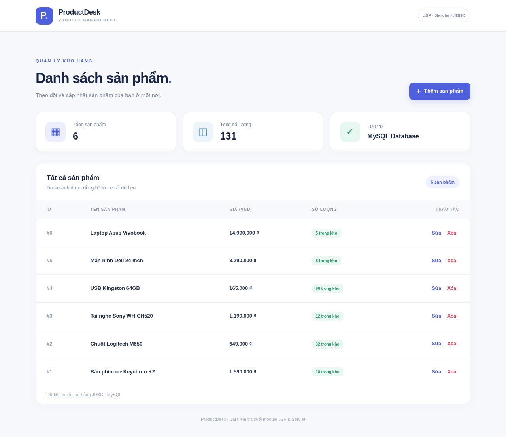

# ProductDesk — Bài kiểm tra cuối module JSP & Servlet

Dự án **quản lý sản phẩm bằng Java 17, Jakarta Servlet 6, JSP/JSTL, JDBC và MySQL**, triển khai dưới dạng WAR trên **Apache Tomcat 10.1+**.

## Xem trước giao diện



Ảnh tĩnh từ HTML/CSS và dữ liệu mẫu; chưa phải ảnh chạy trên Tomcat. [Xem mobile](../previews/mobile.png).

## Chức năng

| Chức năng | URL | Phương thức |
|---|---|---|
| Danh sách (ID, tên, giá, số lượng) | `/products` | GET |
| Form thêm sản phẩm | `/products?action=create` | GET |
| Lưu sản phẩm mới | `/products` (`action=create`) | POST |
| Form sửa sản phẩm | `/products?action=edit&id=1` | GET |
| Lưu thay đổi | `/products` (`action=update`) | POST |
| Xác nhận xóa | `/products?action=delete&id=1` | GET |
| Xóa sau xác nhận | `/products` (`action=delete`) | POST |

- MVC rõ ràng: Model `Product` → DAO `ProductDAO` → Servlet `ProductServlet` → JSP trong `/WEB-INF/views`.
- JDBC `PreparedStatement`, đóng Connection/Statement/ResultSet bằng try-with-resources.
- Server-side validation: tên không rỗng, giá là DECIMAL(12,2) không âm, số lượng nguyên không âm.
- PRG (Post/Redirect/Get) cho thêm, sửa, xóa; không lặp thao tác khi F5.
- Form xác nhận xóa, session CSRF token, HTML-escape đầu vào khi hiển thị.
- Trang 404 / thông báo lỗi MySQL không để lộ mật khẩu.

## Yêu cầu hệ thống

- JDK **17+**
- Maven **3.8+**
- Apache Tomcat **10.1.x** (Jakarta Servlet API; không dùng Tomcat 9/javax)
- MySQL **8.0+**

## 1. Tạo database

Trong MySQL Workbench mở `database/product_management.sql` và thực thi toàn bộ. Script tạo database `product_management`, bảng `products` (`id`, `name`, `price`, `quantity`) và 6 dòng mẫu khi bảng đang trống.

Hoặc MySQL CLI:

```bash
mysql -u root -p < database/product_management.sql
```

## 2. Kết nối MySQL

Cấu hình JDBC bằng **biến môi trường** để tránh commit mật khẩu vào GitHub:

| Biến | Mặc định |
|---|---|
| `PRODUCT_DB_URL` | `jdbc:mysql://localhost:3306/product_management?useUnicode=true&characterEncoding=UTF-8&serverTimezone=Asia/Ho_Chi_Minh` |
| `PRODUCT_DB_USER` | `root` |
| `PRODUCT_DB_PASSWORD` | rỗng (chỉ tiện cho local) |

Ví dụ **PowerShell** (thay mật khẩu MySQL của bạn):

```powershell
$env:PRODUCT_DB_USER = "root"
$env:PRODUCT_DB_PASSWORD = "MAT_KHAU_MYSQL_CUA_BAN"
$env:PRODUCT_DB_URL = "jdbc:mysql://localhost:3306/product_management?useUnicode=true&characterEncoding=UTF-8&serverTimezone=Asia/Ho_Chi_Minh"
```

**Quan trọng:** Biến môi trường phải nằm trong tiến trình **Tomcat**; nếu bạn chạy Tomcat từ IDE/Services, cấu hình env ở tiến trình Tomcat tương ứng. Đặt biến trước khi chạy `startup.bat` từ cùng cửa sổ PowerShell hoặc cấu hình trong IDE. Đặt env trước Maven không tự truyền cho Tomcat Windows Service.

## 3. Build và chạy

```bash
mvn clean test
mvn clean package
```

Maven tạo `target/product-management.war`. Copy file WAR vào `<TOMCAT_HOME>/webapps/`, sau đó khởi chạy hoặc restart Tomcat 10.1.

- Trang chủ: `http://localhost:8080/product-management/`
- Danh sách: `http://localhost:8080/product-management/products`

### Chu trình kiểm tra thủ công

1. Mở danh sách: xác nhận 6 sản phẩm từ MySQL hiện ra với giá và số lượng.
2. Thêm sản phẩm "Sổ tay" giá 25000 số lượng 8 → thấy bản ghi trong danh sách và MySQL.
3. Nhấn **Sửa**, đổi giá và số lượng → kiểm tra dữ liệu sau lưu.
4. Nhấn **Xóa**, xem form xác nhận và bấm **Hủy bỏ** → sản phẩm vẫn tồn tại.
5. Xóa lại và **Xác nhận xóa** → sản phẩm biến mất.
6. Thử giá âm, số lượng chữ, tiêu đề rỗng → form hiện lỗi, database không nhận bản ghi sai.
7. Mở `/products?action=edit&id=999999` → 404 thân thiện.

```sql
USE product_management;
SELECT id, name, price, quantity FROM products ORDER BY id DESC;
```

## Cấu trúc

```text
product-management/
├── pom.xml
├── database/product_management.sql
├── src/main/java/com/codegym/
│   ├── controller/ProductServlet.java
│   ├── dao/ProductDAO.java
│   ├── model/Product.java
│   ├── service/ProductValidator.java
│   └── util/DatabaseConnection.java
├── src/main/webapp/
│   ├── index.jsp
│   ├── assets/styles.css
│   └── WEB-INF/
│       ├── web.xml
│       └── views/{header.jspf,footer.jspf,list.jsp,form.jsp,delete.jsp,error.jsp}
└── src/test/java/com/codegym/service/ProductValidatorTest.java
```

## Nộp bài

Tệp ZIP gồm mã nguồn, `pom.xml`, file SQL, README và mã kiểm thử. Đổi tên file ZIP thành **`<MA_SO_SINH_VIEN>_FinalExam.zip`** theo đúng quy định của giảng viên.

## Ghi chú thiết kế / tác giả

Mã nguồn được xây dựng cho bài kiểm tra này, không sao chép nguyên project nguồn bên ngoài. Dự án sử dụng các thư viện mã nguồn mở Jakarta Servlet/JSTL, MySQL Connector/J và JUnit được khai báo trong `pom.xml`.

Trong môi trường tạo mã nguồn, phần biên dịch Java và cấu trúc mã được kiểm tra độc lập; **không khẳng định đã chạy Maven/Tomcat/MySQL thật nếu chưa triển khai**.
