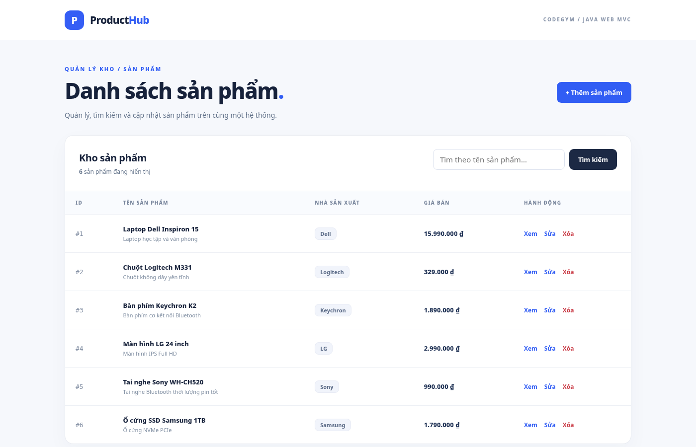

# Product Management MVC — CodeGym

Bài thực hành **quản lý sản phẩm Java Web bằng MVC**, có đầy đủ 6 tính năng: danh sách, thêm mới, sửa, xóa có xác nhận, xem chi tiết và tìm kiếm theo tên.

**Mã nguồn + hướng dẫn đầy đủ:** [product-management/README.md](product-management/README.md)

| Lớp MVC | Mã nguồn |
|---|---|
| Model | [Product.java](product-management/src/main/java/com/codegym/model/Product.java) |
| Service | [ProductService.java](product-management/src/main/java/com/codegym/service/ProductService.java), [ProductServiceImpl.java](product-management/src/main/java/com/codegym/service/ProductServiceImpl.java) |
| Controller | [ProductServlet.java](product-management/src/main/java/com/codegym/controller/ProductServlet.java) |
| View | [list.jsp](product-management/src/main/webapp/WEB-INF/views/products/list.jsp), [create.jsp](product-management/src/main/webapp/WEB-INF/views/products/create.jsp), [edit.jsp](product-management/src/main/webapp/WEB-INF/views/products/edit.jsp), [delete.jsp](product-management/src/main/webapp/WEB-INF/views/products/delete.jsp), [view.jsp](product-management/src/main/webapp/WEB-INF/views/products/view.jsp) |

**Cách chạy:** vào thư mục `product-management`, dùng `mvn clean package`, triển khai `target/product-management.war` lên Tomcat 10.1+ rồi mở `http://localhost:8080/product-management/`.

**Kiểm tra:** Java 17 biên dịch; 18/18 kiểm thử Service và 19/19 kiểm thử Servlet mock đạt; XML hợp lệ; giao diện kiểm tra ở 1400px và 390px, không tràn ngang. Chưa chạy ứng dụng JSP trên Tomcat thật. Dữ liệu nằm trong `Map`, sẽ mất khi khởi động lại ứng dụng.

[Ảnh giao diện mobile](product-management/preview-mobile.png) · [Ảnh form tạo mới](product-management/preview-create.png)
