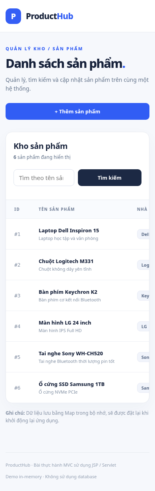

# ProductHub — Product Management MVC

Ứng dụng Java Web quản lý sản phẩm sử dụng **MVC (Model–View–Controller)**, **JSP + JSTL**, **Jakarta Servlet 6.0**, **Java 17**, **Maven WAR** và **Tomcat 10.1+**. Đây là bài thực hành CodeGym, dữ liệu mô phỏng bằng `LinkedHashMap` trong bộ nhớ, không dùng database.


## Chức năng theo đề

| Yêu cầu | Đường dẫn / Xử lý |
|---|---|
| Hiển thị danh sách sản phẩm | `GET /products` |
| Tìm theo tên (không phân biệt hoa/thường) | `GET /products?q=laptop` |
| Tạo sản phẩm | `GET /products?action=create`, `POST /products?action=create` |
| Cập nhật sản phẩm | `GET /products?action=edit&id=1`, `POST /products?action=edit` |
| Xóa sản phẩm có xác nhận | `GET /products?action=delete&id=1`, `POST /products?action=delete` |
| Xem chi tiết | `GET /products?action=view&id=1` |

Thông tin mỗi sản phẩm: `id`, `name` (tên), `price` (giá, kiểu `BigDecimal`), `description` (mô tả), `manufacturer` (nhà sản xuất). Mặc định có 6 sản phẩm mẫu.

## Cách chạy

**Cần:** JDK 17+, Maven 3.8+, Apache Tomcat 10.1+ (không dùng Tomcat 9 vì namespace `javax` khác `jakarta`).

Tại thư mục `product-management` chứa `pom.xml`:

```bash
mvn clean package
```

Triển khai file `target/product-management.war` vào thư mục `webapps` của Tomcat rồi khởi động Tomcat; truy cập:

- http://localhost:8080/product-management/
- http://localhost:8080/product-management/products

Máy chủ cần mạng để Maven tải các dependency ở lần build đầu. Nếu Tomcat dùng cổng khác, thay `8080`.

## Kiến trúc MVC

```text
product-management/
├── pom.xml
├── src/main/java/com/codegym/
│   ├── model/Product.java
│   ├── service/ProductService.java
│   ├── service/ProductServiceImpl.java
│   └── controller/ProductServlet.java
└── src/main/webapp/
    ├── index.jsp
    ├── assets/styles.css
    └── WEB-INF/
        ├── web.xml
        └── views/
            ├── common/header.jspf, footer.jspf
            ├── products/list.jsp, create.jsp, edit.jsp, delete.jsp, view.jsp
            └── error-404.jsp
```

**Model:** [`Product.java`](src/main/java/com/codegym/model/Product.java) lưu thuộc tính và getter/setter. **Service:** [`ProductServiceImpl.java`](src/main/java/com/codegym/service/ProductServiceImpl.java) xử lý CRUD, tạo ID tăng dần và tìm theo tên. **Controller:** [`ProductServlet.java`](src/main/java/com/codegym/controller/ProductServlet.java) xử lý GET/POST, kiểm tra input và forward tới JSP. **View:** JSP trong `WEB-INF/views/products/` render bằng EL + JSTL (URI `jakarta.tags.core`, `jakarta.tags.fmt`, `jakarta.tags.functions`).

> **Lưu ý:** dữ liệu trong Map chỉ tồn tại trong quá trình chạy server và reset khi ứng dụng nạp lại. Đây là bài demo không có đăng nhập, phân quyền, persistence hay bảo vệ CSRF; không dùng trực tiếp trên production.

## Kiểm tra thủ công

1. Vào `/products`, xác nhận có 6 sản phẩm và giá định dạng VNĐ.
2. Tìm `sony` / `SONY` để thấy sản phẩm của Sony; nhập từ không có để thấy trạng thái rỗng.
3. Thêm sản phẩm (ví dụ `Bàn phím demo`, `250000`, `Học tập`, `Demo`), kiểm tra trang chi tiết và danh sách.
4. Sửa tên, giá và nhà sản xuất; kiểm tra thông tin đã thay đổi.
5. Xóa sản phẩm vừa tạo bằng nút **Xác nhận xóa**, kiểm tra nó biến mất khỏi danh sách.
6. Thử giá âm, ký tự không phải số và URL có `id=999999` để xác nhận thông báo lỗi/404.

## Những cải tiến so với code thực hành cơ bản

- `BigDecimal` thay `float` để tránh sai số tiền tệ; kiểm tra dữ liệu tại servlet, không chỉ dựa vào HTML `required`.
- `LinkedHashMap` với `synchronized` và `AtomicInteger` để tránh mất dữ liệu/cấp trùng ID khi có truy cập đồng thời ở demo.
- POST/Redirect/GET sau các thao tác ghi để F5 không vô tình gửi lại biểu mẫu.
- `<c:out>` và `fn:escapeXml` để render chuỗi nhập an toàn.
- Xóa bằng **POST** sau trang xác nhận, không thực hiện xóa khi bấm liên kết GET.
- Giao diện CSS responsive và tách riêng file CSS.

## Kết quả kiểm tra

Các lớp Java được kiểm tra cú pháp bằng JDK 17, Service đạt **18/18** kiểm thử logic và Servlet đạt **19/19** kiểm thử với Jakarta API mock (không phải Tomcat thật). Chưa chứng nhận đã chạy Maven/Tomcat thật trong môi trường tạo bài (Maven không được cài sẵn). Cần chạy `mvn clean package` và thử ứng dụng trên máy của bạn.


