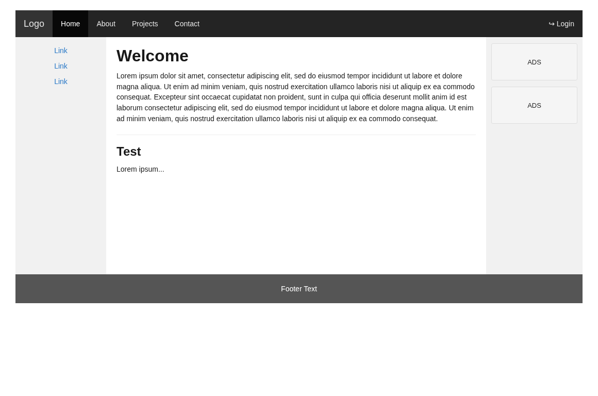
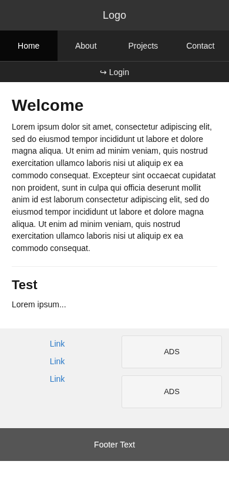

# Responsive DIV & CSS Layout — CodeGym

Bài thực hành **dùng DIV và CSS để tạo bố cục trang web responsive** theo ảnh tham khảo của CodeGym.

## Chức năng / bố cục

- **Thanh menu trên cùng:** Logo, Home, About, Projects, Contact, Login.
- **Sidebar trái:** 3 liên kết mẫu.
- **Nội dung chính:** phần `Welcome` và `Test` với văn bản như ảnh minh họa.
- **Sidebar phải:** hai hộp `ADS`.
- **Footer:** hiển thị `Footer Text`.
- **Responsive:** 3 cột trên màn hình rộng; dưới `620px` ưu tiên nội dung lên trên và đặt hai sidebar phía dưới. Không cần JavaScript hay thư viện ngoài.

## Cách chạy

Mở **`index.html`** bằng trình duyệt (Chrome, Edge, Firefox). Giữ **`styles.css`** trong cùng thư mục để trang tải đúng định dạng. Dùng công cụ Developer Tools (F12 → Toggle Device Toolbar) để xem giao diện ở nhiều kích thước.

## Kỹ thuật sử dụng

Bố cục tạo bằng `div` với CSS **Grid** (3 cột), **Flexbox** (menu và footer), `background-color`, `padding`, `margin`, `min-width`, `border`, `@media` và `box-sizing`. Các link trong trang là anchor nội bộ của bản demo, không phải chức năng đăng nhập thật.

## Ảnh xem trước





## Mã nguồn đầy đủ để tham khảo / chấm bài

### index.html

```html
<!DOCTYPE html>
<html lang="vi">
<head>
    <meta charset="UTF-8">
    <meta name="viewport" content="width=device-width, initial-scale=1.0">
    <title>Responsive Layout - Thực hành DIV và CSS</title>
    <link rel="stylesheet" href="styles.css">
</head>
<body>
    <div class="page" id="top">
        <!-- Thanh điều hướng trên cùng, tạo bằng DIV và CSS. -->
        <div class="navbar">
            <div class="nav-links">
                <a class="logo" href="#top">Logo</a>
                <a class="nav-link active" href="#welcome" aria-current="page">Home</a>
                <a class="nav-link" href="#welcome">About</a>
                <a class="nav-link" href="#test">Projects</a>
                <a class="nav-link" href="#footer">Contact</a>
            </div>
            <a class="login" href="#footer" title="Bản minh họa bố cục, chưa có đăng nhập">↪ Login</a>
        </div>

        <!-- Bố cục ba cột: sidebar - nội dung - quảng cáo. -->
        <div class="layout">
            <div class="sidebar-left" aria-label="Liên kết bên trái">
                <a href="#welcome">Link</a>
                <a href="#test">Link</a>
                <a href="#footer">Link</a>
            </div>

            <div class="main-content">
                <div class="content-block" id="welcome">
                    <h1>Welcome</h1>
                    <p>Lorem ipsum dolor sit amet, consectetur adipiscing elit, sed do eiusmod tempor incididunt ut labore et dolore magna aliqua. Ut enim ad minim veniam, quis nostrud exercitation ullamco laboris nisi ut aliquip ex ea commodo consequat. Excepteur sint occaecat cupidatat non proident, sunt in culpa qui officia deserunt mollit anim id est laborum consectetur adipiscing elit, sed do eiusmod tempor incididunt ut labore et dolore magna aliqua. Ut enim ad minim veniam, quis nostrud exercitation ullamco laboris nisi ut aliquip ex ea commodo consequat.</p>
                </div>

                <div class="content-block" id="test">
                    <h2>Test</h2>
                    <p>Lorem ipsum...</p>
                </div>
            </div>

            <div class="sidebar-right" aria-label="Quảng cáo mẫu">
                <div class="ad">ADS</div>
                <div class="ad">ADS</div>
            </div>
        </div>

        <div class="footer" id="footer">Footer Text</div>
    </div>
</body>
</html>
```

### styles.css

```css
/* BÀI THỰC HÀNH: TẠO BỐ CỤC RESPONSIVE BẰNG DIV VÀ CSS */
/* Box sizing giúp các phần tử không bị tràn khi có border và padding. */
* { box-sizing: border-box; }
html { scroll-behavior: smooth; }
body {
    margin: 0;
    font-family: Arial, Helvetica, sans-serif;
    color: #181818;
    background: #ffffff;
}
.page {
    width: min(1100px, calc(100% - 32px));
    margin: 20px auto;
}

/* 1. Thanh menu ngang. */
.navbar {
    min-height: 52px;
    background-color: #242424;
    color: #eeeeee;
    display: flex;
    align-items: stretch;
    justify-content: space-between;
}
.nav-links { display: flex; align-items: stretch; flex-wrap: wrap; }
.navbar a {
    display: inline-flex;
    align-items: center;
    min-height: 52px;
    padding: 0 16px;
    color: #e5e5e5;
    text-decoration: none;
    font-size: 14px;
}
.navbar .logo { background-color: #333; font-size: 18px; }
.navbar a.active { background-color: #080808; color: white; }
.navbar a:hover, .navbar a:focus-visible { background-color: #111; color: #fff; }
.navbar .login { margin-left: auto; }

/* 2. Bố cục 3 cột của mẫu: 16% - nội dung chính - 17%. */
.layout {
    display: grid;
    grid-template-columns: 16% minmax(0, 1fr) 17%;
    grid-template-areas: 'links main ads';
    min-height: 460px;
}
.sidebar-left, .sidebar-right { background-color: #f1f1f1; }
.sidebar-left {
    grid-area: links;
    padding: 18px 12px;
    text-align: center;
}
.sidebar-left a {
    display: block;
    margin: 0 0 14px;
    color: #2878c7;
    text-decoration: none;
    font-size: 14px;
}
.sidebar-left a:hover, .sidebar-left a:focus-visible { color: #125191; text-decoration: underline; }

.main-content {
    grid-area: main;
    min-width: 0;
    padding: 18px 20px;
    background: #fff;
}
.content-block + .content-block {
    border-top: 1px solid #ededed;
    padding-top: 18px;
    margin-top: 20px;
}
.main-content h1, .main-content h2 { margin: 0 0 10px; font-weight: 600; }
.main-content h1 { font-size: 32px; }
.main-content h2 { font-size: 24px; }
.main-content p { font-size: 14px; line-height: 1.48; margin: 0; }

.sidebar-right { grid-area: ads; padding: 12px 10px; }
.ad {
    min-height: 72px;
    margin: 0 0 12px;
    border: 1px solid #dedede;
    border-radius: 3px;
    display: flex;
    align-items: center;
    justify-content: center;
    color: #222;
    font-size: 13px;
    background-color: #f5f5f5;
}

/* 3. Chân trang. */
.footer {
    min-height: 56px;
    display: flex;
    align-items: center;
    justify-content: center;
    background: #555555;
    color: white;
    font-size: 14px;
}

/* 4. Responsive tablet: các sidebar vẫn ở hai bên và nhỏ lại. */
@media (max-width: 800px) {
    .layout { grid-template-columns: 20% minmax(0, 1fr) 19%; }
    .main-content { padding: 18px 16px; }
    .navbar a { padding: 0 12px; }
}

/* 5. Responsive mobile: ưu tiên nội dung chính, sau đó tới sidebar. */
@media (max-width: 620px) {
    .page { width: 100%; margin: 0; }
    .navbar { flex-wrap: wrap; }
    .nav-links { width: 100%; }
    .navbar .logo { flex: 1 0 100%; justify-content: center; }
    .navbar .nav-link { flex: 1; justify-content: center; padding: 0 6px; }
    .navbar .login { min-height: 36px; width: 100%; justify-content: center; border-top: 1px solid #414141; }
    .layout {
        grid-template-columns: 1fr 1fr;
        grid-template-areas: 'main main' 'links ads';
        min-height: 0;
    }
    .main-content { padding: 24px 20px 30px; }
    .sidebar-left, .sidebar-right { min-height: 170px; }
    .sidebar-right { padding: 12px; }
    .ad { min-height: 56px; }
    .main-content h1 { font-size: 28px; }
    .main-content h2 { font-size: 22px; }
}
@media (max-width: 350px) {
    .navbar a { font-size: 12px; }
    .navbar .logo { font-size: 17px; }
}
```
