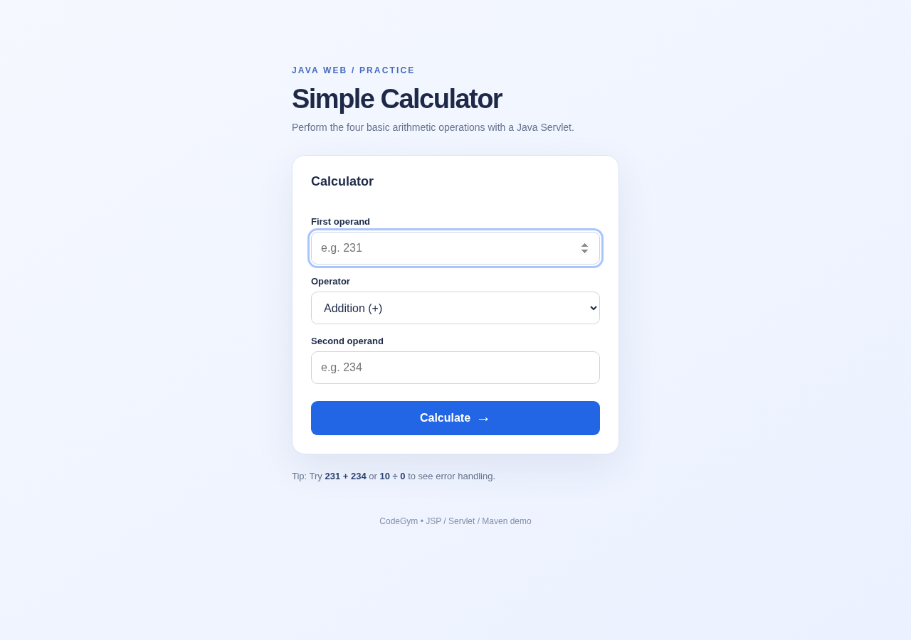

# Simple Calculator — JSP & Servlet (CodeGym)

Bài thực hành Java Web gồm **Cộng, Trừ, Nhân, Chia**, sử dụng `index.jsp` (form), lớp `Calculator.calculate()` (xử lý phép tính), `CalculatorServlet` (nhận POST/try-catch) và `result.jsp` (hiển thị).



[Xem bản mobile](preview-mobile.png)

> Ảnh preview chỉ là kiểm tra HTML/CSS, không thay thế cho kiểm thử trên Tomcat.

## Yêu cầu đáp ứng

| Đề bài | Vị trí |
|---|---|
| Form nhập 2 toán hạng và chọn 4 phép toán | `src/main/webapp/index.jsp` |
| `Calculator.calculate()` | `src/main/java/com/codegym/model/Calculator.java` |
| Chia cho 0 ném Exception | `ArithmeticException` trong `Calculator` |
| `CalculatorServlet` nhận và tính toán | `src/main/java/com/codegym/servlet/CalculatorServlet.java` |
| `try/catch` hiển thị lỗi | Servlet đặt `error`, JSP trình bày thông báo |
| Giao diện kết quả | `src/main/webapp/WEB-INF/views/result.jsp` |
| Hỗ trợ Tomcat 10.1+ | Java 17, Jakarta Servlet 6.0, Maven WAR |

## Chạy bằng Maven + Tomcat 10.1+

Cần JDK 17 trở lên, Maven 3.8+ và Tomcat 10.1+. Trong thư mục `jsp-servlet-calculator` chạy:

```bash
mvn clean package
```

Sau khi **BUILD SUCCESS**, chép `target/jsp-servlet-calculator.war` vào `webapps/` của Tomcat, khởi động server rồi truy cập `http://localhost:8080/jsp-servlet-calculator/`. Nếu Tomcat dùng cổng khác thì thay 8080.

Thử `231 + 234 = 465`, `12 - 20 = -8`, `6 * 7 = 42`, `22 / 2 = 11`, và `10 / 0` nhận thông báo **Không thể chia cho 0.**. Trường số chấp nhận số thập phân. `doGet()` đến `/calculate` chuyển lại form; endpoint chính dùng `POST`.

## Kiến trúc và giải thích

`index.jsp` POST ba tham số `first-operand`, `operator`, `second-operand` tới `${pageContext.request.contextPath}/calculate`; Servlet ép kiểu thành `double`, gọi `Calculator.calculate()`, dùng try/catch để báo lỗi và forward đến `/WEB-INF/views/result.jsp`. JSP kết quả đọc dữ liệu qua Expression Language. URL dùng context path nên không bị lỗi khi triển khai dưới tên WAR.

Dùng `jakarta.servlet` (không phải `javax.servlet`) để tương thích Tomcat 10.1+. `web.xml` thiết lập `index.jsp` là trang mặc định. `style.css` đặt tại `assets/` và không phụ thuộc thư viện CDN. Đây là bài tập học tập, không dùng cơ sở dữ liệu.

## Bản sao mã nguồn để giảng viên/AI chấm được từ một trang README

### `pom.xml`

```xml
<?xml version="1.0" encoding="UTF-8"?>
<project xmlns="http://maven.apache.org/POM/4.0.0"
         xmlns:xsi="http://www.w3.org/2001/XMLSchema-instance"
         xsi:schemaLocation="http://maven.apache.org/POM/4.0.0 https://maven.apache.org/xsd/maven-4.0.0.xsd">
    <modelVersion>4.0.0</modelVersion>
    <groupId>com.codegym</groupId>
    <artifactId>jsp-servlet-calculator</artifactId>
    <version>1.0-SNAPSHOT</version>
    <packaging>war</packaging>
    <name>Simple Calculator - JSP and Servlet</name>

    <properties>
        <maven.compiler.release>17</maven.compiler.release>
        <project.build.sourceEncoding>UTF-8</project.build.sourceEncoding>
    </properties>

    <dependencies>
        <!-- Tomcat 10.1 supplies Servlet and JSP APIs at runtime. -->
        <dependency>
            <groupId>jakarta.servlet</groupId>
            <artifactId>jakarta.servlet-api</artifactId>
            <version>6.0.0</version>
            <scope>provided</scope>
        </dependency>
        <dependency>
            <groupId>jakarta.servlet.jsp</groupId>
            <artifactId>jakarta.servlet.jsp-api</artifactId>
            <version>3.1.1</version>
            <scope>provided</scope>
        </dependency>
    </dependencies>

    <build>
        <finalName>jsp-servlet-calculator</finalName>
        <plugins>
            <plugin>
                <groupId>org.apache.maven.plugins</groupId>
                <artifactId>maven-compiler-plugin</artifactId>
                <version>3.13.0</version>
            </plugin>
            <plugin>
                <groupId>org.apache.maven.plugins</groupId>
                <artifactId>maven-war-plugin</artifactId>
                <version>3.4.0</version>
            </plugin>
        </plugins>
    </build>
</project>
```

### `src/main/java/com/codegym/model/Calculator.java`

```java
package com.codegym.model;

/** The four elementary operations for the Servlet calculator. */
public final class Calculator {
    private Calculator() {
        // Utility class - no instances needed.
    }

    /**
     * Calculates firstOperand (operator) secondOperand.
     *
     * @throws ArithmeticException if dividing by zero or the answer overflows
     * @throws IllegalArgumentException if inputs or the operator are invalid
     */
    public static double calculate(double firstOperand, double secondOperand, char operator) {
        if (!Double.isFinite(firstOperand) || !Double.isFinite(secondOperand)) {
            throw new IllegalArgumentException("Hai toán hạng phải là số hữu hạn.");
        }

        double result;
        switch (operator) {
            case '+':
                result = firstOperand + secondOperand;
                break;
            case '-':
                result = firstOperand - secondOperand;
                break;
            case '*':
                result = firstOperand * secondOperand;
                break;
            case '/':
                if (secondOperand == 0.0) {
                    throw new ArithmeticException("Không thể chia cho 0.");
                }
                result = firstOperand / secondOperand;
                break;
            default:
                throw new IllegalArgumentException("Phép toán không hợp lệ.");
        }

        if (!Double.isFinite(result)) {
            throw new ArithmeticException("Kết quả vượt quá giới hạn hỗ trợ.");
        }
        return result;
    }
}
```

### `src/main/java/com/codegym/servlet/CalculatorServlet.java`

```java
package com.codegym.servlet;

import com.codegym.model.Calculator;
import jakarta.servlet.ServletException;
import jakarta.servlet.annotation.WebServlet;
import jakarta.servlet.http.HttpServlet;
import jakarta.servlet.http.HttpServletRequest;
import jakarta.servlet.http.HttpServletResponse;
import java.io.IOException;

@WebServlet(name = "CalculatorServlet", urlPatterns = "/calculate")
public class CalculatorServlet extends HttpServlet {

    @Override
    protected void doPost(HttpServletRequest request, HttpServletResponse response)
            throws ServletException, IOException {
        request.setCharacterEncoding("UTF-8");
        response.setCharacterEncoding("UTF-8");

        try {
            String firstText = request.getParameter("first-operand");
            String secondText = request.getParameter("second-operand");
            String operatorText = request.getParameter("operator");
            if (firstText == null || secondText == null || operatorText == null
                    || firstText.isBlank() || secondText.isBlank()
                    || operatorText.length() != 1) {
                throw new IllegalArgumentException("Vui lòng nhập đủ hai toán hạng và phép toán.");
            }

            double firstOperand = Double.parseDouble(firstText.trim());
            double secondOperand = Double.parseDouble(secondText.trim());
            char operator = operatorText.charAt(0);
            double result = Calculator.calculate(firstOperand, secondOperand, operator);

            request.setAttribute("firstOperand", firstOperand);
            request.setAttribute("secondOperand", secondOperand);
            request.setAttribute("operator", Character.toString(operator));
            request.setAttribute("result", result);
        } catch (NumberFormatException exception) {
            request.setAttribute("error", "Vui lòng nhập hai số hợp lệ.");
        } catch (ArithmeticException | IllegalArgumentException exception) {
            request.setAttribute("error", exception.getMessage());
        }

        request.getRequestDispatcher("/WEB-INF/views/result.jsp")
                .forward(request, response);
    }

    @Override
    protected void doGet(HttpServletRequest request, HttpServletResponse response)
            throws IOException {
        response.sendRedirect(request.getContextPath() + "/");
    }
}
```

### `src/main/webapp/index.jsp`

```jsp
<%@ page contentType="text/html; charset=UTF-8" pageEncoding="UTF-8" %>
<!doctype html>
<html lang="en">
<head>
    <meta charset="UTF-8">
    <meta name="viewport" content="width=device-width, initial-scale=1.0">
    <meta name="description" content="Simple Calculator using Java JSP and Servlet.">
    <title>Simple Calculator | JSP &amp; Servlet</title>
    <link rel="stylesheet" href="${pageContext.request.contextPath}/assets/style.css">
</head>
<body>
<main class="container">
    <p class="eyebrow">JAVA WEB / PRACTICE</p>
    <h1>Simple Calculator</h1>
    <p class="lead">Perform the four basic arithmetic operations with a Java Servlet.</p>

    <form class="calculator-card" action="${pageContext.request.contextPath}/calculate" method="post">
        <fieldset>
            <legend>Calculator</legend>
            <label for="first-operand">First operand</label>
            <input id="first-operand" name="first-operand" type="number" step="any"
                   placeholder="e.g. 231" required autofocus>

            <label for="operator">Operator</label>
            <select id="operator" name="operator" required>
                <option value="+">Addition (+)</option>
                <option value="-">Subtraction (-)</option>
                <option value="*">Multiplication (×)</option>
                <option value="/">Division (÷)</option>
            </select>

            <label for="second-operand">Second operand</label>
            <input id="second-operand" name="second-operand" type="number" step="any"
                   placeholder="e.g. 234" required>

            <button type="submit">Calculate <span aria-hidden="true">→</span></button>
        </fieldset>
    </form>

    <p class="note">Tip: Try <strong>231 + 234</strong> or <strong>10 ÷ 0</strong> to see error handling.</p>
    <footer>CodeGym • JSP / Servlet / Maven demo</footer>
</main>
</body>
</html>
```

### `src/main/webapp/WEB-INF/views/result.jsp`

```jsp
<%@ page contentType="text/html; charset=UTF-8" pageEncoding="UTF-8" %>
<!doctype html>
<html lang="en">
<head>
    <meta charset="UTF-8">
    <meta name="viewport" content="width=device-width, initial-scale=1.0">
    <title>Result | Simple Calculator</title>
    <link rel="stylesheet" href="${pageContext.request.contextPath}/assets/style.css">
</head>
<body>
<main class="container">
    <p class="eyebrow">JAVA WEB / PRACTICE</p>
    <h1>Result</h1>
    <% if (request.getAttribute("error") != null) { %>
    <section class="result-card error" role="alert">
        <span class="result-label">Calculation error</span>
        <p class="error-message">${error}</p>
    </section>
    <% } else { %>
    <section class="result-card" aria-label="Calculation result">
        <span class="result-label">YOUR CALCULATION</span>
        <p class="calculation">${firstOperand} ${operator} ${secondOperand} =</p>
        <p class="answer">${result}</p>
    </section>
    <% } %>
    <a class="back-link" href="${pageContext.request.contextPath}/">← Back to calculator</a>
    <footer>CodeGym • JSP / Servlet / Maven demo</footer>
</main>
</body>
</html>
```

### `src/main/webapp/WEB-INF/web.xml`

```xml
<?xml version="1.0" encoding="UTF-8"?>
<web-app xmlns="https://jakarta.ee/xml/ns/jakartaee"
         xmlns:xsi="http://www.w3.org/2001/XMLSchema-instance"
         xsi:schemaLocation="https://jakarta.ee/xml/ns/jakartaee https://jakarta.ee/xml/ns/jakartaee/web-app_6_0.xsd"
         version="6.0">
    <display-name>JSP Servlet Simple Calculator</display-name>
    <welcome-file-list>
        <welcome-file>index.jsp</welcome-file>
    </welcome-file-list>
</web-app>
```

### `src/main/webapp/assets/style.css`

```css
:root { color-scheme: light; }
* { box-sizing: border-box; }
body {
    margin: 0;
    min-height: 100vh;
    font-family: Arial, Helvetica, sans-serif;
    color: #1d2947;
    background: linear-gradient(145deg,#f5f8ff,#ebf1ff);
    display: flex;
    justify-content: center;
    align-items: flex-start;
    padding: clamp(32px,7vw,80px) 16px;
}
.container { width: min(100%,460px); }
.eyebrow { color:#486cbe; font-size: 12px; font-weight: 700; letter-spacing: .18em; }
h1 { margin: 10px 0 7px; font-size: clamp(30px,6vw,38px); letter-spacing:-.04em; }
.lead { color:#64728c; line-height:1.6; font-size:14px; margin:0 0 28px; }
.calculator-card,.result-card {
    background:#fff;
    border:1px solid #dce4f4;
    border-radius:18px;
    padding:26px;
    box-shadow: 0 18px 54px rgba(46,66,110,.09);
}
fieldset { border:0; padding:0; margin:0; min-width:0; }
legend { font-size:18px; font-weight:700; margin-bottom:22px; padding:0; }
label { display:block; margin:16px 0 7px; font-size:13px; font-weight:700; }
input,select {
    width:100%; height:46px; padding:0 13px; border:1px solid #cbd5e5;
    border-radius:9px; background:#fff; color:#1d2947; font:inherit;
}
input:focus-visible,select:focus-visible,button:focus-visible,.back-link:focus-visible {
    outline:3px solid #a9c4ff; outline-offset:2px;
}
button {
    margin-top:24px; width:100%; height:48px; border:0; border-radius:9px;
    background:#2266e6; color:#fff; font:inherit; font-weight:700;
    cursor:pointer; display:flex; align-items:center; justify-content:center; gap:8px;
}
button:hover { background:#1554c8; }
button span { font-size:21px; }
.note { margin:20px 0 0; color:#64728c; font-size:13px; line-height:1.65; }
.note strong { color:#2a416f; }
footer { margin-top:45px; text-align:center; font-size:12px; color:#8290ab; }
.result-label { color:#5378bd; font-size:11px; font-weight:700; letter-spacing:.18em; }
.calculation { font-size:18px; color:#62728b; margin:18px 0 4px; overflow-wrap:anywhere; }
.answer { font-size:38px; font-weight:700; letter-spacing:-.03em; margin:5px 0 0; overflow-wrap:anywhere; }
.result-card.error { border-color:#f4c9cf; background:#fffafa; }
.error .result-label { color:#b91c1c; }
.error-message { font-size:19px; line-height:1.5; font-weight:700; color:#a71f32; }
.back-link { display:inline-block; margin-top:24px; color:#1554c8; font-weight:700; text-decoration:none; }
.back-link:hover { text-decoration:underline; }
@media (max-width:380px) { .calculator-card,.result-card { padding:20px; } }
```
