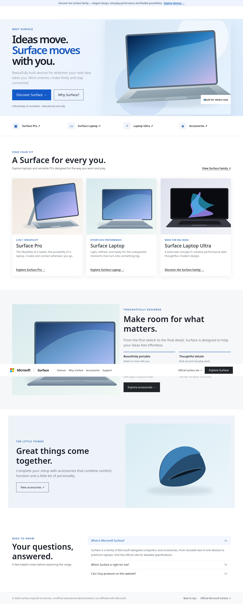
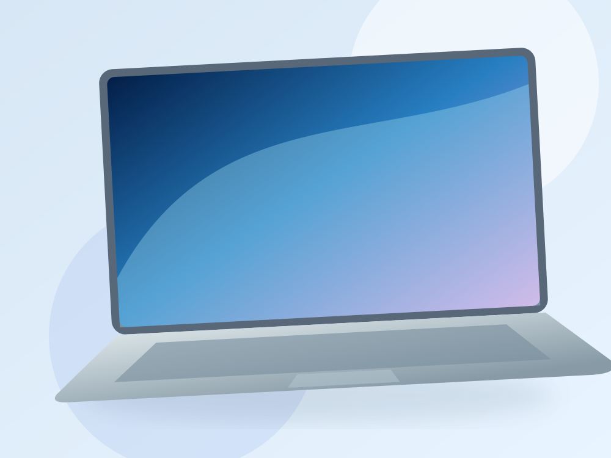
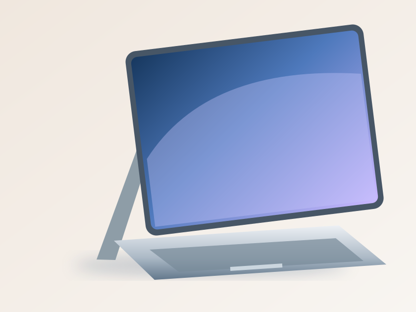
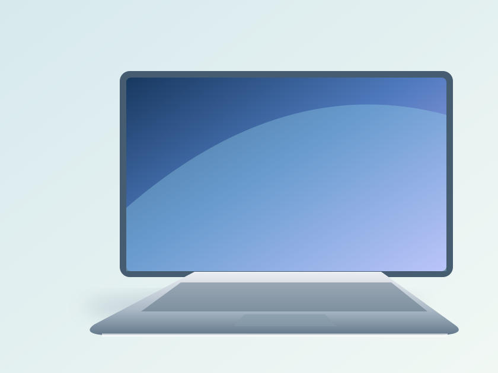
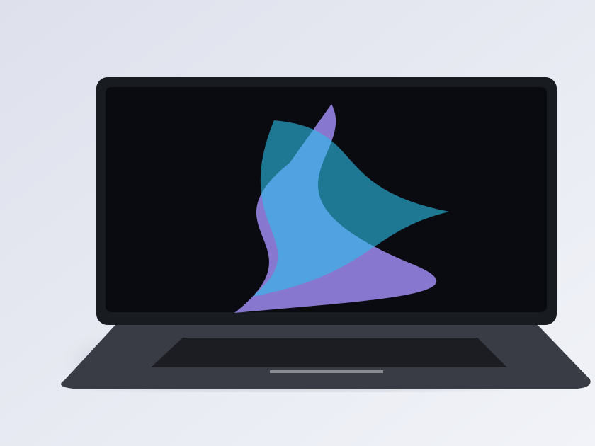
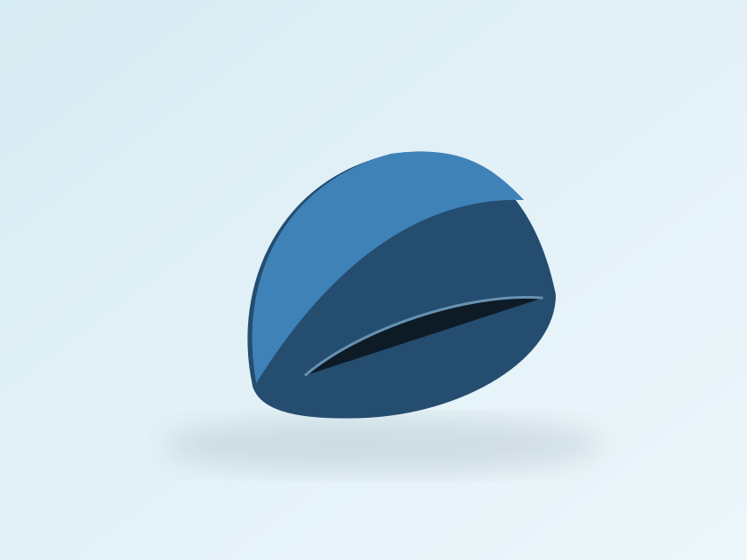

# Surface Landing Page — Bootstrap 5

> **Bài thực hành CodeGym.** Đây là bản dựng giao diện lấy cảm hứng từ trang [Microsoft Surface](https://www.microsoft.com/en-us/surface), **không phải** website hay cửa hàng Microsoft chính thức.



## Mục tiêu

Sử dụng càng nhiều thành phần Bootstrap càng tốt để dựng một landing page giới thiệu Surface, hạn chế CSS viết thêm.

| Thành phần Bootstrap | Vị trí dùng |
|---|---|
| `navbar navbar-expand-lg`, `navbar-toggler`, `collapse` | Thanh điều hướng trên desktop và mobile |
| `container-xl`, `row`, `col-lg-*`, `row-cols-*`, `g-4` | Hero, nhóm sản phẩm, tính năng, footer |
| `btn`, `btn-primary`, `btn-outline-dark`, `btn-dark` | Nút hành động |
| `card`, `card-body`, `card-img-top`, `stretched-link` | Thẻ sản phẩm |
| `accordion`, `accordion-item`, `accordion-button` | FAQ |
| Utility classes: `py-5`, `fw-semibold`, `d-flex`, `gap-3`, `text-secondary`, `rounded-0` | Hầu hết căn chỉnh giao diện |

**Responsive:** Hero 2 cột trên desktop → xếp dọc trên mobile; sản phẩm 3 → 2 → 1 cột theo độ rộng. Header có menu thu gọn trên mobile. Tất cả nút điều hướng, menu và FAQ đều có tương tác thật.

## Hình ảnh & nguồn tham khảo

- Ảnh sản phẩm gốc được tham chiếu bằng URL trên [trang Surface chính thức](https://www.microsoft.com/en-us/surface) và nạp **khi có Internet**. Các URL nằm trong `data-official` của `index.html`.
- Do file ZIP offline CodeGym không truy cập được trong lúc chuẩn bị, dự án kèm **SVG minh họa tự dựng** tại `assets/` làm ảnh dự phòng để chạy offline. Đây không phải ảnh chính thức của sản phẩm.
- Không sao chép nguyên trang nguồn, không cung cấp chức năng đặt hàng/đăng nhập giả. Các nút dẫn tới trang Microsoft thật khi cần.

## Chạy thử

Giải nén và mở `index.html` trong Chrome/Edge hoặc bật Live Server trong VS Code. Bootstrap CSS 5.3.6 đã có trong `vendor/bootstrap.min.css`, nên bố cục không phụ thuộc CDN. Thu nhỏ màn hình lần lượt 1440px, 768px và 375px. Thử nút menu trên mobile và mở các mục FAQ.

## Cấu trúc

```text
Surface_Bootstrap_Landing/
├── index.html
├── style.css
├── app.js
├── vendor/bootstrap.min.css
├── assets/
│   ├── hero-fallback.svg
│   ├── pro-fallback.svg
│   ├── laptop-fallback.svg
│   ├── ultra-fallback.svg
│   └── mouse-fallback.svg
├── preview-desktop.png
├── preview-mobile.png
└── README.md
```

## Tự đánh giá

**Navbar:** Dùng Bootstrap `navbar` và `flex`, tránh kích thước cột cố định. **Hero:** Dùng lưới Bootstrap 12 cột. **Thẻ sản phẩm:** Dùng `card` + `stretched-link`. **FAQ:** Dùng cấu trúc accordion Bootstrap; JavaScript nhỏ để đóng/mở khi chạy offline. CSS thêm vào chỉ để tùy biến tinh tế về màu, hình ảnh, đổ bóng và khoảng cách đặc thù của Surface.

## Mã nguồn đầy đủ để xem từ một liên kết GitHub

<details>
<summary>index.html</summary>

```html
<!doctype html>
<html lang="en">
<head>
  <meta charset="utf-8">
  <meta name="viewport" content="width=device-width, initial-scale=1">
  <meta name="description" content="Bootstrap learning project recreating a Surface-style landing page. Unofficial educational demonstration.">
  <title>Explore Surface | Bootstrap landing page practice</title>
  <link rel="stylesheet" href="vendor/bootstrap.min.css">
  <link rel="stylesheet" href="style.css">
</head>
<body>
  <!-- This is an independent educational UI exercise, not Microsoft's online store. -->
  <a href="#content" class="visually-hidden-focusable position-absolute top-0 start-0 bg-white p-2 z-3">Skip to main content</a>
  <div class="announcement text-center py-2 px-3 small">
    Discover the Surface family — elegant design, everyday performance and flexible possibilities.
    <a class="fw-semibold ms-1" href="#discover">Explore devices <span aria-hidden="true">→</span></a>
  </div>
  <header class="site-header sticky-top border-bottom bg-white">
    <nav class="navbar navbar-expand-lg container-xl py-3" aria-label="Primary navigation">
      <a class="navbar-brand d-flex align-items-center gap-3 me-lg-5" href="#home" aria-label="Microsoft Surface practice landing page">
        <span class="ms-mark" aria-hidden="true"><i></i><i></i><i></i><i></i></span><span class="ms-word">Microsoft</span><span class="brand-divider" aria-hidden="true"></span><span class="surface-word">Surface</span>
      </a>
      <button class="navbar-toggler border-0 shadow-none" type="button" id="menuToggle" aria-expanded="false" aria-controls="mainNav" aria-label="Open navigation menu"><span class="navbar-toggler-icon"></span></button>
      <div class="collapse navbar-collapse" id="mainNav">
        <ul class="navbar-nav me-auto gap-lg-3 align-items-lg-center">
          <li class="nav-item"><a class="nav-link" href="#discover">Devices</a></li>
          <li class="nav-item"><a class="nav-link" href="#features">Why Surface</a></li>
          <li class="nav-item"><a class="nav-link" href="#accessories">Accessories</a></li>
          <li class="nav-item"><a class="nav-link" href="#questions">Support</a></li>
        </ul>
        <div class="d-flex flex-wrap align-items-center gap-3 my-2 my-lg-0">
          <a class="small text-dark text-decoration-none" href="https://www.microsoft.com/en-us/surface" target="_blank" rel="noopener noreferrer">Official Surface site ↗</a>
          <a href="#discover" class="btn btn-dark rounded-0 px-4 py-2">Explore Surface</a>
        </div>
      </div>
    </nav>
  </header>

  <main id="content">
    <!-- Hero: Bootstrap row/columns, buttons and badges. -->
    <section class="hero-section overflow-hidden" id="home" aria-labelledby="heroTitle">
      <div class="container-xl">
        <div class="row align-items-center gy-5 py-5 py-lg-0 hero-layout">
          <div class="col-lg-5 col-xl-5 order-2 order-lg-1 py-lg-5">
            <span class="eyebrow text-uppercase fw-semibold small">Meet Surface</span>
            <h1 class="display-3 lh-1 fw-semibold mt-3 mb-4" id="heroTitle">Ideas move.<br><span class="text-accent">Surface moves</span><br>with you.</h1>
            <p class="lead text-secondary mb-4 pe-lg-3">Beautifully built devices for wherever your next idea takes you. Work smarter, create freely and stay connected.</p>
            <div class="d-flex flex-wrap gap-3">
              <a href="#discover" class="btn btn-primary btn-lg rounded-0 px-4 py-3">Discover Surface <span aria-hidden="true">→</span></a>
              <a href="#features" class="btn btn-outline-dark btn-lg rounded-0 px-4 py-3">Why Surface?</a>
            </div>
            <p class="small text-muted mt-4 mb-0">A Bootstrap UI recreation · Educational use only</p>
          </div>
          <div class="col-lg-7 col-xl-7 order-1 order-lg-2">
            <div class="hero-visual position-relative">
              <div class="hero-orbit" aria-hidden="true"></div>
              
              <div class="hero-label shadow-sm p-3 bg-white d-none d-md-block"><span class="tiny-dot" aria-hidden="true"></span><span class="fw-semibold small">Built for what’s next</span></div>
            </div>
          </div>
        </div>
      </div>
    </section>

    <section class="py-4 border-bottom bg-white" aria-label="Product shortcuts">
      <div class="container-xl">
        <div class="row row-cols-2 row-cols-md-4 g-3 g-md-4">
          <div class="col"><a href="#surface-pro" class="shortcut d-flex align-items-center gap-3 text-decoration-none text-dark"><span class="shortcut-icon" aria-hidden="true">▣</span><span class="fw-semibold">Surface Pro <span class="visually-hidden">section</span>↗</span></a></div>
          <div class="col"><a href="#surface-laptop" class="shortcut d-flex align-items-center gap-3 text-decoration-none text-dark"><span class="shortcut-icon" aria-hidden="true">▭</span><span class="fw-semibold">Surface Laptop ↗</span></a></div>
          <div class="col"><a href="#surface-ultra" class="shortcut d-flex align-items-center gap-3 text-decoration-none text-dark"><span class="shortcut-icon" aria-hidden="true">✧</span><span class="fw-semibold">Laptop Ultra ↗</span></a></div>
          <div class="col"><a href="#accessories" class="shortcut d-flex align-items-center gap-3 text-decoration-none text-dark"><span class="shortcut-icon" aria-hidden="true">◈</span><span class="fw-semibold">Accessories ↗</span></a></div>
        </div>
      </div>
    </section>

    <section class="py-5 py-lg-6" id="discover" aria-labelledby="devicesTitle">
      <div class="container-xl">
        <div class="d-flex flex-column flex-md-row justify-content-between align-items-md-end gap-3 mb-4 mb-lg-5">
          <div><p class="eyebrow text-uppercase fw-semibold small mb-2">Find your fit</p><h2 class="display-5 fw-semibold mb-2" id="devicesTitle">A Surface for every you.</h2><p class="text-muted mb-0">Explore laptops and versatile PCs designed for the way you work and play.</p></div>
          <a class="fw-semibold link-dark link-offset-2" href="https://www.microsoft.com/en-us/surface" target="_blank" rel="noopener noreferrer">View Surface family <span aria-hidden="true">↗</span></a>
        </div>
        <div class="row row-cols-1 row-cols-md-2 row-cols-lg-3 g-4">
          <div class="col" id="surface-pro"><article class="card product-card rounded-0 border-0 h-100"><div class="product-picture"></div><div class="card-body px-4 pb-4 pt-4 d-flex flex-column"><span class="small text-uppercase product-overline">2-in-1 versatility</span><h3 class="h3 mt-2">Surface Pro</h3><p class="text-secondary mb-4">The flexibility of a tablet, the possibility of a laptop. Create and connect wherever you go.</p><a class="mt-auto stretched-link fw-semibold text-dark" target="_blank" rel="noopener noreferrer" href="https://www.microsoft.com/en-us/surface/devices/surface-pro">Explore Surface Pro <span aria-hidden="true">→</span></a></div></article></div>
          <div class="col" id="surface-laptop"><article class="card product-card rounded-0 border-0 h-100"><div class="product-picture"></div><div class="card-body px-4 pb-4 pt-4 d-flex flex-column"><span class="small text-uppercase product-overline">Effortless performance</span><h3 class="h3 mt-2">Surface Laptop</h3><p class="text-secondary mb-4">Light, refined, and ready for the unexpected moments that turn into something big.</p><a class="mt-auto stretched-link fw-semibold text-dark" target="_blank" rel="noopener noreferrer" href="https://www.microsoft.com/en-us/surface/devices/surface-laptop">Explore Surface Laptop <span aria-hidden="true">→</span></a></div></article></div>
          <div class="col" id="surface-ultra"><article class="card product-card rounded-0 border-0 h-100"><div class="product-picture"></div><div class="card-body px-4 pb-4 pt-4 d-flex flex-column"><span class="small text-uppercase product-overline">Made for big ideas</span><h3 class="h3 mt-2">Surface Laptop Ultra</h3><p class="text-secondary mb-4">A bold new concept in creative performance with thoughtful, modern design.</p><a class="mt-auto stretched-link fw-semibold text-dark" href="https://www.microsoft.com/en-us/surface" target="_blank" rel="noopener noreferrer">Discover the Surface family <span aria-hidden="true">→</span></a></div></article></div>
        </div>
      </div>
    </section>

    <section class="py-5 py-lg-6 section-tint" id="features" aria-labelledby="featureTitle">
      <div class="container-xl">
        <div class="row align-items-center g-4">
          <div class="col-lg-6"><div class="feature-picture"></div></div>
          <div class="col-lg-6"><span class="eyebrow text-uppercase fw-semibold small">Thoughtfully designed</span><h2 id="featureTitle" class="display-5 fw-semibold mt-3 mb-4">Make room for what matters.</h2><p class="fs-5 text-secondary mb-4">From the first sketch to the final detail, Surface is designed to help your ideas feel effortless.</p>
            <div class="row g-4 mb-4">
              <div class="col-6"><div class="feature-rule pt-3"><p class="h4 fw-semibold">Beautifully portable</p><p class="text-secondary small mb-0">Made to move with you.</p></div></div>
              <div class="col-6"><div class="feature-rule pt-3"><p class="h4 fw-semibold">Thoughtful details</p><p class="text-secondary small mb-0">Built around everyday work.</p></div></div>
              <div class="col-6"><div class="feature-rule pt-3"><p class="h4 fw-semibold">Ready to create</p><p class="text-secondary small mb-0">New ways to express ideas.</p></div></div>
              <div class="col-6"><div class="feature-rule pt-3"><p class="h4 fw-semibold">Windows experience</p><p class="text-secondary small mb-0">Familiar, versatile, connected.</p></div></div>
            </div><a href="#accessories" class="btn btn-dark rounded-0 px-4 py-3">Explore accessories →</a>
          </div>
        </div>
      </div>
    </section>

    <section class="py-5 py-lg-6" id="accessories" aria-labelledby="accessoriesTitle"><div class="container-xl"><div class="row align-items-center g-4 g-lg-5 accessory-panel"><div class="col-lg-6 order-2 order-lg-1 p-4 p-lg-5"><span class="eyebrow text-uppercase fw-semibold small">The little things</span><h2 class="display-5 fw-semibold mt-3 mb-3" id="accessoriesTitle">Great things come together.</h2><p class="fs-5 text-secondary mb-4">Complete your setup with accessories that combine comfort, function and a little bit of personality.</p><a href="https://www.microsoft.com/en-us/surface/accessories" target="_blank" rel="noopener noreferrer" class="btn btn-outline-dark rounded-0 px-4 py-3">View accessories ↗</a></div><div class="col-lg-6 order-1 order-lg-2"></div></div></div></section>

    <section class="pb-5 py-lg-6" id="questions"><div class="container-xl"><div class="row g-4 g-lg-5"><div class="col-lg-4"><span class="eyebrow text-uppercase fw-semibold small">Need to know</span><h2 class="display-5 fw-semibold mt-2">Your questions, answered.</h2><p class="text-muted">A few helpful notes before exploring the range.</p></div><div class="col-lg-8"><div class="accordion accordion-flush" id="surfaceFaq">
      <div class="accordion-item"><h3 class="accordion-header"><button class="accordion-button" type="button" aria-expanded="true" aria-controls="faq1" data-faq="faq1">What is Microsoft Surface?</button></h3><div id="faq1" class="accordion-collapse collapse show"><div class="accordion-body">Surface is a family of Microsoft-designed computers and accessories, from versatile two-in-one devices to premium laptops. Visit the official site for detailed specifications.</div></div></div>
      <div class="accordion-item"><h3 class="accordion-header"><button class="accordion-button collapsed" type="button" aria-expanded="false" aria-controls="faq2" data-faq="faq2">Which Surface is right for me?</button></h3><div id="faq2" class="accordion-collapse collapse"><div class="accordion-body">Consider portability, preferred form factor and daily activities. Surface Pro favors flexibility, while Surface Laptop offers a traditional notebook experience.</div></div></div>
      <div class="accordion-item"><h3 class="accordion-header"><button class="accordion-button collapsed" type="button" aria-expanded="false" aria-controls="faq3" data-faq="faq3">Can I buy products on this website?</button></h3><div id="faq3" class="accordion-collapse collapse"><div class="accordion-body">No. This is a static Bootstrap learning project, not an official Microsoft store. Product links open Microsoft's site in a new tab.</div></div></div>
    </div></div></div></div></section>
  </main>
  <footer class="border-top footer py-4"><div class="container-xl"><div class="d-flex flex-column flex-md-row justify-content-between gap-2 align-items-md-center"><p class="small text-secondary mb-0">© 2026 Surface-inspired UI exercise. Unofficial educational demonstration; not affiliated with Microsoft.</p><div class="d-flex flex-wrap gap-3 small"><a href="#home">Back to top ↑</a><a href="https://www.microsoft.com/en-us/surface" target="_blank" rel="noopener noreferrer">Official Microsoft Surface ↗</a></div></div></div></footer>
  <script src="app.js" defer></script>
</body>
</html>

```
</details>

<details>
<summary>style.css</summary>

```css
/* Microsoft Surface-inspired practice layout. Bootstrap 5 provides the layout, spacing and components. */
:root {--surface-ink:#171c25; --surface-blue:#1555bb; --surface-light:#f7f8fa;}
html {scroll-behavior:smooth; scroll-padding-top:110px;}
body {font-family: "Segoe UI", system-ui, -apple-system, sans-serif;color:var(--surface-ink);background:#fff;}
.btn-primary {--bs-btn-bg:#145ac9;--bs-btn-border-color:#145ac9;--bs-btn-hover-bg:#0645a9;--bs-btn-hover-border-color:#0645a9;}
.announcement {background:#eef3fd;color:#243956;}
.announcement a {color:#004da2;text-decoration:underline;text-underline-offset:3px;}
.site-header {z-index:1030;}
.nav-link {color:#242830!important;font-size:.93rem;padding-inline:0!important;white-space:nowrap;}
.nav-link:hover,.nav-link:focus-visible {text-decoration:underline;text-underline-offset:5px;}
.navbar-brand {font-size:1rem;}
.ms-mark {display:grid;grid-template-columns:repeat(2,11px);gap:2px;width:24px;height:24px;flex-shrink:0;}
.ms-mark i:nth-child(1){background:#f35325;}.ms-mark i:nth-child(2){background:#81bc06;}.ms-mark i:nth-child(3){background:#05a6f0;}.ms-mark i:nth-child(4){background:#ffba08;}
.ms-word {font-size:1.18rem;letter-spacing:-.045em;font-weight:600;}
.brand-divider {height:25px;width:1px;background:#9da4b0;margin-inline:5px;}
.surface-word {font-size:1.12rem;font-weight:650;}
.hero-section {background:linear-gradient(120deg,#f0f5fb 0%,#e9f3ff 50%,#d8e9fa 100%);}
.hero-layout {min-height:590px;}
.eyebrow {letter-spacing:.14em;color:#1554aa;}
.hero-section h1 {letter-spacing:-.065em;}
.text-accent {color:#1555bb;}
.hero-visual {min-height:455px;display:grid;place-items:center;}
.hero-device {position:relative;width:100%;max-width:760px;filter:drop-shadow(0 20px 28px rgba(22,49,88,.08));border-radius:6px;}
.hero-orbit {position:absolute;inset:11% 3%;border:1px solid rgba(66,114,180,.12);border-radius:50%;transform:rotate(-15deg);}
.hero-label {position:absolute;bottom:11%;right:0;border-radius:3px;display:flex;align-items:center;gap:10px;}
.tiny-dot {display:inline-block;width:9px;height:9px;border-radius:50%;background:#0c77ba;}
.shortcut {min-height:70px;transition:color .2s;}
.shortcut:hover {color:#005cb8!important;}
.shortcut-icon {display:grid;place-items:center;width:43px;height:43px;background:#f2f5fa;color:#185cba;font-size:1.4rem;flex-shrink:0;border-radius:5px;}
.py-lg-6 {padding-top:5.25rem!important;padding-bottom:5.25rem!important;}
.product-picture {background:#f1f5f9;min-height:220px;}
.product-picture img {width:100%;aspect-ratio:5/4;object-fit:cover;transition:transform .35s;}
.product-card {box-shadow:0 6px 28px rgba(33,57,84,.08);transition:transform .25s,box-shadow .25s;}
.product-card:hover {transform:translateY(-5px);box-shadow:0 14px 34px rgba(33,57,84,.14);}
.product-card:hover img {transform:scale(1.025);}
.product-card .card-body {min-height:245px;}
.product-overline {font-size:.72rem;font-weight:700;letter-spacing:.11em;color:#1358b6;}
.product-card .stretched-link {text-underline-offset:4px;}
.section-tint {background:#f6f7f9;}
.feature-picture img {aspect-ratio:1.18;object-fit:cover;background:#e2e9f2;}
.feature-rule {border-top:2px solid #1557b1;}
.feature-rule .h4 {font-size:1.02rem;}
.accessory-panel {background:#edf3f9;}
.accessory-image {aspect-ratio:5/4;object-fit:cover;}
.accordion-button:not(.collapsed) {background:#f3f7ff;color:#0b4fa8;box-shadow:none;}
.accordion-button:focus {box-shadow:0 0 0 .2rem rgba(15,83,175,.16);}
.accordion-item {border-color:#dde4ec;}
.accordion-body {color:#59636f;line-height:1.8;}
.footer {background:#f8f9fb;}
.footer a {color:#343d49;text-decoration:none;}
.footer a:hover{text-decoration:underline;}
@media (max-width:991.98px) {.py-lg-6 {padding-block:3rem!important;}.hero-layout {min-height:auto;}.hero-visual{min-height:315px;}.hero-device {max-height:380px;object-fit:contain;}.hero-section .display-3{font-size:clamp(2.7rem,7vw,4.4rem);}.site-header .navbar-collapse {padding-bottom:.75rem;}.brand-divider{margin-inline:1px;}}
@media (max-width:575.98px){.hero-visual {min-height:250px;}.hero-device{max-height:290px;}.hero-label{display:none!important;}.hero-section .display-3{font-size:2.6rem;}.shortcut {gap:.55rem!important;min-height:55px;font-size:.85rem;}.shortcut-icon {height:34px;width:34px;font-size:1.05rem;}.ms-word{font-size:1.03rem;}.surface-word{font-size:1.03rem;}.product-card .card-body{min-height:unset;}}

```
</details>

<details>
<summary>app.js</summary>

```javascript
/* Minimal progressive enhancement: local illustrations always render; official photos are swapped in if loadable. */
(() => {
  const menu = document.getElementById('mainNav');
  const toggle = document.getElementById('menuToggle');
  toggle?.addEventListener('click', () => {
    const expanded = toggle.getAttribute('aria-expanded') === 'true';
    toggle.setAttribute('aria-expanded', String(!expanded));
    menu.classList.toggle('show', !expanded);
  });
  menu?.querySelectorAll('a[href^="#"]').forEach(link => link.addEventListener('click', () => {
    menu.classList.remove('show');
    toggle?.setAttribute('aria-expanded', 'false');
  }));
  document.querySelectorAll('[data-faq]').forEach(button => button.addEventListener('click', () => {
    const target = document.getElementById(button.dataset.faq);
    if (!target) return;
    const isOpen = button.getAttribute('aria-expanded') === 'true';
    document.querySelectorAll('[data-faq]').forEach(b => {b.setAttribute('aria-expanded','false');b.classList.add('collapsed');});
    document.querySelectorAll('.accordion-collapse').forEach(p => p.classList.remove('show'));
    if (!isOpen) {button.setAttribute('aria-expanded','true');button.classList.remove('collapsed');target.classList.add('show');}
  }));
  // Make the page useful offline; remote images are only an enhancement.
  document.querySelectorAll('img[data-official]').forEach(img => {
    const url = img.dataset.official;
    const official = new Image();
    official.onload = () => { img.src = url; };
    official.onerror = () => {}; // Keep local vector illustration in offline mode.
    official.src = url;
  });
})();

```
</details>
