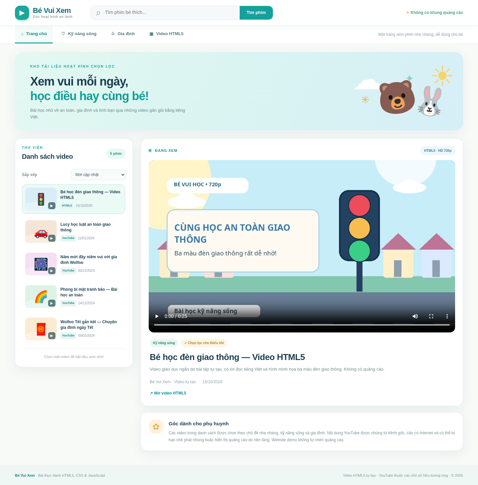
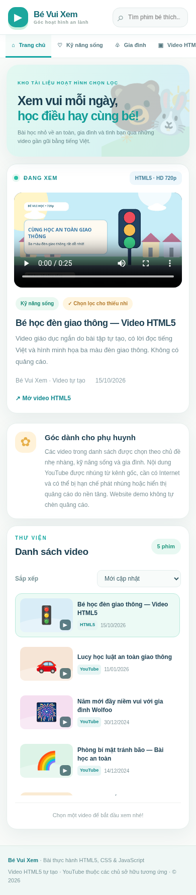

# Bé Vui Xem — Website phim hoạt hình thiếu nhi (HTML5 + CSS)

> Bài thực hành CodeGym: layout bằng `div`/CSS, `header` cố định, `head-link`, `left-content`, `right-content`, `footer`, thẻ `<video>`, nhúng YouTube qua `<iframe>`, responsive.



## Khởi chạy

Tải/giải nén toàn bộ thư mục `TrangPhimHoatHinh_CSS`, mở `index.html` bằng Chrome, Edge hoặc Firefox. Không cần Node.js, package, máy chủ hay cơ sở dữ liệu. Để dùng VS Code Live Server cũng được, nhưng không bắt buộc. **Giữ thư mục `assets/` cùng cấp với `index.html` và giữ `styles.css`, `script.js` ở đúng vị trí.**

## Kiểm tra yêu cầu

| Yêu cầu | Triển khai |
|---|---|
| `header` | Fixed header ở đầu trang, có logo và ô tìm kiếm |
| `head-link` | Thanh điều hướng Trang chủ / Kỹ năng sống / Gia đình / HTML5 |
| `left-content` | Danh sách 5 video, click item để chọn, mặc định chọn item đầu |
| `right-content` | Khung phát đổi qua lại giữa `<video controls>` và YouTube `<iframe>` |
| `footer` | Thông tin bản quyền bài demo và ghi công nguồn video |
| CSS | Bỏ gạch chân cho link; hover đổi màu; link được chọn có style riêng |
| Cuộn trang | `.site-header { position: fixed; top: 0; }` và `body { padding-top: 77px; }` |
| Responsive | CSS media queries cho 1440, 900, 390 px; trên mobile đưa khung xem lên trước danh sách |
| Mở rộng | Tìm theo tên, lọc danh mục, sắp xếp mới cập nhật/xem nhiều/tên |
| Không quảng cáo | Không tự đặt banner quảng cáo, không có analytics, cookie tracking hay backend |

## Nguồn video & giới hạn demo

- Video **Bé học đèn giao thông** là hoạt hình giáo dục ngắn do bài tập tự tạo, có tiếng Việt tổng hợp bằng eSpeak, chuẩn **HD 720p (1280×720), 25 giây**, MP4 H.264 + AAC. Có thể xem offline bằng `<video>` và là video mặc định.
- Bốn video còn lại được **nhúng qua iframe YouTube** từ kênh Wolfoo bằng liên kết video gốc, không sao chép hay phân phối lại video có bản quyền. YouTube có thể chặn phát nhúng, thay đổi chất lượng/lượt xem hoặc hiển thị quảng cáo do YouTube quản lý; trang demo không kiểm soát phần đó.
- Số lượt xem trong dữ liệu JavaScript là **ảnh chụp số liệu tham khảo lúc tra cứu**, **không phải số liệu thời gian thực**. Bộ lọc “xem nhiều” sắp xếp theo các giá trị mẫu này. Độ phân giải HD của các video YouTube phụ thuộc video và nền tảng, không được bảo đảm trong mã bài tập.
- Đây là giao diện **demo học tập**, không phải kho phim đã qua kiểm duyệt chuyên nghiệp cho mọi lứa tuổi. Phụ huynh nên xem trước nội dung nguồn khi cho trẻ xem.

Nguồn YouTube được liên kết công khai:

| Tên video | Kênh nguồn | Link |
|---|---|---|
| Lucy học luật an toàn giao thông | Wolfoo Việt Nam | https://www.youtube.com/watch?v=eJ-ZD_B6ySQ |
| Năm mới đầy niềm vui với gia đình Wolfoo | Wolfoo Tiếng Việt | https://www.youtube.com/watch?v=R9kvGmhC-L8 |
| Phòng bí mật tránh bão – Bài học an toàn | Wolfoo Tiếng Việt | https://www.youtube.com/watch?v=uy31yJ_KikA |
| Wolfoo Tết gắn kết | Wolfoo Tiếng Việt | https://www.youtube.com/watch?v=iPFYdfbepW8 |

## Thư mục dự án

```text
TrangPhimHoatHinh_CSS/
├── index.html
├── styles.css
├── script.js
├── assets/
│   ├── be-hoc-den-giao-thong-720p.mp4
│   └── video-poster.jpg
├── preview-desktop.png
├── preview-tablet.png
├── preview-mobile.png
└── README.md
```

## Kiểm tra đã thực hiện

- Browser test (Chromium): 5 video xuất hiện, tìm “giao thông” còn 2 kết quả; sort “xem nhiều” đưa video Tết lên đầu; click chuyển sang iframe; filter HTML5 về 1 item và quay lại thẻ video.
- 3 viewport desktop 1440px, tablet 900px, mobile 390px: không có horizontal overflow và header có `position: fixed`. Video nội bộ có `duration=25`, kích cỡ `1280×720`, track AAC được kiểm tra bằng `ffprobe`.
- Do môi trường test không được phép truy cập YouTube, không thể bảo đảm 4 iframe đều phát trực tiếp tại thời điểm nộp; đã có link mở video gốc để xử lý trường hợp nhúng bị hạn chế.



## Mã nguồn đầy đủ (để giảng viên / AI chấm đọc được trong một file)

Các file thật ở cạnh README là nguồn chính của ứng dụng. Dưới đây là bản chép nguyên mã nguồn để dễ rà từng tiêu chí khi hệ thống chấm chỉ xem một URL.

### `index.html`

```html
<!DOCTYPE html>
<html lang="vi">
<head>
  <meta charset="UTF-8">
  <meta name="viewport" content="width=device-width, initial-scale=1.0">
  <meta name="description" content="Bé Vui Xem – trang xem hoạt hình tiếng Việt, giao diện học tập HTML5 với video và iframe YouTube.">
  <title>Bé Vui Xem | Phim hoạt hình và bài học cho bé</title>
  <link rel="stylesheet" href="styles.css">
  <script src="script.js" defer></script>
</head>
<body>
  <header class="site-header" id="dau-trang">
    <div class="header-inner">
      <a href="#dau-trang" class="brand" aria-label="Bé Vui Xem - về đầu trang">
        <span class="brand-mark" aria-hidden="true">▶</span>
        <span class="brand-copy"><strong>Bé Vui Xem</strong><small>Góc hoạt hình an lành</small></span>
      </a>
      <form class="header-search" id="searchForm" role="search">
        <label for="searchInput" class="visually-hidden">Tìm phim theo tên</label>
        <span aria-hidden="true" class="search-icon">⌕</span>
        <input type="search" id="searchInput" placeholder="Tìm phim bé thích..." autocomplete="off">
        <button type="submit">Tìm phim</button>
      </form>
      <div class="header-tag"><span aria-hidden="true">✦</span> Không có khung quảng cáo</div>
    </div>
  </header>

  <nav class="top-nav" aria-label="Điều hướng chính">
    <div class="nav-inner">
      <a href="#danh-sach" class="nav-link active" data-nav="all">⌂ <span>Trang chủ</span></a>
      <a href="#danh-sach" class="nav-link" data-nav="skills">♡ <span>Kỹ năng sống</span></a>
      <a href="#danh-sach" class="nav-link" data-nav="family">♧ <span>Gia đình</span></a>
      <a href="#danh-sach" class="nav-link" data-nav="html5">▣ <span>Video HTML5</span></a>
      <span class="nav-right">Một trang xem phim nhẹ nhàng, dễ dùng cho bé</span>
    </div>
  </nav>

  <div class="page-shell">
    <section class="intro-banner" aria-label="Giới thiệu">
      <div class="banner-copy"><span class="eyebrow">KHO TÀI LIỆU HOẠT HÌNH CHỌN LỌC</span>
        <h1>Xem vui mỗi ngày,<br><em>học điều hay cùng bé!</em></h1>
        <p>Bài học nhỏ về an toàn, gia đình và tình bạn qua những video gần gũi bằng tiếng Việt.</p>
      </div>
      <div class="banner-art" aria-hidden="true"><span class="star one">✦</span><span class="star two">✳</span><span class="bubble cloud">☁</span><span class="bubble sun">☀</span><span class="bear">🐻</span><span class="rabbit">🐰</span><span class="hill"></span></div>
    </section>

    <div class="content-grid">
      <aside class="left-content" id="danh-sach" aria-labelledby="playlistTitle">
        <div class="panel-heading"><div><p class="mini-label">THƯ VIỆN</p><h2 id="playlistTitle">Danh sách video</h2></div><span class="count-pill" id="videoCount">5 phim</span></div>
        <div class="sort-wrap"><label for="sortSelect">Sắp xếp</label><select id="sortSelect"><option value="newest">Mới cập nhật</option><option value="popular">Xem nhiều (tham khảo)</option><option value="name">Tên A → Z</option></select></div>
        <div class="playlist" id="playlist" aria-live="polite"></div>
        <p class="playlist-hint" id="playlistHint">Chọn một video để bắt đầu xem nhé!</p>
      </aside>

      <main class="right-content" id="xem-phim">
        <div class="player-panel">
          <div class="player-topline"><span class="now-playing"><span class="pulsing-dot"></span> ĐANG XEM</span><span class="quality-tag" id="qualityTag">HTML5 · HD 720p</span></div>
          <div class="player-frame">
            <video id="html5Player" controls playsinline preload="metadata" poster="assets/video-poster.jpg" aria-label="Phim hoạt hình HTML5">
              <source src="assets/be-hoc-den-giao-thong-720p.mp4" type="video/mp4">
              Trình duyệt không hỗ trợ video HTML5. <a href="assets/be-hoc-den-giao-thong-720p.mp4">Mở tập phim tại đây</a>.
            </video>
            <iframe id="youtubePlayer" title="Video hoạt hình trên YouTube" src="about:blank" allow="accelerometer; autoplay; clipboard-write; encrypted-media; gyroscope; picture-in-picture; web-share" referrerpolicy="strict-origin-when-cross-origin" allowfullscreen loading="lazy" hidden></iframe>
          </div>
          <div class="player-details">
            <div class="content-badges"><span class="type-pill" id="typePill">Bài học kỹ năng</span><span class="safety-pill">✓ Chọn lọc cho thiếu nhi</span></div>
            <h2 id="currentTitle">Bé học đèn giao thông — Video HTML5</h2>
            <p id="currentDescription">Video giáo dục ngắn do bài tập tự tạo, có lời đọc tiếng Việt, minh họa 3 màu đèn giao thông.</p>
            <div class="video-meta"><span id="currentChannel">Bé Vui Xem · Video tự tạo</span><span id="currentDate">15/10/2026</span></div>
            <a id="sourceLink" class="source-link" href="assets/be-hoc-den-giao-thong-720p.mp4" target="_blank" rel="noopener noreferrer">↗ Xem nguồn video</a>
          </div>
        </div>

        <section class="notes-panel" aria-labelledby="notesTitle"><div class="notes-icon" aria-hidden="true">✿</div><div><h3 id="notesTitle">Góc dành cho phụ huynh</h3><p>Các video trong danh sách được chọn theo chủ đề nhẹ nhàng, kỹ năng sống và gia đình. Nội dung YouTube được nhúng từ kênh gốc, cần có Internet và có thể bị hạn chế phát nhúng hoặc hiển thị quảng cáo do nền tảng. Website demo không tự chèn quảng cáo.</p></div></section>
      </main>
    </div>
  </div>
  <footer class="site-footer"><div class="footer-inner"><span><strong>Bé Vui Xem</strong> · Bài thực hành HTML5, CSS & JavaScript</span><span>Video HTML5 tự tạo · YouTube thuộc các chủ sở hữu tương ứng · © 2026</span></div></footer>
</body>
</html>
```

### `styles.css`

```css
:root { --ink:#1b3e50;--muted:#688392;--teal:#179d9c;--teal-dark:#0b7478;--cream:#f8faf8;--line:#e2eceb;--shadow:0 10px 35px rgba(42,91,99,.08);--radius:20px;}
*{box-sizing:border-box}html{scroll-behavior:smooth;scroll-padding-top:116px}body{margin:0;padding-top:77px;font-family:'Segoe UI',Arial,sans-serif;background:var(--cream);color:var(--ink);line-height:1.55}button,input,select{font:inherit}button{cursor:pointer}a{color:inherit}button:focus-visible,a:focus-visible,input:focus-visible,select:focus-visible{outline:3px solid #e1ad4c;outline-offset:3px}#danh-sach{scroll-margin-top:130px}
.site-header{position:fixed;top:0;left:0;right:0;z-index:50;height:77px;background:#fff;border-bottom:1px solid #e0ecec;box-shadow:0 4px 16px rgba(36,98,110,.04)}.header-inner{max-width:1420px;margin:auto;height:100%;padding:0 35px;display:flex;align-items:center;gap:28px}.brand{display:flex;align-items:center;gap:11px;text-decoration:none;white-space:nowrap}.brand-mark{display:grid;place-items:center;height:43px;width:43px;border-radius:15px;background:#1ca79d;color:#fff;font-size:21px;box-shadow:0 5px 0 #c8efdd}.brand-copy{display:flex;flex-direction:column;line-height:1.18}.brand-copy strong{font-size:22px;font-weight:850;letter-spacing:-.6px;color:#136c75}.brand-copy small{font-size:10px;letter-spacing:.7px;color:#92a39e;font-weight:650}.header-search{height:43px;max-width:550px;flex:1;display:flex;align-items:center;border:1px solid #e1e9e9;background:#f6f9f9;border-radius:14px;overflow:hidden;margin-left:26px}.header-search input{flex:1;width:0;border:0;outline:0;background:transparent;font-size:14px;color:#2e5764}.search-icon{font-size:28px;color:#90a6a6;margin:0 10px 0 15px;line-height:1}.header-search button{align-self:stretch;padding:0 21px;border:0;background:#16a09d;color:white;font-weight:750;font-size:13px}.header-search button:hover{background:#137f82}.header-tag{margin-left:auto;font-size:12px;font-weight:750;color:#559d7e;white-space:nowrap}.header-tag span{color:#f1b459}
.top-nav{background:white;border-bottom:1px solid #e8efec}.nav-inner{max-width:1420px;padding:0 35px;margin:auto;min-height:54px;display:flex;align-items:stretch;gap:8px}.nav-link{display:flex;align-items:center;gap:8px;padding:0 18px;text-decoration:none;font-size:13px;font-weight:750;color:#577981;border-bottom:3px solid transparent}.nav-link:hover,.nav-link.active{color:#0d8c90;border-bottom-color:#16a8a5;background:#f5fbf9}.nav-right{align-self:center;margin-left:auto;color:#8b9fa5;font-size:12px}
.page-shell{max-width:1420px;margin:auto;padding:25px 35px 45px}.intro-banner{min-height:215px;position:relative;border-radius:24px;overflow:hidden;background:linear-gradient(114deg,#e3f8f1 0%,#d8f3f2 60%,#d7eef7 100%);padding:30px 46px;display:flex;align-items:center;box-shadow:var(--shadow)}.banner-copy{position:relative;z-index:2;max-width:680px}.eyebrow{font-weight:850;font-size:10px;color:#14a29b;letter-spacing:2.4px}.intro-banner h1{font-weight:880;font-size:clamp(25px,2.5vw,38px);line-height:1.22;letter-spacing:-1.1px;margin:12px 0 11px}.intro-banner h1 em{color:#139e98;font-style:normal}.intro-banner p{max-width:480px;font-size:13px;color:#66878b;margin:0}.banner-art{position:absolute;inset:0 15px 0 auto;width:330px;overflow:hidden}.banner-art .bubble{position:absolute}.banner-art .sun{font-size:83px;right:10px;top:10px;color:#f8d46a}.banner-art .cloud{font-size:87px;top:15px;left:12px;color:white}.banner-art .bear{position:absolute;bottom:25px;left:87px;font-size:95px;transform:rotate(-8deg)}.banner-art .rabbit{position:absolute;bottom:22px;right:30px;font-size:83px;transform:rotate(9deg)}.banner-art .star{position:absolute;font-size:32px;color:#83d3ba}.banner-art .one{top:56px;right:133px}.banner-art .two{top:120px;left:37px;color:#e8b563}.banner-art .hill{display:block;background:#b6e4be;position:absolute;left:-60px;bottom:-170px;width:500px;height:230px;border-radius:50%;z-index:-1}
.content-grid{display:grid;grid-template-columns:minmax(300px,355px) minmax(0,1fr);gap:24px;align-items:start;margin-top:24px}.left-content,.player-panel,.notes-panel{border-radius:var(--radius);background:white;border:1px solid #e7efed;box-shadow:var(--shadow)}.left-content{overflow:hidden;padding:20px}.panel-heading{display:flex;align-items:center;justify-content:space-between;gap:10px}.mini-label{color:#12a7a0;font-weight:850;font-size:10px;letter-spacing:2px;margin:0 0 4px}.panel-heading h2{font-size:20px;margin:0;letter-spacing:-.35px}.count-pill{background:#e8f8f2;color:#259a80;border-radius:30px;font-weight:800;font-size:11px;padding:7px 12px}.sort-wrap{margin:22px 0 12px;display:flex;gap:10px;align-items:center;justify-content:space-between}.sort-wrap label{font-weight:750;font-size:12px;color:#779296}.sort-wrap select{border:1px solid #e4eded;background:#f8fbfa;border-radius:9px;padding:8px 10px;color:#395c66;max-width:190px;font-size:12px}.playlist{display:flex;flex-direction:column;gap:9px;max-height:660px;overflow-y:auto;padding-right:2px}.episode-card{border:1px solid transparent;background:transparent;border-radius:13px;display:grid;grid-template-columns:95px minmax(0,1fr);gap:11px;align-items:center;padding:9px;width:100%;text-align:left;color:var(--ink);transition:background .17s,border-color .17s}.episode-card:hover{background:#f3faf8}.episode-card.selected{border-color:#b8e9db;background:#ecfaf5}.card-thumb{display:flex;align-items:center;justify-content:center;height:69px;position:relative;overflow:hidden;border-radius:10px;isolation:isolate;font-size:35px;background:var(--thumb-bg,#ceeedd)}.card-thumb::before{position:absolute;content:'';inset:auto -15px -22px;height:50px;background:rgba(255,255,255,.34);border-radius:50%;z-index:-1}.card-thumb .play-mark{position:absolute;bottom:4px;right:4px;border-radius:6px;background:rgba(21,66,73,.67);color:white;font-size:11px;padding:2px 7px}.card-title{font-weight:800;font-size:12px;line-height:1.4;margin:0 0 6px;display:-webkit-box;-webkit-line-clamp:2;-webkit-box-orient:vertical;overflow:hidden}.card-meta{display:flex;align-items:center;gap:6px;flex-wrap:wrap;font-size:10px;color:#82969b}.video-kind{font-size:9px;font-weight:800;color:#168b8b;background:#e7f5f4;border-radius:5px;padding:3px 5px}.playlist-hint{border-top:1px solid #eef2ef;padding:16px 6px 2px;margin:14px 0 0;font-size:11px;color:#94a4a6;text-align:center}.empty-state{padding:35px 20px;text-align:center;color:#749098;font-size:13px;background:#f7fbfa;border-radius:12px}
.player-panel{overflow:hidden;padding:23px}.player-topline{display:flex;align-items:center;justify-content:space-between;margin-bottom:15px}.now-playing{font-size:11px;letter-spacing:1px;color:#168f90;font-weight:900}.pulsing-dot{display:inline-block;height:8px;width:8px;border-radius:50%;background:#2cc2a6;margin-right:7px;box-shadow:0 0 0 4px #e7f7f1}.quality-tag{background:#eef7fc;color:#407e98;padding:6px 11px;font-size:10px;font-weight:850;border-radius:9px}.player-frame{width:100%;aspect-ratio:16/9;border-radius:16px;background:linear-gradient(120deg,#1c3e55,#233d53);overflow:hidden;position:relative}.player-frame video,.player-frame iframe{display:block;width:100%;height:100%;border:0;object-fit:contain}.player-frame [hidden]{display:none!important}.player-details{padding:19px 3px 3px}.content-badges{display:flex;gap:8px;align-items:center;flex-wrap:wrap}.type-pill,.safety-pill{font-size:10px;font-weight:780;border-radius:30px;padding:5px 10px}.type-pill{background:#eaf8f1;color:#198974}.safety-pill{background:#fff5e0;color:#b47b2c}.player-details h2{font-size:clamp(18px,2.2vw,26px);letter-spacing:-.5px;margin:14px 0 8px;line-height:1.3}.player-details p{font-size:13px;line-height:1.75;margin:0;color:#738b92}.video-meta{display:flex;gap:20px;flex-wrap:wrap;color:#8ea2a9;font-size:12px;margin-top:17px}.source-link{display:inline-flex;margin-top:16px;color:#178c93;text-decoration:none;font-weight:800;font-size:12px}.source-link:hover{text-decoration:underline}.notes-panel{margin-top:19px;display:flex;gap:17px;padding:21px 24px;align-items:flex-start}.notes-icon{flex:none;background:#fff2d9;border-radius:15px;width:42px;height:42px;display:grid;place-items:center;font-size:25px;color:#e7af49}.notes-panel h3{margin:0 0 7px;font-size:15px}.notes-panel p{margin:0;font-size:12px;color:#7d9297;line-height:1.75}
.site-footer{background:#eff7f5;border-top:1px solid #dcebe5}.footer-inner{max-width:1420px;margin:auto;padding:20px 35px;display:flex;gap:20px;align-items:center;justify-content:space-between;color:#799498;font-size:11px}.footer-inner strong{color:#177d84}.visually-hidden{position:absolute;width:1px;height:1px;padding:0;margin:-1px;overflow:hidden;clip:rect(0,0,0,0);white-space:nowrap;border:0}
@media (max-width:1090px){.header-tag,.nav-right{display:none}.header-search{margin-left:5px}.intro-banner{padding:28px 35px}.banner-art{opacity:.68;right:0}.content-grid{grid-template-columns:300px minmax(0,1fr);gap:18px}.page-shell{padding:21px 22px 35px}.header-inner,.nav-inner,.footer-inner{padding-left:22px;padding-right:22px}.episode-card{grid-template-columns:78px minmax(0,1fr);gap:9px}.card-thumb{height:60px}.left-content{padding:16px}.player-panel{padding:18px}}
@media (max-width:760px){body{padding-top:69px}.site-header{height:69px}.brand-copy strong{font-size:19px}.brand-copy small{font-size:9px}.brand-mark{height:40px;width:40px}.header-inner{gap:8px;padding:0 16px}.header-search{max-width:none;margin-left:auto;flex:0 1 50%;height:39px}.header-search button{padding:0 12px}.nav-inner{overflow-x:auto;white-space:nowrap;gap:0;padding:0 11px;min-height:45px}.nav-link{padding:0 12px;font-size:11px}.page-shell{padding:13px 13px 32px}.intro-banner{padding:22px;min-height:165px}.banner-art{width:200px;opacity:.3;right:-25px}.banner-art .bear{left:12px}.banner-art .rabbit{right:10px}.intro-banner h1{font-size:25px;margin:9px 0}.intro-banner p{font-size:11px;max-width:80%}.eyebrow{font-size:9px;letter-spacing:1.2px}.content-grid{display:flex;flex-direction:column;gap:13px;margin-top:14px}.right-content{order:0;width:100%}.left-content{order:1;width:100%}.player-panel{padding:14px}.player-details h2{font-size:20px}.left-content{padding:16px}.playlist{max-height:400px}.episode-card{grid-template-columns:105px minmax(0,1fr)}.card-thumb{height:67px}.footer-inner{padding:20px 16px;flex-direction:column;align-items:flex-start;gap:6px}}
@media (max-width:460px){.header-search{flex:0 1 42%}.header-search button{display:none}.header-search input{font-size:12px}.search-icon{margin:0 6px 0 9px;font-size:24px}.brand-copy strong{font-size:17px}.intro-banner p{max-width:85%}.notes-panel{padding:16px}.panel-heading h2{font-size:19px}.player-details h2{font-size:18px}}
@media (prefers-reduced-motion:reduce){html{scroll-behavior:auto}.episode-card{transition:none}}
```

### `script.js`

```javascript
'use strict';

// Bài tập HTML5: video nội bộ có lời đọc tiếng Việt; các video YouTube
// dùng URL nhúng chính thức. Số lượt xem là snapshot minh họa từ nguồn tra cứu,
// không phải dữ liệu realtime/API.
const VIDEOS = [
  {
    id: 'traffic-local', type: 'html5', title: 'Bé học đèn giao thông — Video HTML5',
    channel: 'Bé Vui Xem · Video tự tạo', date: '2026-10-15', views: 0,
    emoji: '🚦', thumb: '#d9edf7', category: 'skills', quality: 'HTML5 · HD 720p',
    kind: 'Kỹ năng sống',
    description: 'Video giáo dục ngắn do bài tập tự tạo, có lời đọc tiếng Việt và hình minh họa ba màu đèn giao thông. Không có quảng cáo.',
    url: 'assets/be-hoc-den-giao-thong-720p.mp4'
  },
  {
    id: 'eJ-ZD_B6ySQ', type: 'youtube', title: 'Lucy học luật an toàn giao thông',
    channel: 'Wolfoo Việt Nam', date: '2026-01-11', views: 230524,
    emoji: '🚗', thumb: '#f6e5d6', category: 'skills', quality: 'YouTube · Tiếng Việt',
    kind: 'An toàn giao thông',
    description: 'Wolfoo Việt Nam: Lucy và các bạn học đèn xanh, đèn đỏ và cách sang đường an toàn.',
    url: 'https://www.youtube.com/watch?v=eJ-ZD_B6ySQ'
  },
  {
    id: 'R9kvGmhC-L8', type: 'youtube', title: 'Năm mới đầy niềm vui với gia đình Wolfoo',
    channel: 'Wolfoo Tiếng Việt', date: '2024-12-30', views: 1889771,
    emoji: '🎆', thumb: '#f5dff0', category: 'family', quality: 'YouTube · Tiếng Việt',
    kind: 'Gia đình',
    description: 'Một tập đặc biệt về không khí năm mới và khoảnh khắc vui vẻ cùng gia đình Wolfoo.',
    url: 'https://www.youtube.com/watch?v=R9kvGmhC-L8'
  },
  {
    id: 'uy31yJ_KikA', type: 'youtube', title: 'Phòng bí mật tránh bão — Bài học an toàn',
    channel: 'Wolfoo Tiếng Việt', date: '2024-12-14', views: 2658297,
    emoji: '🌈', thumb: '#ddf3e7', category: 'skills', quality: 'YouTube · Tiếng Việt',
    kind: 'Kỹ năng sống',
    description: 'Wolfoo cùng các bạn khám phá bài học về an toàn khi gặp bão, qua câu chuyện vui nhộn.',
    url: 'https://www.youtube.com/watch?v=uy31yJ_KikA'
  },
  {
    id: 'iPFYdfbepW8', type: 'youtube', title: 'Wolfoo Tết gắn kết — Chuyện gia đình ngày Tết',
    channel: 'Wolfoo Tiếng Việt', date: '2024-02-09', views: 3057937,
    emoji: '🧧', thumb: '#faebd3', category: 'family', quality: 'YouTube · Tiếng Việt',
    kind: 'Gia đình',
    description: 'Tập đặc biệt về Tết, sum họp gia đình và những lời chúc năm mới.',
    url: 'https://www.youtube.com/watch?v=iPFYdfbepW8'
  }
];

const $ = id => document.getElementById(id);
const playlist = $('playlist');
const searchInput = $('searchInput');
const sortSelect = $('sortSelect');
const html5Player = $('html5Player');
const youtubePlayer = $('youtubePlayer');
let activeId = VIDEOS[0].id;
let category = 'all';

const humanDate = iso => iso.split('-').reverse().join('/');
const viewLabel = n => n === 0 ? 'Video tự tạo' : `${new Intl.NumberFormat('vi-VN', {notation: 'compact', maximumFractionDigits: 1}).format(n)} lượt xem*`;
function filteredVideos() {
  const term = searchInput.value.trim().toLocaleLowerCase('vi-VN');
  const result = VIDEOS.filter(v => (category === 'all' || v.category === category || (category === 'html5' && v.type === 'html5')) && `${v.title} ${v.channel} ${v.kind}`.toLocaleLowerCase('vi-VN').includes(term));
  if (sortSelect.value === 'popular') result.sort((a,b) => b.views - a.views);
  else if (sortSelect.value === 'name') result.sort((a,b) => a.title.localeCompare(b.title,'vi'));
  else result.sort((a,b) => b.date.localeCompare(a.date));
  return result;
}
function renderPlaylist() {
  const videos = filteredVideos();
  playlist.replaceChildren();
  $('videoCount').textContent = `${videos.length} phim`;
  if (!videos.length) {
    const empty = document.createElement('p');
    empty.className = 'empty-state';
    empty.textContent = 'Chưa tìm thấy phim phù hợp. Thử tên khác nhé!';
    playlist.appendChild(empty);
  }
  for (const video of videos) {
    const card = document.createElement('button');
    card.type = 'button';
    card.className = `episode-card${activeId === video.id ? ' selected' : ''}`;
    card.setAttribute('aria-pressed', String(activeId === video.id));
    const thumb = document.createElement('span');
    thumb.className = 'card-thumb';
    thumb.style.setProperty('--thumb-bg',video.thumb);
    thumb.textContent=video.emoji;
    const play = document.createElement('span');
    play.className='play-mark'; play.textContent='▶'; thumb.append(play);
    const text = document.createElement('span');
    const title = document.createElement('span');
    title.className='card-title'; title.textContent=video.title;
    const meta = document.createElement('span'); meta.className='card-meta';
    const kind = document.createElement('span'); kind.className='video-kind';kind.textContent=video.type==='html5'?'HTML5':'YouTube';
    const date = document.createElement('span'); date.textContent=humanDate(video.date);
    meta.append(kind,date); text.append(title,meta); card.append(thumb,text);
    card.addEventListener('click',() => selectVideo(video.id));
    playlist.append(card);
  }
  $('playlistHint').textContent = sortSelect.value==='popular' ? '*Lượt xem của YouTube là số liệu tham khảo tại thời điểm tìm nguồn, không cập nhật tự động.' : 'Chọn một video để bắt đầu xem nhé!';
}
function selectVideo(id) {
  const video = VIDEOS.find(v => v.id === id);
  if (!video) return;
  activeId=id;
  // Stop playback of the previously active player, including embedded YouTube.
  html5Player.pause();
  youtubePlayer.src='about:blank';
  const useYoutube = video.type === 'youtube';
  html5Player.hidden=useYoutube;
  youtubePlayer.hidden=!useYoutube;
  if(useYoutube) {
    // Do not autoplay: a child/parent starts playback intentionally.
    youtubePlayer.title = `Hoạt hình: ${video.title}`;
    youtubePlayer.src=`https://www.youtube-nocookie.com/embed/${video.id}?rel=0`;
  } else {
    html5Player.currentTime=0;
    html5Player.load();
  }
  $('currentTitle').textContent=video.title;
  $('currentDescription').textContent=video.description;
  $('currentChannel').textContent=video.channel;
  $('currentDate').textContent=humanDate(video.date);
  $('qualityTag').textContent=video.quality;
  $('typePill').textContent=video.kind;
  $('sourceLink').href=video.url;
  $('sourceLink').textContent=useYoutube?'↗ Mở video gốc trên YouTube':'↗ Mở video HTML5';
  renderPlaylist();
}

function applyCategory(next) {
  category=next;
  document.querySelectorAll('[data-nav]').forEach(el=>el.classList.toggle('active',el.dataset.nav===category));
  renderPlaylist();
  // Keep selected video playing until user explicitly selects another one.
}
document.querySelectorAll('[data-nav]').forEach(link=>{
  link.addEventListener('click',()=>applyCategory(link.dataset.nav));
});
$('searchForm').addEventListener('submit',e=>{e.preventDefault();renderPlaylist();$('danh-sach').scrollIntoView({behavior:'smooth'});});
searchInput.addEventListener('input',renderPlaylist);
sortSelect.addEventListener('change',renderPlaylist);
selectVideo(VIDEOS[0].id);
```
