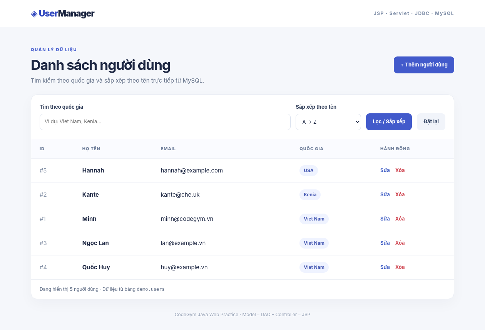

# User Management — JDBC Search by Country & Sort by Name

Ứng dụng Java Web MVC mở rộng bài **User Management JDBC** của CodeGym: quản lý người dùng MySQL bằng JDBC, **tìm kiếm theo quốc gia** và **sắp xếp theo tên A–Z/Z–A**. Đây là bản phát triển từ scaffold của bài trước; có logic CRUD thực tế và form JSP. *Ứng dụng dùng cho thực hành học tập, không có đăng nhập và không dành cho production.*



[Desktop](preview-desktop.png) · [Tablet](preview-tablet.png) · [Mobile](preview-mobile.png)

> **Lưu ý về minh chứng:** Ảnh là bản kiểm tra HTML/CSS với dữ liệu mẫu, **không phải** ảnh chụp JSP đang chạy với MySQL. Các chức năng Java/Servlet đã được kiểm tra bằng mock, chưa kiểm thử trực tiếp trong MySQL/Tomcat ở môi trường tạo bài.

## Chức năng

| Chức năng | URL / kỹ thuật |
| --- | --- |
| Danh sách | `GET /users` dùng `UserDAO.searchAndSort("", "asc")` |
| Tìm theo country | `GET /users?country=Viet` sử dụng JDBC `PreparedStatement` và `LIKE` |
| Sort A → Z | `GET /users?sort=asc` → `ORDER BY name ASC, id ASC` |
| Sort Z → A | `GET /users?sort=desc` → `ORDER BY name DESC, id ASC` |
| Kết hợp | `GET /users?country=Viet&sort=desc` |
| Tạo | `GET /users?action=create`, `POST /users?action=create` |
| Sửa | `GET /users?action=edit&id=1`, `POST /users?action=edit` |
| Xóa | `GET /users?action=delete&id=1`, `POST /users?action=delete` |

**Ví dụ với dữ liệu đề:** Lọc `Viet` cho kết quả Minh; sắp xếp A–Z mặc định xếp Kante trước Minh. Các ký tự `%`, `_`, `!` trong từ khóa được coi là chữ thông thường, không phải ký tự đại diện SQL.

## Cấu trúc

```text
UserManagement_JDBC_SearchSort/
├── README.md                      # Tổng quan và hướng dẫn chạy
├── preview-desktop.png           # Ảnh kiểm tra giao diện
├── preview-mobile.png
└── user-management/
    ├── pom.xml                    # Maven WAR, Jakarta Servlet/JSTL, MySQL Connector/J
    ├── database/
    │   ├── init.sql              # CREATE demo.users + dữ liệu mẫu
    │   └── query_examples.sql    # Các truy vấn kiểm chứng
    └── src/main/
        ├── java/com/codegym/
        │   ├── model/User.java
        │   ├── dao/IUserDAO.java
        │   ├── dao/UserDAO.java
        │   └── controller/UserServlet.java
        └── webapp/
            ├── index.jsp
            ├── error-404.jsp
            ├── assets/styles.css
            ├── WEB-INF/web.xml
            └── user/{list,create,edit,delete}.jsp
```

## Cài đặt và chạy

Yêu cầu: **JDK 17+, Maven, Tomcat 10.1+, MySQL 8.x**.

**1.** Mở **MySQL Workbench**, chạy file [`database/init.sql`](user-management/database/init.sql). Script chỉ `CREATE IF NOT EXISTS` và chèn hai bản ghi mẫu khi chưa tồn tại theo email; không xóa bảng cũ.

**2.** Cấu hình kết nối MySQL bằng biến môi trường. Ví dụ Terminal **PowerShell** (thay mật khẩu của bro, đừng commit giá trị thực):

```powershell
$env:DB_URL = "jdbc:mysql://localhost:3306/demo?useUnicode=true&characterEncoding=UTF-8&serverTimezone=Asia/Ho_Chi_Minh"
$env:DB_USER = "root"
$env:DB_PASSWORD = "MAT_KHAU_MYSQL_CUA_BAN"
```

Để Tomcat nhìn thấy các biến này, chạy Tomcat từ **cùng Terminal** đã thiết lập hoặc đặt chúng trong cấu hình Environment Variables của server trong IDE. Không nên lưu mật khẩu trong source hay Git.

**3.** Mở thư mục **`user-management`** (có `pom.xml`), chạy:

```powershell
mvn clean package
```

**4.** Khi có `BUILD SUCCESS`, triển khai `target/user-management.war` vào Tomcat 10.1 (`webapps` hoặc trình quản lý deploy trong IDE). Khởi động Tomcat và mở:

**<http://localhost:8080/user-management/users>**

Có thể thử `?country=Viet`, `?sort=desc`, `?country=Viet&sort=asc` hoặc sử dụng form giao diện.

## Giải thích giải pháp

**DAO (`UserDAO`)** chịu trách nhiệm JDBC. Truy vấn xây dựng từ hai phần cố định; **giá trị country được truyền qua `PreparedStatement`**, còn `ASC` / `DESC` được chọn từ hai hằng do server kiểm soát, tránh nối SQL tùy ý từ input.

```sql
SELECT id, name, email, country FROM users
WHERE LOWER(country) LIKE ? ESCAPE '!'
ORDER BY name ASC, id ASC;
```

`country` được chuẩn hóa chữ thường, bao bởi `%` để tìm kiếm chứa từ khóa; các wildcard do người dùng nhập được escape bằng `!`. Bỏ điều kiện `WHERE` nếu ô country rỗng. Sort mặc định là A–Z, trường hợp `sort=desc` là Z–A.

**Controller (`UserServlet`)** nhận `country` và `sort` qua GET, đưa danh sách vào `requestScope.listUser`, `countryFilter`, `selectedSort`, rồi forward sang `user/list.jsp`. Khi xử lý POST sẽ kiểm tra dữ liệu trước khi gọi DAO, sau đó redirect về `/users` để tránh submit lặp khi refresh.

**View (`list.jsp`)** dùng Jakarta JSTL (`jakarta.tags.core`) với `c:forEach` và `c:out` để hiển thị dữ liệu an toàn. Bảng có thanh cuộn ngang bên trong trên điện thoại; toàn trang không bị tràn ngang.

## Kiểm tra đã thực hiện

- Compile Java 17 với Jakarta Servlet API **mô phỏng**: đạt.
- **16/16** bài kiểm thử logic Servlet mock: tìm kiếm, sort, thao tác GET/POST CRUD, dữ liệu sai, ID không tồn tại.
- **9/9** bài kiểm tra JDBC mock: câu SQL, thứ tự sắp xếp, bind tham số và escape ký tự `%`, `_`, `!`.
- Chromium: responsive các kích thước 1260px, 768px, 390px và 320px, không bị tràn trang.
- Cấu trúc Maven, XML, JSP, ZIP: rà soát tĩnh.
- **Chưa** chạy `mvn clean package` thành công với thư viện Maven thật, **chưa** chạy Tomcat hoặc MySQL trực tiếp trong môi trường tạo bài. Người nộp cần thực hiện bước 1–4 để có bằng chứng triển khai thực tế.

## Phân biệt với bài trước

`UserManagement_JDBC/` ở bài trước chỉ là scaffold theo yêu cầu AI Agent. Thư mục bài này `UserManagement_JDBC_SearchSort/` là **bản triển khai nối tiếp hoàn chỉnh**, gồm cả CRUD làm nền cho tìm kiếm theo country và sắp xếp theo name.

---

## Mã nguồn cốt lõi (để đọc từ một liên kết GitHub)

Đây là phần mã Java/JSP thực sự được biên soạn trong dự án, không phải pseudocode. Có thể truy cập file gốc qua các đường dẫn tương ứng để chỉnh sửa.

### [IUserDAO.java](user-management/src/main/java/com/codegym/dao/IUserDAO.java)

```java
package com.codegym.dao;

import com.codegym.model.User;
import java.sql.SQLException;
import java.util.List;

/** Thao tác JDBC trên bảng demo.users. */
public interface IUserDAO {
    void insertUser(User user) throws SQLException;
    User selectUser(int id) throws SQLException;
    List<User> selectAllUsers() throws SQLException;
    boolean deleteUser(int id) throws SQLException;
    boolean updateUser(User user) throws SQLException;

    /** Tìm theo một phần tên quốc gia, sắp xếp tên asc hoặc desc. */
    List<User> searchAndSort(String country, String sort) throws SQLException;
}

```

### [UserDAO.java](user-management/src/main/java/com/codegym/dao/UserDAO.java)

```java
package com.codegym.dao;

import com.codegym.model.User;
import java.sql.Connection;
import java.sql.DriverManager;
import java.sql.PreparedStatement;
import java.sql.ResultSet;
import java.sql.SQLException;
import java.util.ArrayList;
import java.util.List;
import java.util.Locale;

/** MySQL JDBC: truy vấn có tham số, kết nối đóng bằng try-with-resources. */
public class UserDAO implements IUserDAO {
    private static final String DEFAULT_URL =
            "jdbc:mysql://localhost:3306/demo?useUnicode=true&characterEncoding=UTF-8&serverTimezone=Asia/Ho_Chi_Minh";
    private static final String SQL_INSERT =
            "INSERT INTO users (name, email, country) VALUES (?, ?, ?)";
    private static final String SQL_FIND =
            "SELECT id, name, email, country FROM users WHERE id = ?";
    private static final String SQL_UPDATE =
            "UPDATE users SET name = ?, email = ?, country = ? WHERE id = ?";
    private static final String SQL_DELETE = "DELETE FROM users WHERE id = ?";

    /** Không lưu mật khẩu thật trong source; đọc từ biến môi trường. */
    protected Connection getConnection() throws SQLException {
        String url = getenvOrDefault("DB_URL", DEFAULT_URL);
        String username = getenvOrDefault("DB_USER", "root");
        String password = System.getenv("DB_PASSWORD");
        return DriverManager.getConnection(url, username, password == null ? "" : password);
    }

    private static String getenvOrDefault(String key, String fallback) {
        String value = System.getenv(key);
        return value == null || value.isBlank() ? fallback : value;
    }

    private static User readUser(ResultSet rs) throws SQLException {
        return new User(rs.getInt("id"), rs.getString("name"),
                rs.getString("email"), rs.getString("country"));
    }

    @Override
    public void insertUser(User user) throws SQLException {
        try (Connection con = getConnection();
             PreparedStatement ps = con.prepareStatement(SQL_INSERT)) {
            ps.setString(1, user.getName());
            ps.setString(2, user.getEmail());
            ps.setString(3, user.getCountry());
            ps.executeUpdate();
        }
    }

    @Override
    public User selectUser(int id) throws SQLException {
        try (Connection con = getConnection();
             PreparedStatement ps = con.prepareStatement(SQL_FIND)) {
            ps.setInt(1, id);
            try (ResultSet rs = ps.executeQuery()) {
                return rs.next() ? readUser(rs) : null;
            }
        }
    }

    @Override
    public List<User> selectAllUsers() throws SQLException {
        return searchAndSort("", "asc");
    }

    /**
     * @param country Từ khóa (chứa trong tên country); rỗng = tất cả.
     * @param sort asc hoặc desc. Chỉ chọn 2 hằng SQL an toàn (không nối input tự do).
     */
    @Override
    public List<User> searchAndSort(String country, String sort) throws SQLException {
        String keyword = country == null ? "" : country.trim();
        boolean filtered = !keyword.isEmpty();
        boolean descending = "desc".equalsIgnoreCase(sort);
        String sql = "SELECT id, name, email, country FROM users"
                + (filtered ? " WHERE LOWER(country) LIKE ? ESCAPE '!'" : "")
                + " ORDER BY name " + (descending ? "DESC" : "ASC") + ", id ASC";
        List<User> users = new ArrayList<>();
        try (Connection con = getConnection();
             PreparedStatement ps = con.prepareStatement(sql)) {
            if (filtered) {
                String escaped = keyword.toLowerCase(Locale.ROOT)
                        .replace("!", "!!").replace("%", "!%").replace("_", "!_");
                ps.setString(1, "%" + escaped + "%");
            }
            try (ResultSet rs = ps.executeQuery()) {
                while (rs.next()) {
                    users.add(readUser(rs));
                }
            }
        }
        return users;
    }

    @Override
    public boolean updateUser(User user) throws SQLException {
        try (Connection con = getConnection();
             PreparedStatement ps = con.prepareStatement(SQL_UPDATE)) {
            ps.setString(1, user.getName());
            ps.setString(2, user.getEmail());
            ps.setString(3, user.getCountry());
            ps.setInt(4, user.getId());
            return ps.executeUpdate() > 0;
        }
    }

    @Override
    public boolean deleteUser(int id) throws SQLException {
        try (Connection con = getConnection();
             PreparedStatement ps = con.prepareStatement(SQL_DELETE)) {
            ps.setInt(1, id);
            return ps.executeUpdate() > 0;
        }
    }
}

```

### [UserServlet.java](user-management/src/main/java/com/codegym/controller/UserServlet.java)

```java
package com.codegym.controller;

import com.codegym.dao.IUserDAO;
import com.codegym.dao.UserDAO;
import com.codegym.model.User;
import jakarta.servlet.ServletException;
import jakarta.servlet.annotation.WebServlet;
import jakarta.servlet.http.HttpServlet;
import jakarta.servlet.http.HttpServletRequest;
import jakarta.servlet.http.HttpServletResponse;
import java.io.IOException;
import java.sql.SQLException;
import java.util.List;
import java.util.Locale;

/** Điều hướng MVC: GET xem/form/lọc/sắp xếp; POST tạo/sửa/xóa. */
@WebServlet(name = "UserServlet", urlPatterns = "/users")
public class UserServlet extends HttpServlet {
    private static final long serialVersionUID = 1L;
    private IUserDAO dao;

    @Override
    public void init() {
        dao = new UserDAO();
    }

    @Override
    protected void doGet(HttpServletRequest req, HttpServletResponse resp)
            throws ServletException, IOException {
        try {
            String action = req.getParameter("action");
            if (action == null || action.isEmpty() || "list".equals(action)) {
                showList(req, resp);
            } else if ("create".equals(action)) {
                forward(req, resp, "/user/create.jsp");
            } else if ("edit".equals(action) || "delete".equals(action)) {
                Integer id = parseId(req.getParameter("id"));
                if (id == null) {
                    resp.sendError(HttpServletResponse.SC_BAD_REQUEST, "ID không hợp lệ");
                    return;
                }
                User user = dao.selectUser(id);
                if (user == null) {
                    notFound(req, resp);
                    return;
                }
                req.setAttribute("user", user);
                forward(req, resp, "/user/" + action + ".jsp");
            } else {
                resp.sendError(HttpServletResponse.SC_NOT_FOUND);
            }
        } catch (SQLException ex) {
            throw new ServletException("Không truy cập được dữ liệu MySQL", ex);
        }
    }

    @Override
    protected void doPost(HttpServletRequest req, HttpServletResponse resp)
            throws ServletException, IOException {
        req.setCharacterEncoding("UTF-8");
        String action = req.getParameter("action");
        if (action == null) {
            resp.sendError(HttpServletResponse.SC_BAD_REQUEST);
            return;
        }
        try {
            switch (action) {
                case "create":
                    save(req, resp, false);
                    break;
                case "edit":
                    save(req, resp, true);
                    break;
                case "delete":
                    delete(req, resp);
                    break;
                default:
                    resp.sendError(HttpServletResponse.SC_BAD_REQUEST, "Thao tác không hợp lệ");
            }
        } catch (SQLException ex) {
            throw new ServletException("Không ghi được dữ liệu MySQL", ex);
        }
    }

    private void showList(HttpServletRequest req, HttpServletResponse resp)
            throws SQLException, ServletException, IOException {
        String country = req.getParameter("country");
        String sort = req.getParameter("sort");
        country = country == null ? "" : country.trim();
        sort = "desc".equalsIgnoreCase(sort) ? "desc" : "asc";
        List<User> users = dao.searchAndSort(country, sort);
        req.setAttribute("listUser", users);
        req.setAttribute("countryFilter", country);
        req.setAttribute("selectedSort", sort);
        forward(req, resp, "/user/list.jsp");
    }

    private void save(HttpServletRequest req, HttpServletResponse resp, boolean edit)
            throws SQLException, ServletException, IOException {
        Integer id = edit ? parseId(req.getParameter("id")) : null;
        if (edit && id == null) {
            resp.sendError(HttpServletResponse.SC_BAD_REQUEST, "ID không hợp lệ");
            return;
        }
        if (edit && dao.selectUser(id) == null) {
            notFound(req, resp);
            return;
        }
        String name = trim(req.getParameter("name"));
        String email = trim(req.getParameter("email"));
        String country = trim(req.getParameter("country"));
        User user = new User(id == null ? 0 : id, name, email, country);
        String error = validate(name, email, country);
        if (error != null) {
            req.setAttribute("error", error);
            req.setAttribute("user", user);
            resp.setStatus(HttpServletResponse.SC_BAD_REQUEST);
            forward(req, resp, edit ? "/user/edit.jsp" : "/user/create.jsp");
            return;
        }
        if (edit) {
            dao.updateUser(user);
        } else {
            dao.insertUser(user);
        }
        redirectList(req, resp);
    }

    private void delete(HttpServletRequest req, HttpServletResponse resp)
            throws SQLException, ServletException, IOException {
        Integer id = parseId(req.getParameter("id"));
        if (id == null) {
            resp.sendError(HttpServletResponse.SC_BAD_REQUEST, "ID không hợp lệ");
            return;
        }
        if (!dao.deleteUser(id)) {
            notFound(req, resp);
            return;
        }
        redirectList(req, resp);
    }

    private static String trim(String value) {
        return value == null ? "" : value.trim();
    }

    private static String validate(String name, String email, String country) {
        if (name.isEmpty() || name.length() > 120) {
            return "Tên bắt buộc, tối đa 120 ký tự.";
        }
        if (email.isEmpty() || email.length() > 220
                || !email.matches("^[^\\s@]+@[^\\s@]+\\.[^\\s@]+$")) {
            return "Email không đúng định dạng hoặc quá 220 ký tự.";
        }
        if (country.length() > 120) {
            return "Quốc gia tối đa 120 ký tự.";
        }
        return null;
    }

    private static Integer parseId(String text) {
        try {
            int value = Integer.parseInt(text);
            return value > 0 ? value : null;
        } catch (NumberFormatException ex) {
            return null;
        }
    }

    private void notFound(HttpServletRequest req, HttpServletResponse resp)
            throws ServletException, IOException {
        resp.setStatus(HttpServletResponse.SC_NOT_FOUND);
        forward(req, resp, "/error-404.jsp");
    }

    private static void forward(HttpServletRequest req, HttpServletResponse resp, String jsp)
            throws ServletException, IOException {
        req.getRequestDispatcher(jsp).forward(req, resp);
    }

    private static void redirectList(HttpServletRequest req, HttpServletResponse resp)
            throws IOException {
        resp.sendRedirect(req.getContextPath() + "/users");
    }
}

```

### [list.jsp](user-management/src/main/webapp/user/list.jsp)

```jsp
<%@ page contentType="text/html; charset=UTF-8" pageEncoding="UTF-8" %>
<%@ taglib prefix="c" uri="jakarta.tags.core" %>
<!doctype html>
<html lang="vi">
<head>
<meta charset="UTF-8"><meta name="viewport" content="width=device-width, initial-scale=1">
<title>Danh sách User | User Management</title>
<link rel="stylesheet" href="${pageContext.request.contextPath}/assets/styles.css">
</head>
<body>
<header class="topbar"><div class="container topbar-inner"><a class="brand" href="${pageContext.request.contextPath}/users">◈ User<span>Manager</span></a><span class="eyebrow">JSP · Servlet · JDBC · MySQL</span></div></header>
<main class="container page">
  <div class="page-heading">
    <div><span class="section-tag">QUẢN LÝ DỮ LIỆU</span><h1>Danh sách người dùng</h1><p>Tìm kiếm theo quốc gia và sắp xếp theo tên trực tiếp từ MySQL.</p></div>
    <a class="button primary" href="${pageContext.request.contextPath}/users?action=create">+ Thêm người dùng</a>
  </div>
  <section class="panel">
    <form class="toolbar" action="${pageContext.request.contextPath}/users" method="get" role="search">
      <label class="field search-field" for="country">Tìm theo quốc gia
        <input id="country" name="country" type="search" maxlength="120" placeholder="Ví dụ: Viet Nam, Kenia..." value="<c:out value='${countryFilter}'/>">
      </label>
      <label class="field sort-field" for="sort">Sắp xếp theo tên
        <select id="sort" name="sort">
          <c:choose>
            <c:when test="${selectedSort eq 'desc'}"><option value="asc">A → Z</option><option value="desc" selected>Z → A</option></c:when>
            <c:otherwise><option value="asc" selected>A → Z</option><option value="desc">Z → A</option></c:otherwise>
          </c:choose>
        </select>
      </label>
      <button class="button primary" type="submit">Lọc / Sắp xếp</button>
      <a class="button ghost" href="${pageContext.request.contextPath}/users">Đặt lại</a>
    </form>
    <div class="table-wrap">
      <table>
        <thead><tr><th>ID</th><th>Họ tên</th><th>Email</th><th>Quốc gia</th><th>Hành động</th></tr></thead>
        <tbody>
          <c:forEach var="user" items="${listUser}">
            <tr>
              <td class="id-col">#<c:out value="${user.id}"/></td>
              <td class="name-col"><c:out value="${user.name}"/></td>
              <td><c:out value="${user.email}"/></td>
              <td><span class="tag"><c:out value="${user.country}" default="Chưa có"/></span></td>
              <td><div class="actions">
                <a class="action edit" href="${pageContext.request.contextPath}/users?action=edit&amp;id=${user.id}">Sửa</a>
                <a class="action delete" href="${pageContext.request.contextPath}/users?action=delete&amp;id=${user.id}">Xóa</a>
              </div></td>
            </tr>
          </c:forEach>
          <c:if test="${empty listUser}"><tr><td colspan="5" class="no-results">Không tìm thấy người dùng phù hợp.</td></tr></c:if>
        </tbody>
      </table>
    </div>
    <p class="table-footer">Đang hiển thị <strong>${listUser.size()}</strong> người dùng · Dữ liệu từ bảng <code>demo.users</code></p>
  </section>
  <footer class="footer">CodeGym Java Web Practice · Model – DAO – Controller – JSP</footer>
</main>
</body>
</html>

```

### [create.jsp](user-management/src/main/webapp/user/create.jsp)

```jsp
<%@ page contentType="text/html; charset=UTF-8" pageEncoding="UTF-8" %>
<%@ taglib prefix="c" uri="jakarta.tags.core" %>
<!doctype html><html lang="vi"><head><meta charset="UTF-8"><meta name="viewport" content="width=device-width, initial-scale=1">
<title>Thêm User</title><link rel="stylesheet" href="${pageContext.request.contextPath}/assets/styles.css"></head>
<body><header class="topbar"><div class="container topbar-inner"><a class="brand" href="${pageContext.request.contextPath}/users">◈ User<span>Manager</span></a></div></header>
<main class="container form-page"><a class="back" href="${pageContext.request.contextPath}/users">← Trở về danh sách</a>
<section class="panel form-panel"><span class="section-tag">TẠO MỚI</span><h1>Thêm người dùng</h1><p>Điền thông tin, dữ liệu được lưu vào MySQL.</p>
<c:if test="${not empty error}"><div class="alert" role="alert"><c:out value="${error}"/></div></c:if>
<form action="${pageContext.request.contextPath}/users?action=create" method="post">
<label class="field" for="name">Họ tên <span class="required">*</span><input id="name" name="name" type="text" maxlength="120" required value="<c:out value='${user.name}'/>"></label>
<label class="field" for="email">Email <span class="required">*</span><input id="email" name="email" type="email" maxlength="220" required value="<c:out value='${user.email}'/>"></label>
<label class="field" for="country">Quốc gia<input id="country" name="country" type="text" maxlength="120" value="<c:out value='${user.country}'/>"></label>
<div class="form-actions"><button class="button primary" type="submit">Lưu người dùng</button><a class="button ghost" href="${pageContext.request.contextPath}/users">Hủy</a></div>
</form></section></main></body></html>

```

### [edit.jsp](user-management/src/main/webapp/user/edit.jsp)

```jsp
<%@ page contentType="text/html; charset=UTF-8" pageEncoding="UTF-8" %>
<%@ taglib prefix="c" uri="jakarta.tags.core" %>
<!doctype html><html lang="vi"><head><meta charset="UTF-8"><meta name="viewport" content="width=device-width, initial-scale=1">
<title>Sửa User</title><link rel="stylesheet" href="${pageContext.request.contextPath}/assets/styles.css"></head>
<body><header class="topbar"><div class="container topbar-inner"><a class="brand" href="${pageContext.request.contextPath}/users">◈ User<span>Manager</span></a></div></header>
<main class="container form-page"><a class="back" href="${pageContext.request.contextPath}/users">← Trở về danh sách</a>
<section class="panel form-panel"><span class="section-tag">CẬP NHẬT</span><h1>Chỉnh sửa người dùng</h1><p>ID #<c:out value="${user.id}"/> · Cập nhật thông tin trong MySQL.</p>
<c:if test="${not empty error}"><div class="alert" role="alert"><c:out value="${error}"/></div></c:if>
<form action="${pageContext.request.contextPath}/users?action=edit" method="post">
<input type="hidden" name="id" value="${user.id}">
<label class="field" for="name">Họ tên <span class="required">*</span><input id="name" name="name" type="text" maxlength="120" required value="<c:out value='${user.name}'/>"></label>
<label class="field" for="email">Email <span class="required">*</span><input id="email" name="email" type="email" maxlength="220" required value="<c:out value='${user.email}'/>"></label>
<label class="field" for="country">Quốc gia<input id="country" name="country" type="text" maxlength="120" value="<c:out value='${user.country}'/>"></label>
<div class="form-actions"><button class="button primary" type="submit">Lưu thay đổi</button><a class="button ghost" href="${pageContext.request.contextPath}/users">Hủy</a></div>
</form></section></main></body></html>

```

### [delete.jsp](user-management/src/main/webapp/user/delete.jsp)

```jsp
<%@ page contentType="text/html; charset=UTF-8" pageEncoding="UTF-8" %>
<%@ taglib prefix="c" uri="jakarta.tags.core" %>
<!doctype html><html lang="vi"><head><meta charset="UTF-8"><meta name="viewport" content="width=device-width, initial-scale=1">
<title>Xóa User</title><link rel="stylesheet" href="${pageContext.request.contextPath}/assets/styles.css"></head>
<body><header class="topbar"><div class="container topbar-inner"><a class="brand" href="${pageContext.request.contextPath}/users">◈ User<span>Manager</span></a></div></header>
<main class="container form-page"><a class="back" href="${pageContext.request.contextPath}/users">← Trở về danh sách</a>
<section class="panel form-panel"><span class="section-tag">XÁC NHẬN</span><h1>Xóa người dùng?</h1>
<div class="notice">Hành động này sẽ xóa bản ghi trong MySQL và không thể hoàn tác.</div>
<div class="detail"><strong>ID</strong><span>#<c:out value="${user.id}"/></span></div>
<div class="detail"><strong>Tên</strong><span><c:out value="${user.name}"/></span></div>
<div class="detail"><strong>Email</strong><span><c:out value="${user.email}"/></span></div>
<div class="detail"><strong>Quốc gia</strong><span><c:out value="${user.country}"/></span></div>
<form action="${pageContext.request.contextPath}/users?action=delete" method="post"><input type="hidden" name="id" value="${user.id}">
<div class="form-actions"><button class="button danger" type="submit">Xác nhận xóa</button><a class="button ghost" href="${pageContext.request.contextPath}/users">Hủy</a></div></form>
</section></main></body></html>

```
