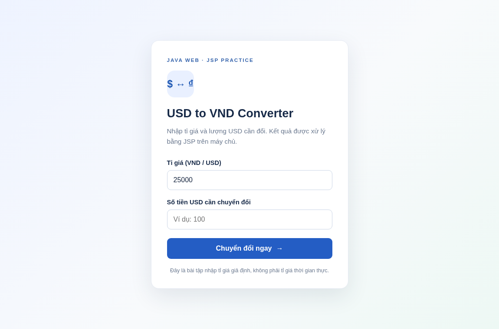

# JSP Currency Converter — Chuyển đổi USD sang VNĐ

Bài thực hành CodeGym: **Tạo và xử lý dữ liệu với JSP**, sử dụng JSP Scriptlet (`<% ... %>`) để đọc dữ liệu form và JSP Expression (`<%= ... %>`) để in kết quả. Phù hợp **Java 17 + Maven + Apache Tomcat 10.1+** (Jakarta Servlet 6).

## Chức năng / đáp ứng yêu cầu

- `index.jsp` hiển thị form gồm hai input: `rate` (tỉ giá VND/USD), `usd` (số USD), nút submit.
- Form có `action="converter.jsp"` và `method="post"`.
- `converter.jsp` đọc tham số qua `request.getParameter()`, sử dụng `Double.parseDouble()`, tính **VND = USD × rate** trong JSP Scriptlet và in bằng JSP Expression.
- Kiểm tra dữ liệu đầu vào; tỉ giá phải dương, USD không âm; GET trực tiếp vào trang kết quả được báo hướng dẫn. Kết quả có phân tách hàng nghìn kiểu Việt Nam.
- `WEB-INF/web.xml` khai báo Jakarta Web 6.0, welcome file `index.jsp`.

> **Lưu ý:** 25.000 chỉ là tỉ giá minh họa để học tập, không phải tỉ giá thị trường. Đây là bài tập tính toán với `double`, chưa dành cho xử lý tiền thật (hệ thống tài chính nên dùng `BigDecimal`).

## Ảnh xem trước (HTML/CSS tĩnh)



[Desktop](preview-desktop.png) · [Mobile](preview-mobile.png)

Đây là ảnh chụp phần form HTML/CSS bằng Chromium; phần xử lý JSP phải kiểm thử trên Tomcat.

## Cấu trúc dự án

```text
jsp-currency-converter/
├── pom.xml
├── .gitignore
├── README.md
├── preview-desktop.png
├── preview-mobile.png
└── src/
    └── main/
        └── webapp/
            ├── index.jsp
            ├── converter.jsp
            ├── assets/
            │   └── style.css
            └── WEB-INF/
                └── web.xml
```

## Cách chạy trên Windows (Tomcat 10.1+)

1. Cài **JDK 17+**, **Apache Maven** và **Tomcat 10.1+**.
2. Mở terminal trong thư mục `jsp-currency-converter` (cùng cấp `pom.xml`).
3. Chạy:

```powershell
mvn clean package
```

4. Sau khi hiện **BUILD SUCCESS**, copy `target/jsp-currency-converter.war` vào thư mục `webapps` của Tomcat.
5. Khởi động Tomcat bằng `bin/startup.bat` (hoặc từ IDE). Mở: <http://localhost:8080/jsp-currency-converter/>
6. Thử `rate=25000`, `usd=100`: kết quả **2.500.000 VNĐ**. Thử USD âm, tỉ giá bằng 0, hoặc nhập chữ để xem xử lý lỗi (trình duyệt cũng có kiểm tra form).

> `index.jsp` không chạy bằng cách double-click hay Live Server HTML; phải dùng Tomcat để thực thi JSP.

## Giải thích JSP / quy trình POST

1. Client mở `/jsp-currency-converter/` → `index.jsp` hiển thị form.
2. Nhấn submit → trình duyệt gửi HTTP POST tới `converter.jsp`.
3. Scriptlet `<% ... %>` lấy `rate` và `usd`, ép sang `double`, nhân lại và định dạng kết quả.
4. Expression `<%= ... %>` đưa các giá trị đã xử lý vào giao diện. Không dùng JavaScript để làm phép chuyển đổi.

## Mã nguồn đầy đủ để xem trong một link GitHub

Dù người đọc chỉ mở `README.md`, họ vẫn có thể đọc code thiết yếu của bài (đã liên kết đến các tệp riêng phía trên).

### `index.jsp`

```jsp
<%@ page contentType="text/html; charset=UTF-8" pageEncoding="UTF-8" %>
<!DOCTYPE html>
<html lang="vi">
<head>
    <meta charset="UTF-8">
    <meta name="viewport" content="width=device-width, initial-scale=1.0">
    <title>Chuyển đổi USD sang VNĐ | CodeGym</title>
    <link rel="stylesheet" href="assets/style.css">
</head>
<body>
<main class="page">
    <section class="converter-card" aria-labelledby="converter-title">
        <p class="eyebrow">JAVA WEB · JSP PRACTICE</p>
        <div class="icon-circle" aria-hidden="true">$ ↔ ₫</div>
        <h1 id="converter-title">USD to VND Converter</h1>
        <p class="description">Nhập tỉ giá và lượng USD cần đổi. Kết quả được xử lý bằng JSP trên máy chủ.</p>

        <%-- Gửi dữ liệu bằng POST đến converter.jsp (cùng thư mục). --%>
        <form action="converter.jsp" method="post">
            <div class="field">
                <label for="rate">Tỉ giá (VND / USD)</label>
                <input id="rate" name="rate" type="number" min="0.000001" step="any"
                       inputmode="decimal" value="25000" placeholder="Ví dụ: 25000" required>
            </div>
            <div class="field">
                <label for="usd">Số tiền USD cần chuyển đổi</label>
                <input id="usd" name="usd" type="number" min="0" step="any"
                       inputmode="decimal" placeholder="Ví dụ: 100" required>
            </div>
            <button type="submit">Chuyển đổi ngay <span aria-hidden="true">→</span></button>
        </form>
        <p class="footnote">Đây là bài tập nhập tỉ giá giả định, không phải tỉ giá thời gian thực.</p>
    </section>
</main>
</body>
</html>
```

### `converter.jsp`

```jsp
<%@ page contentType="text/html; charset=UTF-8" pageEncoding="UTF-8" %>
<%
    // JSP Scriptlet: lấy tham số POST, chuyển thành số thực và tính VND = USD * Rate.
    request.setCharacterEncoding("UTF-8");
    String errorMessage = null;
    String rateFormatted = "";
    String usdFormatted = "";
    String vndFormatted = "";

    try {
        if (!"POST".equalsIgnoreCase(request.getMethod())) {
            throw new IllegalArgumentException("Vui lòng nhập thông tin từ biểu mẫu trước.");
        }

        String rateValue = request.getParameter("rate");
        String usdValue = request.getParameter("usd");
        if (rateValue == null || usdValue == null
                || rateValue.isBlank() || usdValue.isBlank()) {
            throw new IllegalArgumentException("Vui lòng nhập đầy đủ tỉ giá và số USD.");
        }

        double rate = Double.parseDouble(rateValue.trim());
        double usd = Double.parseDouble(usdValue.trim());
        double vnd = rate * usd;
        if (!Double.isFinite(rate) || !Double.isFinite(usd) || !Double.isFinite(vnd)
                || rate <= 0 || usd < 0) {
            throw new IllegalArgumentException("Tỉ giá phải lớn hơn 0 và USD không được âm.");
        }

        java.text.NumberFormat format = java.text.NumberFormat.getNumberInstance(
                java.util.Locale.forLanguageTag("vi-VN"));
        format.setMinimumFractionDigits(0);
        format.setMaximumFractionDigits(2);
        rateFormatted = format.format(rate);
        usdFormatted = format.format(usd);
        vndFormatted = format.format(vnd);
    } catch (NumberFormatException e) {
        errorMessage = "Giá trị nhập không hợp lệ. Vui lòng nhập số hợp lệ.";
    } catch (IllegalArgumentException e) {
        errorMessage = e.getMessage();
    }
%>
<!DOCTYPE html>
<html lang="vi">
<head>
    <meta charset="UTF-8">
    <meta name="viewport" content="width=device-width, initial-scale=1.0">
    <title>Kết quả chuyển đổi | CodeGym</title>
    <link rel="stylesheet" href="assets/style.css">
</head>
<body>
<main class="page">
    <section class="converter-card result-card" aria-labelledby="result-title">
        <p class="eyebrow">KẾT QUẢ · JSP EXPRESSION</p>
        <% if (errorMessage == null) { %>
            <div class="icon-circle success" aria-hidden="true">✓</div>
            <h1 id="result-title">Chuyển đổi thành công</h1>
            <div class="result-details">
                <%-- JSP Expression: in giá trị đã tính ra trang HTML. --%>
                <p>Tỉ giá: <strong><%= rateFormatted %> VNĐ / USD</strong></p>
                <p>Số tiền: <strong><%= usdFormatted %> USD</strong></p>
            </div>
            <div class="result-total">
                <span>Thành tiền</span>
                <strong><%= vndFormatted %> VNĐ</strong>
            </div>
        <% } else { %>
            <div class="icon-circle error" aria-hidden="true">!</div>
            <h1 id="result-title">Không thể chuyển đổi</h1>
            <p class="error-text"><%= errorMessage %></p>
        <% } %>
        <a class="back-button" href="index.jsp">← Quay lại nhập số tiền</a>
        <p class="footnote">Công thức: VNĐ = USD × Tỉ giá.</p>
    </section>
</main>
</body>
</html>
```

### `pom.xml`

```xml
<?xml version="1.0" encoding="UTF-8"?>
<project xmlns="http://maven.apache.org/POM/4.0.0"
         xmlns:xsi="http://www.w3.org/2001/XMLSchema-instance"
         xsi:schemaLocation="http://maven.apache.org/POM/4.0.0 https://maven.apache.org/xsd/maven-4.0.0.xsd">
    <modelVersion>4.0.0</modelVersion>
    <groupId>com.codegym</groupId>
    <artifactId>jsp-currency-converter</artifactId>
    <version>1.0-SNAPSHOT</version>
    <packaging>war</packaging>
    <name>JSP Currency Converter Webapp</name>

    <properties>
        <maven.compiler.release>17</maven.compiler.release>
        <project.build.sourceEncoding>UTF-8</project.build.sourceEncoding>
    </properties>

    <dependencies>
        <dependency>
            <groupId>jakarta.servlet</groupId>
            <artifactId>jakarta.servlet-api</artifactId>
            <version>6.0.0</version>
            <scope>provided</scope>
        </dependency>
        <dependency>
            <groupId>jakarta.servlet.jsp</groupId>
            <artifactId>jakarta.servlet.jsp-api</artifactId>
            <version>3.1.1</version>
            <scope>provided</scope>
        </dependency>
    </dependencies>

    <build>
        <finalName>jsp-currency-converter</finalName>
        <plugins>
            <plugin>
                <groupId>org.apache.maven.plugins</groupId>
                <artifactId>maven-compiler-plugin</artifactId>
                <version>3.13.0</version>
            </plugin>
            <plugin>
                <groupId>org.apache.maven.plugins</groupId>
                <artifactId>maven-war-plugin</artifactId>
                <version>3.4.0</version>
            </plugin>
        </plugins>
    </build>
</project>
```

### `web.xml`

```xml
<?xml version="1.0" encoding="UTF-8"?>
<web-app xmlns="https://jakarta.ee/xml/ns/jakartaee"
         xmlns:xsi="http://www.w3.org/2001/XMLSchema-instance"
         xsi:schemaLocation="https://jakarta.ee/xml/ns/jakartaee https://jakarta.ee/xml/ns/jakartaee/web-app_6_0.xsd"
         version="6.0">
    <display-name>JSP Currency Converter</display-name>
    <welcome-file-list>
        <welcome-file>index.jsp</welcome-file>
    </welcome-file-list>
</web-app>
```

### `assets/style.css`

```css
/* CSS thuan cho bai thuc hanh JSP Currency Converter. */
:root { color-scheme: light; font-family: Arial, Helvetica, sans-serif; }
* { box-sizing: border-box; }
body { margin: 0; background: linear-gradient(135deg, #eef3ff, #f8fafc 55%, #edf8f4); color: #172a48; }
.page { min-height: 100vh; display: flex; align-items: center; justify-content: center; padding: 28px 16px; }
.converter-card { width: min(100%, 455px); padding: 38px 36px 30px; background: white;
    border: 1px solid #e5eaf3; border-radius: 18px; box-shadow: 0 18px 50px rgba(25,45,80,.10); }
.eyebrow { color: #3765ad; font-size: .73rem; font-weight: 700; letter-spacing: .17em; margin: 0 0 18px; }
.icon-circle { display: grid; place-items: center; width: 62px; height: 62px; border-radius: 17px;
    background: #e9f0ff; color: #1c56b2; font-size: 23px; font-weight: bold; margin-bottom: 20px; }
.icon-circle.success { color: #087c56; background: #ddf5e9; }
.icon-circle.error { color: #c63636; background: #ffebeb; }
h1 { font-size: clamp(1.35rem, 4vw, 1.7rem); line-height: 1.24; margin: 0 0 12px; }
.description, .footnote { color: #6c7a90; line-height: 1.6; }
.description { margin: 0 0 28px; font-size: .95rem; }
.field { margin-bottom: 20px; }
label { display: block; font-size: .91rem; font-weight: 700; margin-bottom: 9px; }
input { display: block; width: 100%; padding: 13px 14px; border: 1px solid #cbd6e6;
    border-radius: 9px; font: inherit; font-size: 1rem; color: #14233d; background: #fff; }
input:focus { outline: 3px solid #c5dafe; outline-offset: 1px; border-color: #3b77d7; }
button, .back-button { display: flex; width: 100%; min-height: 48px; align-items: center;
    justify-content: center; gap: 10px; border: 0; border-radius: 9px; background: #245dc4;
    color: #fff; font-size: 1rem; font-weight: 700; cursor: pointer; text-decoration: none; }
button:hover, .back-button:hover { background: #18499b; }
.footnote { font-size: .78rem; text-align: center; margin: 18px 0 0; }
.result-details { border-top: 1px solid #e7edf5; padding-top: 13px; margin-top: 24px; }
.result-details p { display: flex; justify-content: space-between; flex-wrap: wrap; gap: 8px;
    font-size: .89rem; color: #64748b; }
.result-details strong { color: #1c2d47; }
.result-total { padding: 21px; border-radius: 12px; background: #e8f8ee; margin: 21px 0; }
.result-total span { display: block; color: #187950; font-size: .85rem; margin-bottom: 8px; }
.result-total strong { font-size: clamp(1.2rem, 4vw, 1.65rem); color: #116542; overflow-wrap: anywhere; }
.error-text { color: #a63232; background: #fff1f1; padding: 16px; border-radius: 9px; line-height: 1.6; }
.back-button { margin-top: 22px; }
@media (max-width: 480px) { .converter-card { padding: 26px 21px; } }
```

## Kiểm tra

- Đã kiểm tra cú pháp XML, form POST, tham số `rate`, `usd`, Scriptlet và Expression, CSS, cấu trúc và nội dung file ZIP.
- Cần chạy `mvn clean package` và triển khai WAR trên máy có Maven, internet để Maven tải dependencies và Tomcat thực tế. **Không khẳng định đã chạy Tomcat nếu chưa thử trên máy của bạn.**
