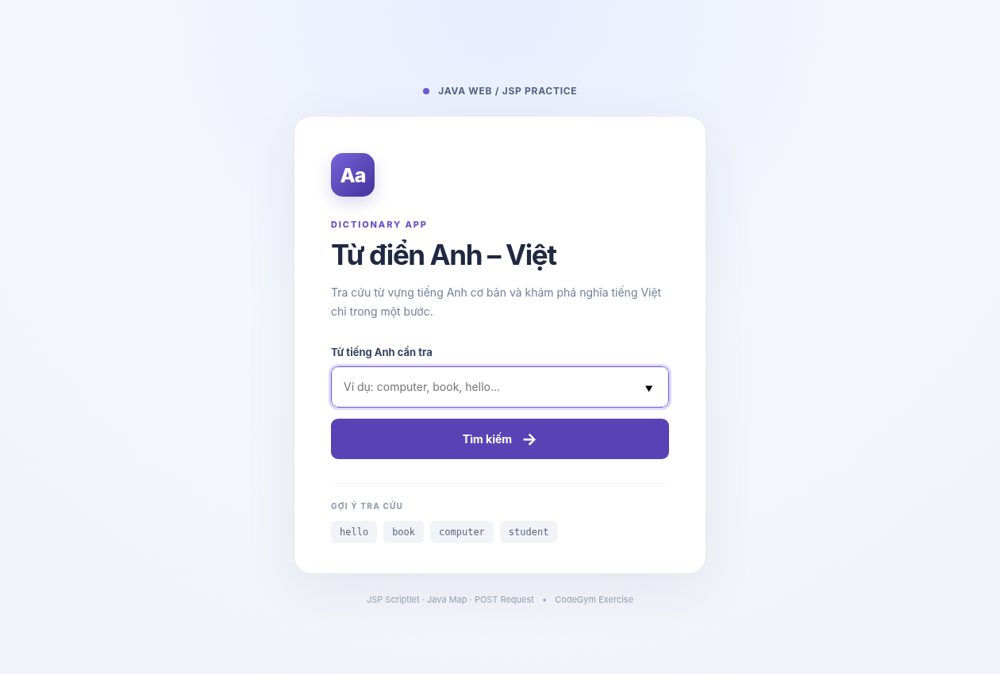

# JSP Pure Dictionary — Từ điển Anh–Việt

Bài thực hành CodeGym về JSP Scriptlet (`<% ... %>`), JSP Expression (`<%= ... %>`), xử lý dữ liệu từ **HTTP POST** và tra cứu từ vựng bằng **Java `Map`**. Đây là dự án Maven Java Web tiêu chuẩn dành cho **Java 17+ và Apache Tomcat 10.1+**.



[Ảnh xem trước màn hình tra cứu thành công](preview-result.png) *(bản chụp giao diện mô phỏng kết quả, chưa chạy JSP trên Tomcat).*

## Các yêu cầu đã đáp ứng

| Yêu cầu | Thực hiện |
|---|---|
| `index.jsp` | Form có `name="search"`, `method="POST"`, `action="dictionary.jsp"` |
| `dictionary.jsp` | Scriptlet tạo `Map<String,String>`, nhận `request.getParameter("search")`, hiển thị bằng Expression |
| Kết quả có từ | `hello` → Xin chào, `book` → Quyển sách, `computer` → Máy tính |
| Kết quả không có từ | Thông báo không tìm thấy, có liên kết quay lại |
| Tăng độ ổn định | Không phân biệt hoa/thường, bỏ khoảng trắng ở hai đầu; escape HTML đầu vào |
| Đóng gói | Maven WAR, web.xml Jakarta EE 10 (Servlet 6.0) |

**Lưu ý:** Đây là từ điển **mẫu chứa 12 từ**, không gọi API bên ngoài, không cần MySQL. Tra cứu phân biệt đúng/sai theo từ *đầy đủ*, không phải tìm kiếm gần đúng.

## Cấu trúc thư mục

```text
jsp-pure-dictionary/
├── pom.xml
├── .gitignore
├── README.md
├── preview-home.png
├── preview-result.png
└── src/main/webapp/
    ├── index.jsp
    ├── dictionary.jsp
    ├── assets/styles.css
    └── WEB-INF/web.xml
```

## Hướng dẫn chạy Tomcat trên Windows

Cần JDK 17+ (kiểm tra `java -version`), Maven (`mvn -version`) và Tomcat 10.1+ (Tomcat 10.1 tương thích Jakarta Servlet 6.0).

Mở Terminal tại thư mục `jsp-pure-dictionary/` có `pom.xml`, chạy:

```powershell
mvn clean package
```

Sau khi Maven báo `BUILD SUCCESS`, copy `target/jsp-pure-dictionary.war` vào thư mục `<TOMCAT_HOME>/webapps/`, sau đó khởi động Tomcat bằng `bin/startup.bat`. Truy cập:

- **Trang tìm kiếm:** http://localhost:8080/jsp-pure-dictionary/
- **Trang xử lý:** http://localhost:8080/jsp-pure-dictionary/dictionary.jsp — cần dữ liệu gửi bằng POST từ form để có kết quả.

## Cách kiểm tra chức năng

| Từ nhập | Kết quả mong đợi |
|---|---|
| `hello` | Xin chào |
| `BOOK` | Quyển sách (không phân biệt hoa/thường) |
| `  computer  ` | Máy tính (bỏ khoảng trắng) |
| `student` | Sinh viên |
| `unicorn` | Không tìm thấy |
| để trống / truy cập trang kết quả trực tiếp | Yêu cầu nhập từ |

## Lưu ý kỹ thuật

- `<% ... %>`: thực thi Java trong JSP. Ở đây dùng để tạo `Map`, nhận request và tính toán kết quả.
- `<%= ... %>`: viết giá trị ra trang HTML đã trả về.
- `request.setCharacterEncoding("UTF-8")` được gọi trước `getParameter` để bảo toàn Unicode khi nhận dữ liệu POST.
- Cơ chế JSP Scriptlet dùng **theo yêu cầu bài học**; ứng dụng thực tế nên tách logic ra Servlet/Service và chỉ hiển thị qua JSP/EL.
- Dữ liệu từ người dùng cần escape HTML trước khi đưa ra giao diện để tránh chèn HTML tùy ý.
- Không mở `.jsp` bằng Live Server HTML thông thường: cần chạy trên Apache Tomcat.

## Mã nguồn để đọc toàn bộ từ README

README cung cấp toàn bộ source bên dưới để việc xem xét qua **một URL GitHub** không bỏ sót nội dung.

### `pom.xml`

```xml
<?xml version="1.0" encoding="UTF-8"?>
<project xmlns="http://maven.apache.org/POM/4.0.0"
         xmlns:xsi="http://www.w3.org/2001/XMLSchema-instance"
         xsi:schemaLocation="http://maven.apache.org/POM/4.0.0 https://maven.apache.org/xsd/maven-4.0.0.xsd">
    <modelVersion>4.0.0</modelVersion>
    <groupId>com.codegym</groupId>
    <artifactId>jsp-pure-dictionary</artifactId>
    <version>1.0-SNAPSHOT</version>
    <packaging>war</packaging>
    <name>JSP Pure Dictionary</name>
    <properties>
        <maven.compiler.release>17</maven.compiler.release>
        <project.build.sourceEncoding>UTF-8</project.build.sourceEncoding>
    </properties>
    <dependencies>
        <dependency>
            <groupId>jakarta.servlet</groupId>
            <artifactId>jakarta.servlet-api</artifactId>
            <version>6.0.0</version>
            <scope>provided</scope>
        </dependency>
        <dependency>
            <groupId>jakarta.servlet.jsp</groupId>
            <artifactId>jakarta.servlet.jsp-api</artifactId>
            <version>3.1.1</version>
            <scope>provided</scope>
        </dependency>
    </dependencies>
    <build>
        <finalName>jsp-pure-dictionary</finalName>
        <plugins>
            <plugin>
                <groupId>org.apache.maven.plugins</groupId>
                <artifactId>maven-war-plugin</artifactId>
                <version>3.4.0</version>
            </plugin>
        </plugins>
    </build>
</project>
```

### `src/main/webapp/WEB-INF/web.xml`

```xml
<?xml version="1.0" encoding="UTF-8"?>
<web-app xmlns="https://jakarta.ee/xml/ns/jakartaee"
         xmlns:xsi="http://www.w3.org/2001/XMLSchema-instance"
         xsi:schemaLocation="https://jakarta.ee/xml/ns/jakartaee https://jakarta.ee/xml/ns/jakartaee/web-app_6_0.xsd"
         version="6.0">
    <display-name>JSP Pure Dictionary</display-name>
    <welcome-file-list>
        <welcome-file>index.jsp</welcome-file>
    </welcome-file-list>
</web-app>
```

### `src/main/webapp/index.jsp`

```jsp
<%@ page contentType="text/html; charset=UTF-8" pageEncoding="UTF-8" %>
<!DOCTYPE html>
<html lang="vi">
<head>
    <meta charset="UTF-8">
    <meta name="viewport" content="width=device-width, initial-scale=1.0">
    <meta name="description" content="Từ điển Anh Việt đơn giản bằng JSP và Java Map.">
    <title>Từ điển Anh – Việt | JSP</title>
    <link rel="stylesheet" href="assets/styles.css">
</head>
<body>
    <main class="page-shell">
        <div class="topline"><span class="topline-dot"></span> Java Web / JSP Practice</div>
        <section class="card" aria-labelledby="app-title">
            <div class="book-icon" aria-hidden="true">Aa</div>
            <p class="eyebrow">DICTIONARY APP</p>
            <h1 id="app-title">Từ điển Anh – Việt</h1>
            <p class="description">Tra cứu từ vựng tiếng Anh cơ bản và khám phá nghĩa tiếng Việt chỉ trong một bước.</p>

            <!-- Bài tập: POST đến dictionary.jsp và tham số name="search" -->
            <form action="dictionary.jsp" method="POST" class="search-form">
                <label for="search">Từ tiếng Anh cần tra</label>
                <input type="search" id="search" name="search"
                       list="sample-words" placeholder="Ví dụ: computer, book, hello..."
                       maxlength="100" required autofocus autocomplete="off">
                <datalist id="sample-words">
                    <option value="hello">
                    <option value="book">
                    <option value="computer">
                    <option value="student">
                    <option value="teacher">
                    <option value="family">
                    <option value="friend">
                </datalist>
                <button type="submit">Tìm kiếm <span aria-hidden="true">→</span></button>
            </form>
            <div class="tips">
                <span class="tip-label">GỢI Ý TRA CỨU</span>
                <div class="examples"><code>hello</code><code>book</code><code>computer</code><code>student</code></div>
            </div>
        </section>
        <p class="footer-note">JSP Scriptlet · Java Map · POST Request <span>•</span> CodeGym Exercise</p>
    </main>
</body>
</html>
```

### `src/main/webapp/dictionary.jsp`

```jsp
<%@ page import="java.util.Map" %>
<%@ page import="java.util.LinkedHashMap" %>
<%@ page import="java.util.Locale" %>
<%@ page contentType="text/html; charset=UTF-8" pageEncoding="UTF-8" %>
<%-- Dùng JSP Scriptlet để nhận request, tra cứu Java Map và tính kết quả. --%>
<%
    request.setCharacterEncoding("UTF-8");

    Map<String, String> dic = new LinkedHashMap<>();
    dic.put("hello", "Xin chào");
    dic.put("how", "Thế nào");
    dic.put("book", "Quyển sách");
    dic.put("computer", "Máy tính");
    dic.put("student", "Sinh viên");
    dic.put("teacher", "Giáo viên");
    dic.put("school", "Trường học");
    dic.put("family", "Gia đình");
    dic.put("friend", "Bạn bè");
    dic.put("water", "Nước");
    dic.put("apple", "Quả táo");
    dic.put("love", "Tình yêu");

    String searchWord = request.getParameter("search");
    String normalizedWord = searchWord == null ? "" : searchWord.trim().toLowerCase(Locale.ROOT);
    String meaning = dic.get(normalizedWord);
    boolean emptyInput = normalizedWord.isEmpty();

    // Escape ký tự đặc biệt trước khi in dữ liệu do người dùng nhập vào HTML.
    String safeSearchWord = searchWord == null ? "" : searchWord.trim()
            .replace("&", "&amp;")
            .replace("<", "&lt;")
            .replace(">", "&gt;")
            .replace("\"", "&quot;")
            .replace("'", "&#39;");
%>
<!DOCTYPE html>
<html lang="vi">
<head>
    <meta charset="UTF-8">
    <meta name="viewport" content="width=device-width, initial-scale=1.0">
    <title>Kết quả tra cứu | Từ điển Anh – Việt</title>
    <link rel="stylesheet" href="assets/styles.css">
</head>
<body>
    <main class="page-shell">
        <div class="topline"><span class="topline-dot"></span> Java Web / JSP Practice</div>
        <section class="card result-card" aria-labelledby="result-title">
            <div class="book-icon" aria-hidden="true">Aa</div>
            <p class="eyebrow">SEARCH RESULT</p>
            <h1 id="result-title">Kết quả tra cứu</h1>

            <% if (emptyInput) { %>
                <div class="result-box result-warning" role="status">
                    <span class="result-kicker">CHƯA NHẬP TỪ KHÓA</span>
                    <p>Hãy quay lại và nhập một từ tiếng Anh để tra cứu.</p>
                </div>
            <% } else if (meaning != null) { %>
                <p class="searched">Từ tiếng Anh: <strong><%= safeSearchWord %></strong></p>
                <div class="result-box result-success" role="status">
                    <span class="result-kicker">ĐÃ TÌM THẤY</span>
                    <div class="word"><%= normalizedWord %></div>
                    <div class="translation"><%= meaning %></div>
                </div>
            <% } else { %>
                <p class="searched">Từ tiếng Anh: <strong><%= safeSearchWord %></strong></p>
                <div class="result-box result-warning" role="status">
                    <span class="result-kicker">KHÔNG TÌM THẤY</span>
                    <p>Không tìm thấy từ này trong từ điển mẫu.</p>
                    <small>Thử các từ như hello, book, computer, student...</small>
                </div>
            <% } %>

            <a class="back-link" href="index.jsp"><span aria-hidden="true">←</span> Tra cứu từ khác</a>
        </section>
        <p class="footer-note">Xử lý bằng JSP Scriptlet <span>•</span> Xuất kết quả bằng JSP Expression</p>
    </main>
</body>
</html>
```

### `src/main/webapp/assets/styles.css`

```css
:root {font-family: Inter, system-ui, -apple-system, "Segoe UI", Arial, sans-serif; color: #202942; background: #f1f4fa;}
* {box-sizing: border-box;}
body {margin: 0; min-height: 100vh; background: radial-gradient(circle at 50% 0, #e7edff 0, #f5f7fc 46%, #f0f3f9 100%);}
.page-shell {min-height: 100vh; display: flex; align-items: center; justify-content: center; flex-direction: column; padding: 52px 20px 32px;}
.topline {font-size: 12px; font-weight: 750; letter-spacing: .06em; color: #536480; margin-bottom: 24px; text-transform: uppercase;}
.topline-dot {display: inline-block; width: 8px; height: 8px; border-radius: 50%; background: #6e58d8; margin-right: 8px;}
.card {width: 100%; max-width: 520px; padding: 46px 46px 38px; background: #fff; border: 1px solid #e4e8f1; border-radius: 22px; box-shadow: 0 20px 70px rgba(34,48,91,.075);}
.book-icon {height: 55px; width: 55px; border-radius: 15px; display: flex; justify-content: center; align-items: center; font-size: 25px; font-weight: 850; letter-spacing: -1px; color: white; background: linear-gradient(135deg,#7664d9,#44329c); margin-bottom: 28px; box-shadow: 0 8px 20px rgba(94,75,188,.22);}
.eyebrow {margin: 0 0 10px; font-size: 11px; letter-spacing: .17em; font-weight: 800; color:#6751ca;}
h1 {font-size: clamp(26px, 4vw, 35px); margin: 0; line-height: 1.2; letter-spacing: -.04em;}
.description {line-height: 1.7; color: #728098; margin: 15px 0 31px; font-size: 14px;}
.search-form {display: flex; flex-direction: column;}
label {font-size: 13px; color: #334361; font-weight: 700; margin-bottom: 10px;}
input[type=search] {height: 52px; padding: 13px 15px; border: 1px solid #d8deeb; border-radius: 9px; font: inherit; font-size: 14px; width: 100%; background: #fff;}
input[type=search]:focus {outline: 3px solid #dfd8fc; border-color: #6d54c7;}
button,.back-link {font: inherit; cursor:pointer; text-decoration: none; border-radius:9px; font-size:14px; font-weight:750;}
button {background: #5843b6; color: white; border: 0; height: 51px; margin-top: 14px; display:flex; justify-content:center; align-items:center; gap: 12px;}
button:hover {background: #44339c;}
button span {font-size: 21px;}
.tips {margin-top: 30px; padding-top: 22px; border-top: 1px solid #edf0f6;}
.tip-label {display: block; font-size: 10px; letter-spacing: .12em; color:#93a0b2; font-weight: 800; margin-bottom: 13px;}
.examples {display: flex; flex-wrap:wrap; gap: 8px;}
code {border-radius: 6px; padding: 7px 11px; background: #f1f3f9; font: 12px ui-monospace, Consolas, monospace; color:#5e6681;}
.footer-note {color:#94a0b4; font-size: 11px; margin: 25px 0 0; text-align:center;}
.footer-note span {padding:0 7px;}
.result-card .searched {color:#67758d; margin: 21px 0 20px; font-size:14px; overflow-wrap: anywhere;}
.searched strong {color:#35415e;}
.result-box {padding: 24px; margin: 24px 0 18px; border-radius: 12px; border:1px solid;}
.result-success {background: #edfaf5; border-color: #ccefe0;}
.result-warning {background: #fff7ef; border-color: #ffe1bf;}
.result-kicker {color: #278567; font-size:11px; font-weight:800; letter-spacing:.1em;}
.result-warning .result-kicker {color:#bd7526;}
.word {font-size:24px; color:#2b4640; margin:13px 0 5px; font-weight:800;}
.translation {font-size:18px; color:#1d7c58; font-weight:700;}
.result-box p {margin:12px 0 5px; line-height:1.6;}
.result-box small {color: #8b785f;}
.back-link {display:block; margin-top:26px; padding:15px; text-align:center; color:white; background:#5843b6;}
.back-link:hover {background:#44339c;}
@media (max-width: 520px) {.page-shell{padding:25px 16px;}.card{padding:29px 23px 26px; border-radius:17px;}.description{margin-bottom:25px;}.book-icon{margin-bottom:23px;}}
```
